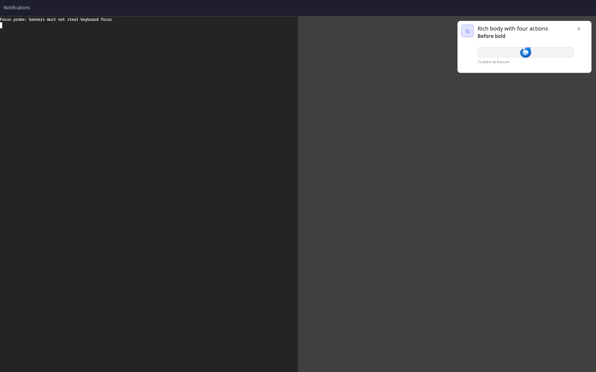
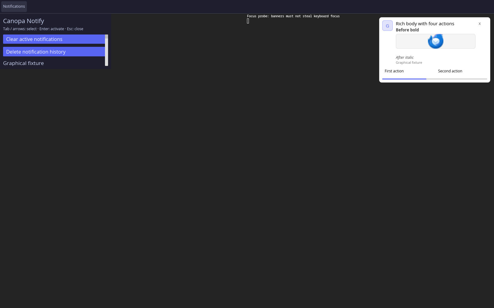

# Measured banner layout: graphical evidence

Date: 2026-09-14. Starting Notify commit: `7ce2a0f`; tested changes are the measured-layout continuation. Review baseline remains `df88ecd`. Niribar checkout: `/home/kevinard/projects/niribar`, unchanged at `b5d1b54` (Canopa-v3 host port).

## Environment and isolation

Real Niri 26.04 (`8ed0da4`) ran nested inside Sway 1.12 with a headless 1600×1000 output, scale 1 and software rendering. Notify ran in graphical service mode, not the headless presenter. Niribar opened its Canopa-v3 provider panel. A private D-Bus configuration omitted service-activation directories; separate temporary runtime/config/state/cache paths isolated both processes from the installed desktop. Sound was disabled. No installed configuration or running desktop notification owner/bar was replaced.

An initial exploratory private bus used default activation directories and began portal helper activation; that session was stopped before continuing with the non-activating bus. Isolation requires replacing inherited display/runtime variables **before** starting the private bus, not just before starting Notify. A private bus alone is insufficient isolation for desktop helpers.

## Reproduction and correction

The fixture supplied a default action, four named actions, resident/transient hints, progress 42, and bold text → local PNG → italic text. The compact banner still intentionally projects the first two named actions; the Center remains the route to the full action set.

Before the fix, the 140px card clipped its app metadata and hid both action labels and progress. The 70px body clipped the image and omitted following text. Real Iced software layout reproduced a zero-height `First action` label, independently of the compositor.



After the fix, naturally measured cards fit their content. Body content grows naturally up to a 120 logical-pixel scrollable preview, keeping app metadata, action controls and progress outside that scroll area. The screenshot shows the ordered image and following italic text without duplicate alternative text, both compact action labels and progress.



The layer-shell surface follows measured stack height instead of multiplying a fixed card height. Measurement frames do not acknowledge a stack that exceeds the actual surface viewport. Same-size replacements have their own frame acknowledgement. Asynchronous old resize commands are self-correcting: current measured geometry is reconciled against the actual viewport, not only the last requested size.

## Observations

- A real pointer click on `First action` emitted `ActivationToken` followed by `ActionInvoked(1, "one")`; body activation emitted the default action. The resident item remained available.
- With the test Center closed, Niri's focused window remained the same `canopa-focus-probe` window with the same focus timestamp across a changed-summary/progress replacement. Earlier initial-banner checks also preserved the focus probe.
- A new rich notification with a finite 2000ms timeout emitted `NotificationClosed(4, 1)` without interaction after display. This is a smoke check of the graphical acknowledgement path, not a measurement of compositor presentation latency.
- The compatible Niribar panel opened and displayed Canopa content. This proves basic host integration, not the full rich-body or keyboard checklist.
- The final rebuilt binary repeated the original rich fixture successfully ([final capture](graphical/banner-layout-final.png)). Stopping only the private Niri compositor then changed Control status to `banner renderer stopped; restart the daemon to restore banners` before another receipt; the service remained available and accepted a subsequent D-Bus notification. This adds real compositor-disconnect evidence for ADR 0043, without testing automatic recovery.
- Seven deterministic software-renderer tests exercise rich layout, body-wheel scrolling, real action hit regions, fitting-frame acknowledgement, persistent-widget replacement ownership, three cards plus overflow, clear/shrink and delayed-resize repair. Run `cargo test -p canopa-notify --lib presentation::tests::layout --locked`.

For a manual replay, use a disposable Wayland session with Notify owning **that session's private bus**, then issue:

```sh
gdbus call --session --dest org.freedesktop.Notifications \
  --object-path /org/freedesktop/Notifications \
  --method org.freedesktop.Notifications.Notify \
  'Graphical fixture' 0 '' 'Rich body with four actions' \
  '<b>Before bold</b>\n\n<i>After italic</i>' \
  "['default', '', 'one', 'First action', 'two', 'Second action', 'three', 'Third action', 'four', 'Fourth action']" \
  "{'resident': <true>, 'transient': <true>, 'value': <int32 42>, 'suppress-sound': <true>}" 0
```

Use an installed local PNG path if that example icon is unavailable. Observe the private notification signal stream, click both action and body controls, replace using the returned sender ID, and compare `niri msg --json focused-window` before/after. `niri msg action screenshot-screen --path … --show-pointer false` captures the disposable output. Do not run this against the user's ordinary notification service.

Cleanup: the temporary interactive launcher reported an EOF parsing error after its child shell exited; its exit cleanup still ran. Subsequent PID checks found no recorded test children, and command-line checks found no private Sway or D-Bus daemon. The exploratory launcher is not presented as a passing reusable automation script. Raw artifacts remain in the explicitly temporary `/tmp/canopa-graphical-nDyeFa` directory; the selected screenshots above are preserved in the tracker.

## Explicit remaining acceptance work

This is **partial W10/W11 evidence**, not freedesktop completion or a supported-scale certification. Long-label presentation, multiple-output fallback, small/high-scale outputs, complete Center action scrolling/keyboard selection, screen-reader names/roles/announcements and host-independent expansion remain open. Transient overflow has automated provider coverage, not a complete graphical pass here. The temporary virtual-input setup did not establish a reliable Center keyboard result; no product keyboard defect or pass is inferred from it.

Whole-stack acknowledgement remains conservative: if the compositor constrains the surface viewport, a clipped lower card also delays first-display timers for visible upper cards. Per-card acknowledgement is still required to fully satisfy ADR 0028 on constrained outputs. Surface-viewport fit is not proof of physical output fit when a compositor accepts an oversized surface. This tranche does not certify either case. A processed Iced redraw is also not compositor presentation feedback.

Screen-reader testing needs a supported full desktop session; Niri documents that its [accessibility interfaces are unavailable in nested mode](https://github.com/niri-wm/niri/wiki/Accessibility). `body-images`, `body-hyperlinks` and `persistence` remain unadvertised. The broader [Center verification checklist](../../docs/notification-center-verification.md) remains open.
