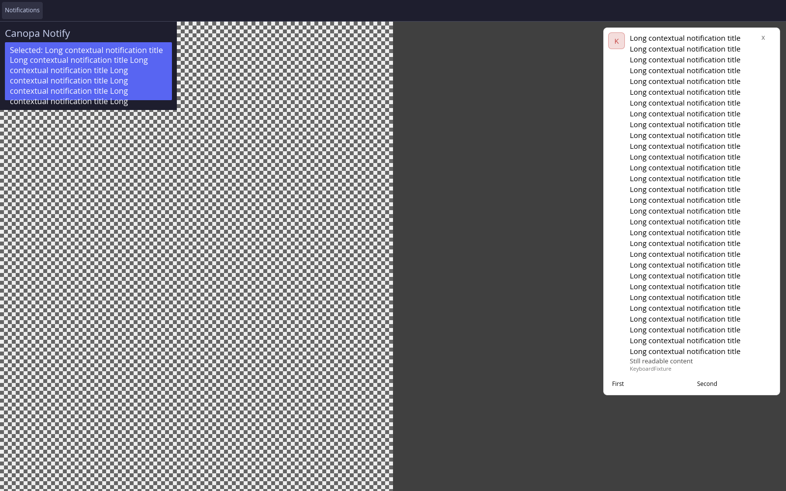
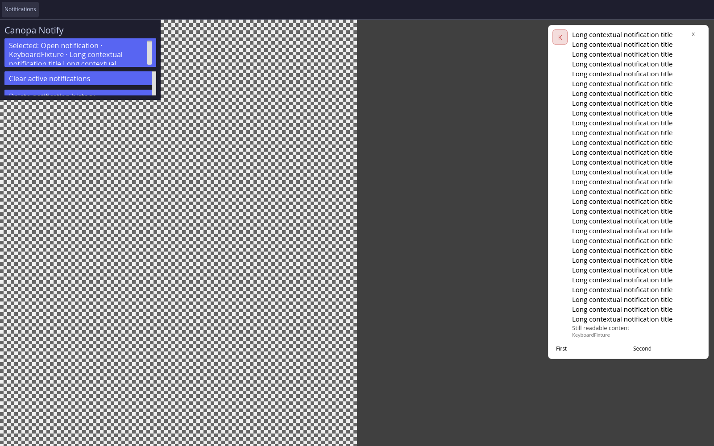
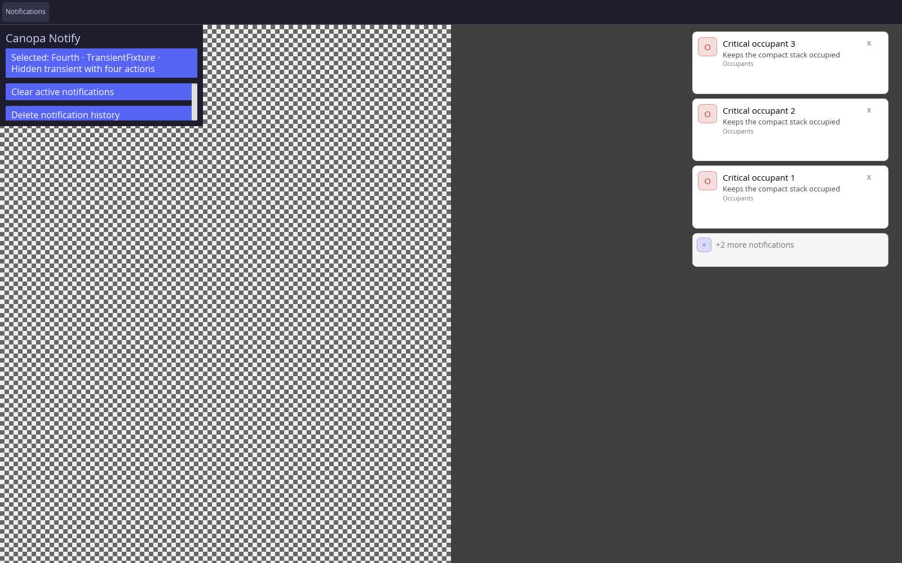

# Notification Center keyboard continuation

Date: 2026-09-14. Notify starting commit: `2284945`; unchanged runtime. Niribar starting commit: `b5d1b54`; verified fixes committed as `bdda852`. Notify review baseline remains `df88ecd`; the host-port baseline remains `d7870c2d20cff5d0f84da03296e15bf65115cc90`.

## Isolation and reproduction

The real Niribar Canopa-v3 provider panel and graphical Notify daemon ran under nested Niri inside a headless 1600×1000 Sway output. The fixture used separate runtime/config/state/cache directories and a private D-Bus configuration without service-activation directories. Sound was disabled. No live desktop services or installed configuration were changed. The temporary launcher is `/tmp/canopa-center-keys-mZYdQV/session.sh`.

On the starting host binary, clicking the Notifications module opened the panel; injected Tab, Shift-Tab and Up input changed the persistent selected-action label. Wrapping backwards reached the default action, then the fourth named action. Enter emitted exactly one `ActionInvoked(1, "four")`; the resident notification remained active. Replacing the selected notification reset selection: Enter emitted no additional action ([baseline capture](graphical/center-keyboard-replacement-reset.png)). Escape removed the panel layer surface and restored the bar's on-demand keyboard policy.

A notification summary containing `Long contextual notification title ` repeated 30 times reproduced a layout defect. Selecting its default action let the contextual header consume the compact panel. The action name followed the long title and was clipped; the content below the header had no visible room. This is a renderer issue, not a provider transport or keyboard-routing failure.

## Corrections and regression boundaries

The host now puts action/control labels before their section/item context and bounds the complete selected label to a scrollable preview. No provider text is truncated and no new protocol fields are needed. A private host action widget owns pointer-press and preview-scroll state using the existing opaque interaction identity; the provider adapter's public interface is unchanged.

Three real-Iced renderer/input cases reproduce the layout, scroll-state and gesture-lifetime defects before their corrections. The ordinary-button case exposed a separate safety gap: pressing an old control, replacing the snapshot, then releasing built an interaction using the new control's identity. Previously serialized stale-ID rejection could not catch it. All Canopa content actions, permission options and item actions now use the identity-owned widget, not only the selected preview. A complete new gesture still activates normally. The independent Spec review also identified this path.

The provider-seam label regression checks action-first context and the exact opaque action key/target/revision value on the wire. Existing protocol-version, bounds, image, stale-ID and selection-reset checks remain in place. Software rendering is a test-only Iced feature; the graphical host retains its existing production backend.

## Final verification

The normal `cargo build --offline --locked --bin niribar` binary repeated the long-title case successfully. The selected action name now leads the preview, and a content action remains visible underneath. The full preview has its own scrollbar.

Paced Up navigation selected the [fourth named action](graphical/center-keyboard-fourth-after.png); Enter emitted one action event, preceded by an activation token in this session. A subsequent selected-item replacement cleared selection, and Enter emitted no additional action ([final replacement capture](graphical/center-keyboard-replacement-after.png)). Escape removed the panel surface. Token values are intentionally not preserved in this report.

A second fixture filled the compact stack with three critical banners, then sent resident/transient ID 5 with a 2000ms timeout, default activation and four named actions. After waiting three seconds before opening the Center and another three seconds before invoking, the hidden transient was still actionable. The Center invoked both its [default action](graphical/center-keyboard-transient-default.png) and fourth named action without displaying its banner or expiring it. `CloseNotification(5)` subsequently emitted reason 3 and reduced the banner overflow count from two to one ([closed capture](graphical/center-keyboard-transient-closed.png)). This supports hidden-item timeout/Center separation, not a complete transient-removal/DND/restart/persistence pass.

The virtual-keyboard fixture used paced keys checked against visible selection. An initial batched Up/Up selected Open, so no rapid-key or held-key stress pass is claimed; the cause of that batched-input result was not isolated. The screenshots and signal stream, not the intended key count, define the observed action.

All **1,145 Niribar tests passed**, with zero failed or ignored: 10 library, 1,117 binary, 6 Canopa provider, 2 provider-protocol and 10 Wi-Fi provider tests. Command: `dbus-run-session -- cargo test --offline --locked -- --test-threads=4`; raw log: `/tmp/canopa-center-host-tests.log`. The normal production build, formatting, whitespace checks and Notify/Niribar protocol-source drift check pass. Existing compiler warnings remain. Notify runtime code was unchanged in this continuation; its workspace suite was not rerun for documentation-only changes.

Both independent [review axes](CENTER-KEYBOARD-REVIEW.md) report zero outstanding scoped findings after the stale-press correction. The final private launcher exited normally; an outside-sandbox check found all six recorded process groups empty, including provider descendants. Temporary fixtures remain under `/tmp`; no installed config or live desktop service was replaced.

## Accessibility boundary

This is keyboard evidence, not a screen-reader pass. The pinned host uses Iced 0.14 (`iced_core` 0.14.0, `iced_widget` 0.14.2) and a vendored `iced_layershell` 0.18 adapter. Inspection of the resolved lockfile, application, widget interface and vendored event loop found no AccessKit/AT-SPI semantic-tree bridge. `iced_core::Widget` exposes layout/draw/input/operation interfaces, not an accessibility-node interface; the host renderer creates ordinary text, image and button widgets without a platform accessibility exporter. Visible contextual labels therefore do not establish accessible names, roles, states, image alternatives or update announcements in a screen reader.

Before issue 35/W11 can close, the project needs a supported semantic-tree/platform bridge across its actual layer-shell stack, complete widget semantics and a real full-session assistive-technology check. The update policy must preserve revision/session safety without disruptive focus changes or repeated announcements. A toolkit/adapter integration is substantive remaining implementation, not an unrun label assertion.

The complete scale/font/locale matrix, full rich-content and permission-control graphical checklist, rapid/held-key behavior, full keyboard reading of overflowing context, host/provider loss and restart, and aggregate projection overflow/pagination remain outside this bounded continuation. No additional capabilities are advertised.
