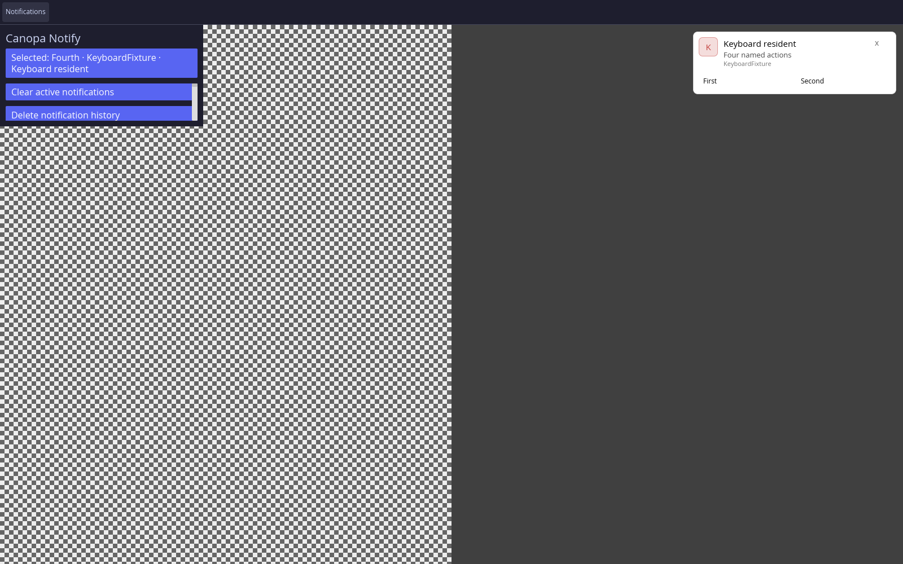

# Notification Center window-lifetime continuation

Date: 2026-09-14. Notify starting commit: `ad4e008`; unchanged runtime. Niribar starting commit: `bdda852`; verified fix: `05e6e5f`. Notify review baseline remains `df88ecd`; the host-port baseline remains `d7870c2d20cff5d0f84da03296e15bf65115cc90`.

## Reproduction and cause

The [previous keyboard check](CENTER-KEYBOARD-EVIDENCE.md) left an unexplained batched Up/Up result. A private nested-Niri session reproduced it with a resident notification containing default activation and four named actions. Each trial replaced the same notification, waited one second, sent two Up presses, then sent Return after a further pause. All five zero-gap trials invoked `default` instead of `four`; five trials with separate key commands and a 300ms gap did the same. Two-second pacing allowed the next action to be selected.

The temporary fixture is `/tmp/canopa-rapid-keys-hmlVZV/session.sh`, with `rapid-loop.sh` as its action-signal oracle. It uses separate runtime/config/state/cache directories, a private D-Bus configuration without service activation directories, disabled sound and a 1600×1000 headless Sway output hosting Niri. No installed configuration or live desktop services are changed.

Three predictions distinguished window/focus churn, lost input delivery and injector behavior. A targeted Wayland trace of `wtype -k Up -k Up` showed two press/release pairs. The host's existing `niribar::panel` debug target then showed one paced Up replacing panel `Id(3)` with `Id(4)`. Canopa focus movement emitted the same open effect as initial provider content; Foreground retired the old window. Queued keys still addressed that retiring window and were ignored. This was window-lifetime loss, not proven subscription-channel loss or injector deduplication.

The app-level regression captures that exact seam: two queued `SurfaceEvent::FocusMovePrev` events target the original window. Before correction, a two-action document remained on Second instead of First. After the navigation correction, an incoming-content regression still failed: replacement retired the window and both subsequent keys were ignored. Both failures were observed before their corresponding corrections.

## Correction and compatibility

External Panel Session now distinguishes opening content from updating an existing Canopa document. Foreground validates the active provider/origin identity, updates its content and private Panel Runtime state, and retains the physical window. Navigation, Canopa replacement and Canopa failure content use that path. Initial opening and explicit replacement/closing retain their existing lifecycle. External content sizing is independent of document contents, so updating the document does not require a new physical size.

Incoming Canopa generations still clear selection. Existing identity-owned action widgets reset stale press/preview state; retaining a window does not retain authority to activate replaced content. No wire fields, notification action keys, capabilities, dependencies or Notify runtime behavior change.

Independent review caught a P1 in the first, broader implementation: framed-v1 buttons lack generation-owned pointer-press state, so retaining their widget tree could let a press on old content activate a new button on release. The correction deliberately retains framed-v1's previous window-replacement behavior, including text/search local echo. This is not a v1 keyboard-lifetime fix. Separate compatibility tests guard that distinction.

Six application regressions cover queued navigation and Escape, replacement/selection reset with continuing input, stale session/provider updates and post-close output, failure dismissal, v1 local echo and v1 button-window retirement. The previous real-widget stale-press tests remain applicable to the retained Canopa tree.

## Verification status

All **1,151 Niribar tests passed**, with zero failed or ignored: 10 library, 1,123 binary, 6 Canopa provider, 2 provider-protocol and 10 Wi-Fi provider tests. Command: `dbus-run-session -- cargo test --offline --locked -- --test-threads=4`; complete log: `/tmp/canopa-rapid-keys-host-tests.log`. All six focused application regressions also pass (`/tmp/canopa-rapid-keys-focused-tests.log`). The all-targets offline/locked typecheck and protocol-source drift check pass; existing compiler warnings remain. Notify runtime is unchanged, so its workspace suite was not rerun for this documentation-only continuation.

The normal `cargo build --offline --locked --bin niribar` build passes. On that binary, **20/20 Up/Up burst trials**, **10/10 trials with a 300ms gap**, and **10/10 Up/Up/Return single-command bursts** each emit exactly one `ActionInvoked(1, "four")`. Every trial replaces the notification first. The selected-label capture shows Fourth, and the targeted host log records only the initial `Id(2)` opening throughout the forty trials. Token values are deliberately excluded from this report.

A final [selected-item replacement](graphical/center-window-replacement.png) cleared selection, and Return emitted no additional action: the monitor stayed at forty action signals. [Escape removed the panel](graphical/center-window-escape.png). The host log still contained exactly one panel opening. No timing workaround or application debug instrumentation is part of the fix.

Both private graphical launchers exited. Outside-sandbox process-group checks confirmed the baseline groups (including the separately launched diagnostic host) and all six final-run groups empty, including provider descendants. Temporary diagnostic scripts/captures remain under the clearly named `/tmp/canopa-rapid-keys-hmlVZV`; no production debug logging was added and no live desktop state was changed.

Both final independent [review axes](CENTER-WINDOW-REVIEW.md) report zero outstanding scoped findings after the v1 compatibility correction. Formatting and whitespace checks pass in both repositories. The host fix is committed without pushing or replacing a running desktop service.

## Remaining boundary

The pinned Iced/layer-shell stack still lacks an implemented semantic-tree/platform bridge. Held-key/repeat stress, complete keyboard reading of overflowing content, full rich-content/permission/scale/font/locale coverage, host recovery and projection overflow/pagination remain open. This bounded burst test is not full W11 or screen-reader acceptance. The Notify daemon and its advertised capabilities are unchanged.
