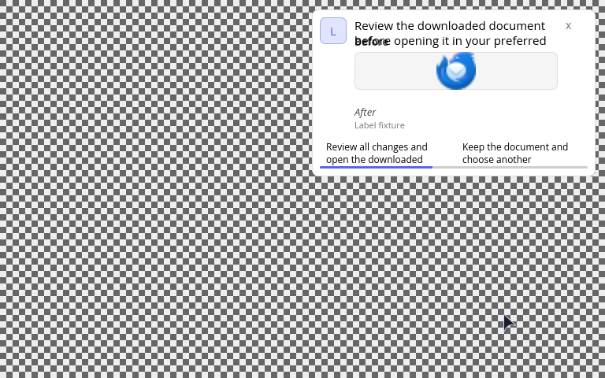
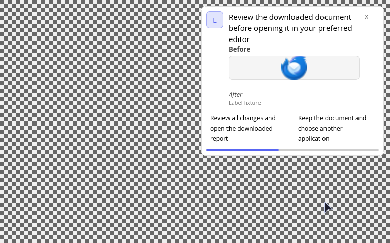
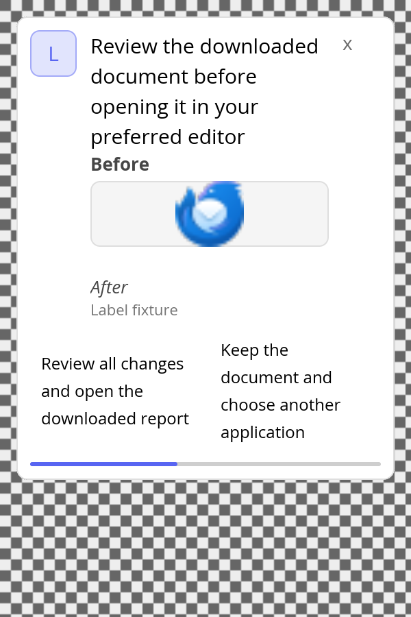

# Wrapped banner labels: graphical evidence

Date: 2026-09-14. Starting Notify commit: `2394849`; tested changes are the long-summary/action-label continuation. Review baseline remains `df88ecd`. No Niribar or shared-protocol changes were made.

## Isolation and fixture

Two sequential disposable sessions ran Niri nested inside headless Sway with software rendering: first the starting executable, then the rebuilt executable. Each used a non-activating private D-Bus configuration and temporary runtime/config/state/cache paths, with inherited display/runtime variables replaced before private-bus startup. Sound was disabled. The temporary history was reused on the second startup; the old notification was stale, not restored as a banner. Both launchers exited successfully, and process checks found none of their ten recorded children. No installed configuration or live desktop owner/bar was changed.

The fixture combined a long summary, ordered bold text → local PNG → italic text, progress, default activation and two long resident actions. Run this only against the disposable session's private bus:

```sh
gdbus call --session --dest org.freedesktop.Notifications \
  --object-path /org/freedesktop/Notifications \
  --method org.freedesktop.Notifications.Notify \
  'Label fixture' 0 '' \
  'Review the downloaded document before opening it in your preferred editor' \
  '<b>Before</b>\n\n<i>After</i>' \
  "['default', '', 'one', 'Review all changes and open the downloaded report', 'two', 'Keep the document and choose another application']" \
  "{'resident': <true>, 'value': <int32 42>, 'suppress-sound': <true>}" 0
```

Use an installed local PNG if that icon is unavailable. A fullscreen `wev` window provided the underlying input/focus probe. Captures used outer Sway `grim`, avoiding Niri screenshot notifications. Raw temporary artifacts remain in `/tmp/canopa-labels-WLYrMl`; captures below are retained in the tracker.

## Before and after

At 768×480 physical/logical pixels (scale 1), the starting executable clipped the final summary line and action-label endings; summary text overlapped the following body. The unchanged fixture on the rebuilt executable shows the complete summary and both action labels, preserving body order and progress space.





Changing the headless output to 600×900 and Niri's `winit` scale to 2 produced a 300×450 logical output. The 276-pixel-wide card grew naturally to show all fixture content within the available space.



Actual pointer clicks on the last line of each action emitted `ActionInvoked(1, "one")` and `ActionInvoked(1, "two")`; a click on the final summary line emitted `ActionInvoked(1, "default")`. Each was preceded by an activation-token signal; opaque token values are not retained here. The resident notification remained active. Niri's focused window stayed `wev`, ID 2, with the same focus timestamp across display, size/scale changes, those clicks and replacement.

Replacing sender ID 1 with summary `Ready`, body `Short body`, labels `Open`/`Keep` and progress 75 shrank the same notification's card. Control reported the active item at revision 2. A click at the former first action's last-line position, now outside the card, reached `wev` as a left-button press/release at logical position (75, 306), serials 24/25; it did not invoke an old action.

[Short replacement capture](graphical/long-labels-replacement.png).

## Automated evidence and limits

Two test-first renderer/input regressions reproduced a three-line summary in a 22px box and long action content in a 20px box before their fixes. They now cover 360/276 logical-pixel card widths, explicit line breaks, word/glyph wrapping, icon-bearing actions, final-line clicks and opaque keys. Existing constrained-card coverage now includes multiline summary/actions and verifies pending acknowledgement until fit, then shrink/new-frame acknowledgement after a short replacement. All 104 focused tests pass (56 presenter library, 48 presentation integration), including 15 layout/wire tests.

This is partial W10/W11 evidence. There is no new oversized-card policy: if natural content is taller than the viewport, ADR 0044 still withholds first-display acknowledgement, and stack scrolling does not make that entire card fit at once. Arbitrarily long labels, the complete scale/font/locale matrix, multi-output/reserved-panel behavior, host-independent expansion, Center action/keyboard navigation and screen-reader integration remain open. This run does not certify transient overflow, action-icon pixels, exact timeout intervals or compositor presentation feedback; relevant existing automated coverage remains separate. No new freedesktop capability is advertised.
