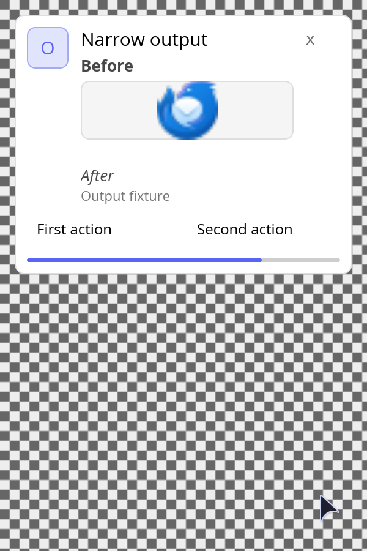
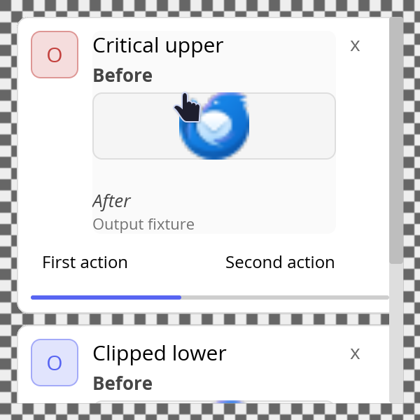
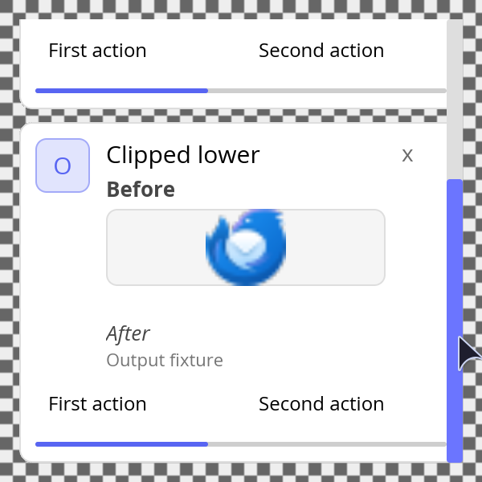

# Compositor-sized banners: graphical evidence

Date: 2026-09-14. Starting Notify commit: `559cdfa`; tested changes are the compositor-sized surface continuation under ADR 0045. Review baseline remains `df88ecd`. Niribar and the shared panel protocol were not changed or exercised in this run.

## Environment and isolation

Real Niri 26.04 ran nested inside Sway 1.12 with a headless output and software rendering. Notify ran in graphical service mode, not with the headless presenter. A fullscreen `wev` window underneath recorded real pointer events and served as the keyboard-focus probe. The session used a non-activating private D-Bus configuration, temporary runtime/config/state/cache directories and disabled sound. Inherited display/runtime variables were replaced before starting that private bus. No live desktop notification owner, bar or installed configuration was changed.

The frozen temporary launcher exited successfully; subsequent process checks found none of its five recorded children (Sway, Niri, Notify, `wev`, signal monitor). Raw artifacts remain in `/tmp/canopa-output-JbvFuA`; selected screenshots are preserved below. This is a manual fixture, not a reusable CI harness or a full compositor certification.

## Output fitting

The rich resident fixture supplied a default action, four named actions, progress 42 and bold text → local PNG → italic text. The compact banner still projects the first two named actions. Niri's output query reported the following logical sizes; outer-compositor captures verified the card placement and visible content.

| Physical output | Niri scale | Logical output | Banner width | Observation |
| --- | --- | --- | --- | --- |
| 768×480 | 1 | 768×480 | 360 | Top-right, 12 logical-pixel margins; text, image, compact actions and progress visible. |
| 768×480 | 1.5 | 512×320 | 360 | Same rich content fits; physical margins become 18 pixels. |
| 768×480 | 2 | 384×240 | 360 | Rich card fits the available 360×216 logical viewport. |
| 600×900 | 2 | 300×450 | 276 | Card shrinks with output width; changed-summary/progress replacement fits. |
| 600×600 | 2 | 300×300 | 276 | Two rich cards require stack scrolling; lower-card timing tested below. |

[Scale 1 capture](graphical/output-fit-scale-1.png), [scale 1.5 capture](graphical/output-fit-scale-1_5.png), [scale 2 capture](graphical/output-fit-scale-2.png).

Empty startup, space below a displayed card, and the former card position after closure delivered actual button press/release events to `wev`. These checks included scales 1, 1.5 and the narrow scale-2 output. Named and default action clicks at scale 2 each emitted `ActivationToken` followed by the correct `ActionInvoked(1, "one")` or `ActionInvoked(1, "default")`; the resident notification stayed active. Activation tokens are intentionally omitted from retained evidence.

The focused `wev` window ID and focus timestamp stayed unchanged across initial display, scale/size changes, action clicks, replacement and the final scrolling check. This verifies no keyboard-focus steal in this fixture, not complete keyboard navigation.

## Clipped-card timing

A critical non-expiring upper card was already settled before a normal lower card with a 2000ms timeout arrived. At 300×300 logical output, the lower card was visibly clipped and still present in Control's active state more than ten seconds after receipt; the private signal stream had no closure for its sender ID 6. Control's `shown` delivery classification is not itself display evidence—the captured layout, active state and signals establish this observation together.

A real vertical wheel event over the stack scrollbar brought the complete lower card into view. The capture below was taken before its expiry. The monitor then received `NotificationClosed(6, 1)`, and Control showed only the critical upper card remaining. This is a smoke check that a clipped finite notification waits for a fitting processed redraw; it does not measure compositor presentation latency or certify the exact expiry interval.

An earlier 300×450 fixture expired before scrolling; it did not establish that the lower card was clipped and is not counted as a clipping regression or timing pass. Reducing the viewport and inspecting the settled stack established the intended condition. Early Niri screenshot commands also generated incidental notifications on the private bus; those expired before the final timing fixture. Later captures used outer Sway `grim` to avoid introducing notifications into the scene.

## Reproduction outline and remaining work

Use a disposable nested Wayland session with a non-activating private bus and isolated XDG paths. Run the graphical Notify service and a focused input probe there. Adapt the [earlier rich fixture](BANNER-LAYOUT-EVIDENCE.md) to the local installed PNG, then use `niri msg output winit scale 1.5` / `2` and `swaymsg output HEADLESS-1 mode 600x900` / `600x600` for these profiles. Capture the outer output with `env WAYLAND_DISPLAY="$OUTER_WAYLAND_DISPLAY" grim -o HEADLESS-1 …`, not Niri's screenshot action. Query focus, active state and notification signals on the private session; send actual pointer clicks/wheel input through that session's virtual-pointer protocol. The temporary input helpers used coordinates normalized to 1600×1000, not the current pixel dimensions.

Thirteen deterministic renderer/layout/Wayland-wire tests separately cover width caps, top-right placement, measured input instead of surface resizing, delayed callback ordering, empty click-through, per-card visibility, scrolling and revision ownership. Run `cargo test -p canopa-notify --lib presentation::tests::layout --locked`.

W10/W11 remain incomplete. Multiple-output selection/fallback/hotplug, reserved-panel interaction, the full supported-scale and long-label matrix, cards taller than the viewport, compositor occlusion/presentation feedback, host-independent expansion, complete Center action/keyboard navigation and screen-reader integration remain open. The larger transparent rendering-buffer trade-off is recorded in [ADR 0045](../../docs/adr/0045-compositor-sized-banner-surface.md). No new freedesktop capability is advertised.
