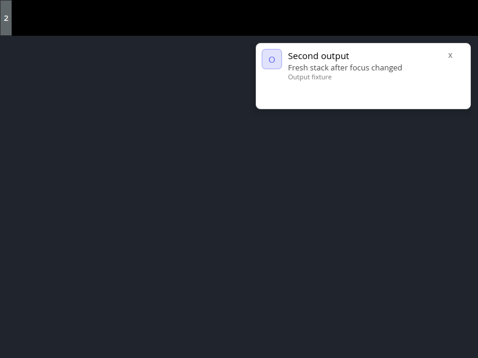

# Banner output-lifetime evidence

Date: 2026-09-14. Starting executable: `5951e3d`; review baseline remains `df88ecd`. Scope: W10 multi-output placement, reserved space and surviving-output fallback under ADR 0047. This is direct headless Sway evidence, not multi-output Niri certification or complete W10/W11 acceptance.

## Reproduction and correction

The original executable used one permanently mapped startup surface. In a private two-output session, clearing the first notification, focusing the other output and sending a new notification left it on the startup output. Disabling that output set `presentation_error` to `banner renderer stopped; restart the daemon to restore banners`, despite a surviving output.



The output-lifetime executable uses a transparent readiness probe, retires empty surfaces and creates each new stack independently. An intermediate run exposed a second adapter assumption: `OutputOption::None` selects a cached/first output. The new explicit `Compositor` option emits a null output in `zwlr_layer_shell_v1.get_layer_surface`; the existing option keeps its previous behavior. Backend output destruction also requires resolving closed windows from the surviving renderer alias, not the already-removed backend unit.

## Isolated graphical checks

The fixture uses Sway with `WLR_BACKENDS=headless`, two outputs, pixman, software GL, no Xwayland, an explicitly non-activating private D-Bus and fresh XDG runtime/config/state/cache paths. Sound is disabled in the temporary configuration. No live desktop service, installed configuration or Niribar checkout was changed.

Output configuration:

```text
HEADLESS-1: 800x600 at (0,0)
HEADLESS-2: 600x480 at (800,0)
swaybar: docked top, height 60, tray disabled
```

Each command below ran only against this disposable session. The frozen launchers/configs and raw logs are in `/tmp/canopa-outputs-MBiUqP` (original), `/tmp/canopa-outputs-fixed-XM51MO` (intermediate) and `/tmp/canopa-outputs-final-Tye7Xv` (explicit compositor selection). The latter run precedes the subsequent adapter-only stale-close race guard; that guard has its own consumer regression and review evidence.

1. Focus `HEADLESS-1`, send sender ID 1 with timeout 0. The first card is at `(428,72)`, width 360: 12px below the 60px reserved bar and 12px from the right edge.
2. Close ID 1, focus `HEADLESS-2`, send ID 2. The new card appears at `(228,72)` on output 2; output 1 is empty.
3. Focus output 1 while ID 2 is visible, then replace ID 2 with resident content and `reply`/default actions. The replacement stays on output 2, using the same layer surface. Focus changes alone do not relocate the stack.
4. Disable output 2. The same notification appears on output 1 at `(428,72)`. Control status has `presentation_error: null`; the wire trace shows the old surface closing followed by a new null-output layer-surface request.

[First stack](graphical/output-lifetime-first.png) · [Next output](graphical/output-lifetime-second.png) · [Stable replacement](graphical/output-lifetime-stable.png)


After fallback, actual pointer clicks emitted `ActionInvoked(2, "reply")` and `ActionInvoked(2, "default")`, each preceded by an activation-token signal. Token values are not retained in this document. The resident notification remained active; focused `wev` window ID 7 was unchanged before and after both actions. Closing ID 2 emitted reason 3.

Re-enabling output 2, focusing it and sending ID 3 with a 5000ms timeout exercised a second removal. Output 2 was disabled about one second after receipt; the fallback appeared on output 1 with exactly one timeout record. ID 3 subsequently emitted exactly one `NotificationClosed(3, 1)` and the record count returned to zero, with healthy renderer status. This records eventual normal expiry across fallback, not a timestamped proof of the exact deadline; unchanged deadline ownership is additionally covered by runtime tests.

[Timed fallback over the input probe](graphical/output-lifetime-timed.png)

After the stack cleared, clicking its former Reply position reached the line-buffered `wev` probe (pointer press/release serials 144/145). The private session exited normally; all seven recorded final compositor/bar/background/daemon/monitor/probe PIDs were absent afterward. The earlier successful sessions were also checked. One intervening launcher failed its readiness check before starting the daemon and produced an empty Sway log; a traced retry succeeded. Its cause was not established.

## Automated coverage and limits

Six new presenter/renderer-consumer tests cover probe retirement, serial stack lifetimes, stable replacement, one fallback attempt before first redraw, stale close/redraw/deadline events, deadline-task cancellation, hidden-window acknowledgement exclusion and stale-output input geometry. Existing layout tests now use the actual surface ID. All 65 focused presenter library and 48 presentation integration tests pass.

Independent review identified queued closes retained forever after output removal; the separate vendored adapter action-consumer regression sends 100 closes after their windows are absent. Final RED/GREEN and workspace results are recorded in [the execution log](IMPLEMENTATION.md) and [review](OUTPUT-LIFETIME-REVIEW.md).

Multiple physical outputs, multi-output Niri, combined hotplug/scale/font/locale coverage, zero-output recovery, compositor disconnect/restart, occlusion/presentation feedback and complete Center keyboard/accessibility remain outside this evidence. Banners still do not automatically restart a disconnected renderer. No capability, public protocol, schema, installed setting or host source changed.
