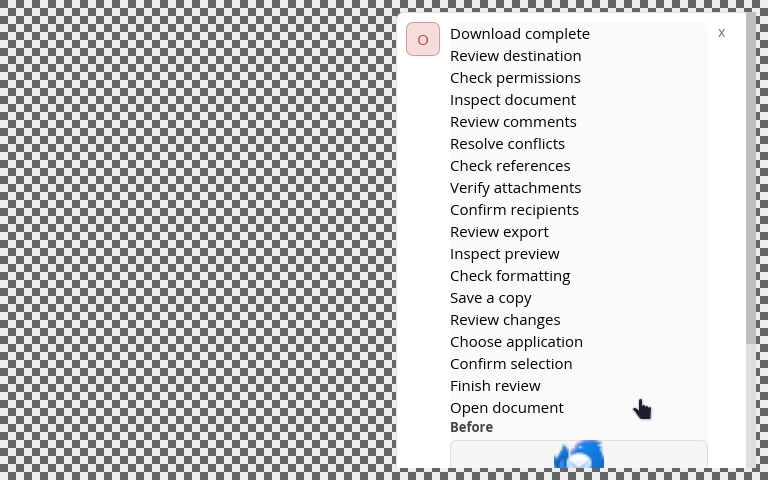
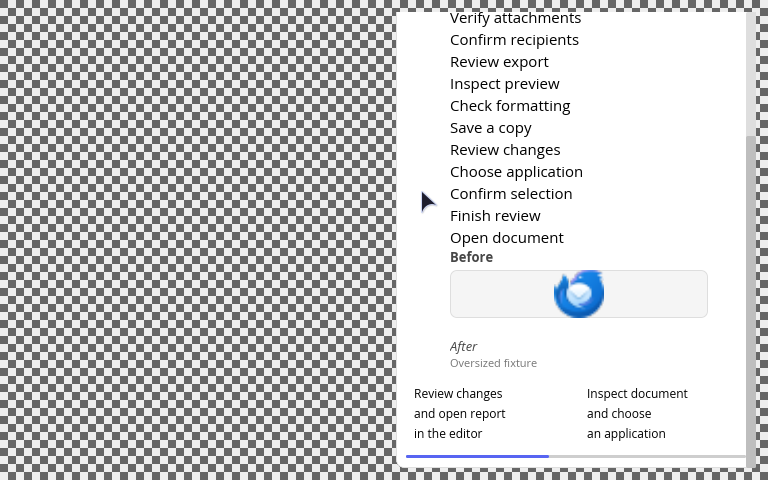
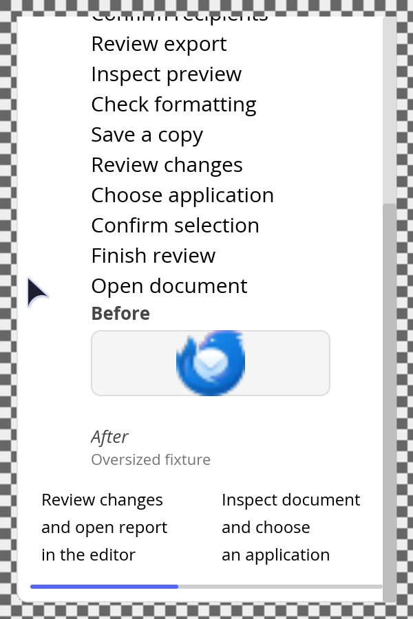
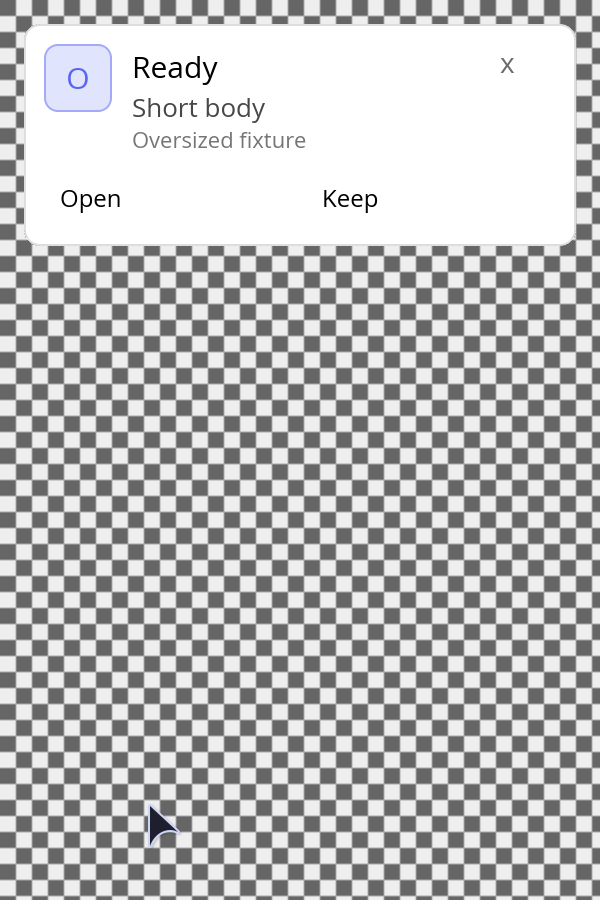

# Oversized compact cards: verification evidence

Date: 2026-09-14. Starting Notify commit: `8b752f3`; review baseline: `df88ecd`. This is a bounded W10 continuation under ADR 0046, not full freedesktop or W10/W11 acceptance.

## Graphical setup and result

The starting and final executables ran in disposable Niri sessions nested inside headless Sway, with software rendering, a non-activating private D-Bus and temporary XDG runtime/config/state/cache paths. Sound was disabled. A fullscreen `wev` window recorded focus and pointer input. Screenshots used outer Sway `grim`, avoiding screenshot notifications. No installed configuration, live desktop owner, Niribar process or shared protocol was changed.

The notification fixture used an 18-line summary ending in “Open document”, ordered bold `Before` → local Thunderbird PNG → italic `After`, progress 42, a default action and two three-line named actions (`one` and `two`). It was resident, critical, and sound-suppressed. The natural card exceeded the 456-logical-pixel available height on a 768×480 scale-1 output. On the starting executable, a request with `expire_timeout=2000` remained active well after two seconds; on the final executable, the same fixture was absent from active notifications after a three-second wait and emitted `NotificationClosed(1, 1)` (expired), without requiring scrolling. This checks normal expiry after first display, not an exact presentation-to-expiry interval.

A second, non-expiring fixture on the final executable retained every line behind internal scrolling. Scrolling revealed the final summary lines, image, following text, progress and both complete action labels.

Actual final-line clicks emitted `ActionInvoked(2, "one")`, `ActionInvoked(2, "two")`, and default activation emitted `ActionInvoked(2, "default")`. Each action had a preceding activation-token signal; opaque token values are not retained here. The resident item stayed active. The focused window remained `wev`, ID 2, with the same focus timestamp throughout.

Changing the headless output to 600×900 and Niri scale to 2 produced a 300×450 logical output. Internal scrolling and final-line clicks on both named actions still worked.

Replacing sender ID 2 with `Ready` / `Short body` and `Open` / `Keep` actions shrank the card, retained the ID and reported revision 2. A click at the former action position reached `wev` (left-button press/release serials 36/37), without an extra action signal or focus change.

Adding two oversized cards verified the separate scrollbar rails on the narrow output: clicking the inner rail scrolled the first card to its actions without moving the stack; clicking the outer rail then revealed the short bottom card.

[Inner-card rail capture](graphical/oversized-card-inner-rail.png) · [Outer-stack rail capture](graphical/oversized-card-stack-rail.png)

Raw final artifacts and the replay fixture `send.sh` are in `/tmp/canopa-oversized-final-mYXSGF`; starting capture is in `/tmp/canopa-oversized-sCa2gn`. Run the fixture only inside the isolated session; its arguments are replacement ID and timeout milliseconds. Both successful launchers exited normally and all ten recorded compositor/daemon/probe/monitor children were absent afterward. Two intervening graphical launches failed before readiness with Niri reporting a reset Wayland connection; their recorded compositor processes were also absent. The cause was not established. The successful final retry used a fresh runtime, an explicit Sway IPC readiness probe, and no concurrent build.

## Automated regressions and limits

The existing renderer-consumer seam uses real Iced software layout/input and actual Wayland region requests. Three new tests plus strengthened existing coverage verify independent card/stack scrollbar hits, nested body-image wheel navigation, last-line opaque action clicks across acknowledgement removal, scroll retention, viewport growth, short replacement and per-card display ownership. The initial bounded-card regression failed because no acknowledgement arrived; the separate-rail regression failed because the internal rail was unreachable.

Independent Spec review exposed a full-height middle card requiring almost pixel-perfect outer alignment. A new three-oversized-card test reproduced the missing middle acknowledgement with ordinary one-line wheel events. The correction reserves 60 logical pixels of vertical navigation room in multi-item stacks, with a half-viewport minimum card budget on tiny outputs. The regression passes at 150, 216 and 426 logical-pixel viewport heights. All 107 focused tests pass (59 presenter library and 48 presentation integration), including 18 layout/wire tests. Final workspace results are recorded in [IMPLEMENTATION.md](IMPLEMENTATION.md).

Only the fully visible bounded card viewport counts as display; internal scrolling is not read completion and does not pause/reset a finite timeout. Large wheel jumps can skip cards; available heights below 120 logical pixels are outside ordinary-wheel reachability coverage. Multiple-output fallback/hotplug, reserved-panel interaction, the full scale/font/locale matrix, occlusion/presentation feedback, complete Center keyboard/screen-reader acceptance, projection pagination and safe hyperlinks remain unfinished. No capability is newly advertised. Middle-card timing is automated evidence, not a claimed fresh graphical timing trace for three simultaneously pending cards.
