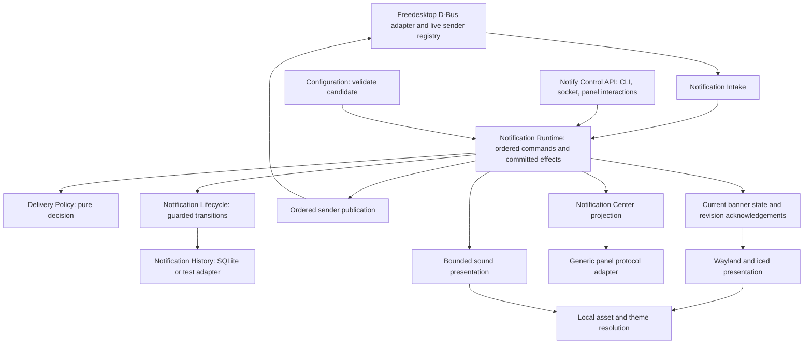

# Canopa Notify: completion and maintainability plan

Prepared 2026-09-10 for baseline `d3f12df1888acbeb1cf05fd81baa00fb500e6a89`.

Status: selected W01–W14 profile implemented and verified on 2026-09-16; W15 selected 2026-11-11 (Tier 3 item 5, Notify ADR 0055) and implemented at the backend level, with real-frontend and native acceptance open. Supported-format and environment limits are explicit in [the release record](../../../docs/notify/notification-release-verification.md). Current progress is recorded in [IMPLEMENTATION.md](IMPLEMENTATION.md). Supporting documents: [review and evidence](REVIEW.md), [authoritative standards research](standards-research.md).

## Recommended target

Complete and verify the static Desktop Notifications 1.3 implementation, make the existing product features usable through the installed daemon, and establish reliable behavior under concurrency and failure. Preserve the current Rust, Wayland, same-process UI, SQLite, KDL, and generic panel-protocol decisions. Incrementally deepen existing modules rather than rebuilding the daemon.

Use the versioned [Notifications 1.3 specification](https://specifications.freedesktop.org/notification/1.3/) as the protocol baseline. A full static profile is a deliberate target: optionality still matters, and animation cannot be advertised together with static icons. Native portal v2 support is a separate interface and workstream.

| Surface | Completion target |
| --- | --- |
| Core D-Bus interface | All four methods and applicable signals; exact signatures; nonzero/session-safe IDs; atomic replacement; closure/error behavior; reliable publication. |
| Actions | Default, named, resident, and action-icon behavior; all provided actions reachable, including transient notifications. |
| Body | Text, b/i/u styling, local body images, and safe hyperlinks in banners and Notification Center, with tested fallback. |
| Static visuals | Correct raw image layout/precedence, safe local files, standards-aware themed lookup, scale-aware rendering. |
| Sound | File/named/default sound and suppression; availability-based advertisement; bounded playback and supporting theme semantics. |
| Persistence | Explicit retention/acknowledgement contract with tests before advertising. Durable history alone does not satisfy this milestone. |
| Hints | Complete standard/legacy hint matrix showing implemented, ignored, or deliberately restricted behavior and malformed-input policy. |
| Portal interoperability | Existing bridge tested with recorded negotiated versions; unavailable v2 fields remain explicitly unavailable. |
| Operations | Persistent state paths, ownership-safe startup, usable config/DND/reload controls, recovery, installation, CI, and maintainer documentation. |

Optional exclusions remain explicit: X11; Dunst-specific interfaces/import; mandatory honoring of Wayland coordinates; undocumented animation transport; arbitrary vendor hints. Snoozing, conversation grouping, burst UX, and inline replies are additional product features, not prerequisites for the core protocol claim. Active-resource limits are required even if burst UX is deferred.

## Architecture to work toward

Keep Notification Runtime as the owner of state changes and their ordering. Notification Lifecycle continues to own lifecycle meaning; Notification History persists requested shapes. Transport adapters resolve their own identifiers before entering the runtime. Callers use the same small interfaces that tests exercise.

The graph is an ownership map, not a demand for a trait or crate per box. Notification History and presentation adapters already have real alternatives. Prefer private modules for wire IDs, content parsing, resources, and transport formatting. Image and sound lookup may share XDG/path helpers while retaining their different resolution rules.

Runtime commands should be serialized through a bounded command loop, or an equivalently small mutation coordinator, covering state mutation and effect enqueueing. Slow rendering, audio decoding, and activation-token acquisition stay outside that critical section. Sender events are ordered commands with explicit delivery/error handling; banner and center updates are replaceable current-state projections. This distinction is central to correctness.

Introduce typed concepts where a demonstrated bug needs them: `SenderNotificationId`, `NotificationThreadId`, and `NotificationRevision`. Represent transient runtime identity without relying on undocumented negative-ID conventions. Preserve a separate claimed display identity and transport identity if W03's trust decision needs both. Do not introduce a general event bus, a second persistence framework, or a separate domain crate merely to make the diagram symmetrical.

## Delivery sequence

| Milestone | Work packages | Exit condition |
| --- | --- | --- |
| M1 — Safe ownership and protocol identity | W01, W02, W03 | Failed startup cannot mutate the live daemon; state survives session changes; IDs cannot address unrelated history. |
| M2 — Reliable lifecycle and failure behavior | W04, W05, W06 | Concurrent transitions preserve revisions; committed changes publish consistently; sender events cannot silently disappear. |
| M3 — Usable, bounded daemon | W07, W08 | Configuration/DND/reload work through the executable; resource growth and adapter failures have explicit behavior. |
| M4 — Complete selected presentation | W09, W10, W11, W12 | Assets, all actions, images, hyperlinks, and accessible interactions work on actual banner/center surfaces. |
| M5 — Persistence and release evidence | W13, W14 | The chosen capability profile is substantiated by executable and graphical evidence; installation is reproducible. |
| Optional M6 — Native portal v2 | W15 | A separately selected v2 backend handles the v2 payload and response contract end to end. |

Start with small vertical fixes. W02 and W03 can proceed independently after W01. W06's storage work can run alongside W03/W04, with shared commit semantics agreed early. W09's resolver fixtures can run alongside runtime work. W11/W12 require external host support and should be investigated early, even though capability advertisement comes later. Add the basic CI job during W01 and expand it through later milestones.

Each work package below should become one or more local issues under this directory when implementation begins. Preserve links to existing issues instead of creating duplicate feature ownership. Split by observable behavior, not by files or broad “refactor everything” tasks.

## Work packages

### W01 — Establish the executable conformance baseline

Dependencies: none. Size: small. Findings: review-wide verification gaps.

Build a requirement matrix in `docs/notify/freedesktop-notification-compliance.md` with source version/section, required versus optional status, implementation owner, public test, presentation evidence where applicable, and explicit exclusions. Preserve the existing exact capability-set tests. Record intentional local policies separately from standards facts.

Convert the reproduced ID collision and 130-event overflow into failing regression tests alongside their fixes. Establish a private-session-bus runner for the complete test suite; existing test-specific bus names avoid replacing the desktop daemon, but a private bus also removes dependence on the developer's ambient session. Add a minimal CI build/test/format job using `--locked` and documented system dependencies.

Acceptance:

- [x] A clean checkout runs the protocol suite without a graphical desktop or an existing session bus.
- [x] Method introspection, server information, capabilities, error replies, and event payloads are checked at the D-Bus interface.
- [x] Every selected requirement has a named evidence location or an explicit open work item.
- [x] Tests fail clearly when their fixture cannot start; unavailable graphical jobs are distinguished from passing headless coverage.

### W02 — Make startup ownership and state paths safe

Dependencies: W01. Size: medium. Findings: A01, A02.

Create one startup/path module that resolves validated absolute XDG paths and CLI overrides. Store durable history and policy under `$XDG_STATE_HOME/canopa-notify/history.db` or the standard fallback; keep sockets/locks under `$XDG_RUNTIME_DIR`. Use private permissions appropriate to notification content.

Acquire exclusive process/session ownership before database migrations, stale conversion, or graphical side effects. Reserve the canonical D-Bus name early enough that failure cannot mutate user state, while gating request handling until policy hydration completes. Check socket file type/ownership before removing a stale socket; never unlink an arbitrary user file supplied as `--socket`. Keep the startup guard alive until shutdown.

Support a recoverable import from the old runtime-path database if it still exists and the old daemon is stopped. Use SQLite-aware backup/checkpoint semantics, verify the destination, preserve the source until success, and never overwrite an existing destination automatically. Lost runtime files after logout cannot be recovered by this migration.

Acceptance:

- [x] Competing startup on the same socket/database leaves the first daemon's rows, actions, IDs, and timers unchanged.
- [x] Failure to acquire the D-Bus name or graphical readiness does not mark existing history stale.
- [x] A changed/clean runtime directory retains history, DND, and user rules at the persistent state path.
- [x] Custom paths, invalid relative XDG values, restrictive permissions, stale sockets, regular-file collisions, and database-import failure/cleanup/retry are covered.

### W03 — Separate sender IDs from thread identity

Dependencies: W01; coordinate with W04/W05. Size: medium. Findings: F01.

Move the sender registry out of `main.rs` into a cohesive protocol module. Resolve wire replacement targets once, exclusively against live registrations. Pass a typed resolved target into Notification Lifecycle. Remove the fallback that interprets an unresolved sender ID as a history primary key or searches persisted request tokens as though they were live IDs.

Write the identity/replacement ADR before changing compatibility behavior. Recommended ownership model: retain transport evidence independently from sender-claimed `desktop-entry`/app name, treat app rules as convenience policy until trustworthy resolution is proven, and make any cross-sender restrictions explicit. A portal backend connection can multiplex many applications, so unique bus name alone is not universal app identity. Unknown/stale replacement handling must explicitly reconcile the spec's nonzero-return wording with invalidated IDs and existing fixed-token tests. Preserve safe same-sender fixed-token compatibility only as a separate live alias mechanism if needed.

Acceptance:

- [x] The empty-wire-1 / AppA-wire-2-thread-1 / AppB-replaces-1 sequence cannot overwrite AppA or break its ID.
- [x] Closed, dropped, transient, unknown, restarted, and wrapping IDs never select unrelated rows or return zero.
- [x] Live replacement preserves the chosen wire ID and thread identity without visual remove/add behavior.
- [x] Identity evidence, allowed cross-sender behavior, disconnect handling, and existing rule/history compatibility are documented and tested.

Reuse existing identity issues [26](../canopa-notify/issues/26-decide-trustworthy-app-identity-boundary.md) and [27](../canopa-notify/issues/27-enforce-resolved-app-identity.md). The typed-ID correction need not wait for a comprehensive application-authentication system.

### W04 — Order lifecycle mutations and preserve the validated revision

Dependencies: W03's ID model; integrate with W06. Size: medium to large. Findings: A03.

Make expiry/action transitions persist the thread that was actually validated, using the original revision as the precondition. A stale timer is a harmless no-op; an unavailable action yields a defined control error. Route receipt, replace, close, dismiss, action, clear, and display-acknowledgement commands through one mutation-ordering interface. Apply or enqueue effects in commit order.

Carry revision/generation in asynchronous UI interactions and asset/display callbacks where needed. Define whether an interaction on replaced content is rejected or deliberately resolved against the new content; never invoke a removed action accidentally. Preserve policy changes applying only to subsequent requests under ADR 0027.

Acceptance:

- [x] Barrier-controlled tests cover expiry/read → replacement → expiry/write and action/read → replacement → dismissal/write.
- [x] Close/replace, action/close, duplicate action, and delayed earlier effects cannot resurrect banners or publish events for the wrong revision.
- [x] Delayed display acknowledgements start only their eligible revision's timer and cannot recreate a cancelled timer.
- [x] Slow activation-token or resource resolution does not hold the entire mutation path indefinitely.

### W05 — Make sender publication reliable and presentation failure recoverable

Dependencies: W03, W04. Size: medium to large. Findings: F02, C02; part of A05.

Replace lossy broadcast as the authoritative sender-event mechanism with an ordered bounded publisher. Reserve capacity before accepting a transition, or use a runtime-owned mechanism with equivalent commit/admission guarantees. Include the resolved wire identity in publication records so asynchronous lookup cannot rebind an old event. Invalidate live IDs as part of lifecycle commitment, independent from whether the bus successfully transmits the closure.

Keep diagnostic subscribers separate. Use coalesced current-state presentation with generation/revision acknowledgements. Renderer backpressure after commit must not turn accepted notifications into ambiguous errors. Publish center state for committed changes even if rendering fails. Add UI startup readiness, a health/error channel, and a documented renderer-failure response. A disconnected bus cannot guarantee delivery; expose failure explicitly without corrupting runtime identity.

Acceptance:

- [x] Bulk clear well beyond 128 events and an intentionally slow sink deliver every required event while the bus remains healthy.
- [x] Token → action → closure ordering is preserved for nonresident actions; resident invocations remain separate opportunities.
- [x] Full/closed renderer queues preserve accepted receipts and center state, and eventually display the latest eligible state after recovery.
- [x] Immediate dropped-request replies/events work with real client subscriptions; the chosen wire ordering is recorded as compatibility behavior.
- [x] Failed signal transport, renderer exit, and shutdown drain/cancellation have explicit observable outcomes.

### W06 — Give SQLite writes and migrations explicit commit semantics

Dependencies: W01; align with W04/W05 before integration. Size: medium. Findings: A04, A08.

Persist and return the exact requested thread revision in a transaction or through an equivalent atomic returning operation. Decide whether retention pruning is required for that transaction or is separately reported maintenance. Do not return a generic failed mutation after it has committed. Give bulk clear a defined transaction/partial-success result across retained and transient state.

Introduce numbered, forward-only migrations and fixtures for the historical schemas the project promises to support. Preserve existing serialized content and avoid reparsing body markup on ordinary reads. Add focused history queries/indexes and pagination for center/history access where measured query behavior warrants them; `active_threads()` should not need to materialize all inactive history.

Acceptance:

- [x] Injected prune/write failures roll back without misleading receipts; partial clear publishes committed effects. Atomic RETURNING removes the former post-write readback failure boundary.
- [x] Concurrent writes return their own committed revision; precondition failure does not modify state.
- [x] Supported historical-schema upgrade fixtures preserve history, user rules and DND; future versions are rejected before recovery.
- [x] Bulk clear failure, retention limits, active exemptions, and deletion have tested, documented semantics.

### W07 — Bound input, retained runtime resources, and diagnostics

Dependencies: W04/W05 for lifecycle-aware cleanup. Size: medium. Findings: A05, C03, F04.

Choose and document byte/count/work budgets for request text, actions, markup, raw/decoded visuals, aggregate active assets, socket frames/connections, and sound workers. Enforce parser budgets while parsing; preserve safe text fallback and avoid repeated scanning of malformed input. Validate original signed image fields before narrowing. Keep raw-image final-row padding support intact.

Replace unbounded production event/log vectors with injectable test recording and bounded operational diagnostics. Reclaim timer tombstones only when old callbacks cannot become valid again. Define active overflow/admission behavior without persisting transient content or silently closing retained notifications promised by a future persistence capability. Log command kinds and sanitized error categories, not raw IPC payloads or body/URI contents.

Acceptance:

- [x] Table/fuzz cases cover malformed UTF-8-independent strings, XML entities, repeated `<`, deeply nested styles, huge action lists, corrupt images, and negative/wrapped numeric hints.
- [x] Long-running notification churn has bounded post-completion memory, worker count, and diagnostic storage.
- [x] DND and transient bursts remain responsive and produce documented lifecycle outcomes at resource limits.
- [x] Limits are configurable only where users need a meaningful choice; defaults and rejection/degradation behavior are documented.

### W08 — Finish configuration and control as installed product features

Dependencies: W02, W04. Size: medium. Findings: C01, A06.

Load the default KDL config from the XDG config path, with a CLI override, before accepting notifications. Expose reload, DND read/on/off/toggle, active/history operations, and meaningful status through Notify Control API and the CLI. Show committed config version/path and sanitized last failure in status. Decide the minimal supported timeout, retention, sound, placement, and presentation settings; reject unknown settings clearly.

Parse a candidate, validate all slices, then commit one coherent active version. Preserve previous valid settings on fatal reload failure; define degraded sound/display availability separately. Serialize concurrent reloads. Do not re-evaluate existing notifications, and do not rewrite user-authored KDL from UI controls.

Acceptance:

- [x] An installed-style startup honors a temporary user's KDL rule without any in-process test call.
- [x] CLI DND survives restart and affects subsequent Notify requests; invalid commands and failed reloads return useful exit status.
- [x] Concurrent reload and failing-adapter tests prove one coherent active config/rule/capability version.
- [x] Timeout `-1`, `0`, and positive cases, critical defaults, and any configured override policy have explicit tests.
- [x] Samples and help cover every supported setting and command, with no undocumented library-only completion claim.

Reconcile existing configuration/DND tickets [08](../canopa-notify/issues/08-add-do-not-disturb-end-to-end.md), [09](../canopa-notify/issues/09-load-kdl-notification-configuration-rules.md), and [10](../canopa-notify/issues/10-add-user-rule-store-app-policy.md).

### W09 — Complete safe asset and theme resolution

Dependencies: W07's budgets; fixture research can begin after W01. Size: medium. Findings: C03, C05.

Separate icon/image resolution and sound-theme resolution from widgets/runtime mutation. For local images, read/decode with bounds, return a stable validated asset, and use fallback when decoding fails. Cache by an appropriate source version rather than a forever-valid filename index. Keep local-only image semantics and distinct app-icon/notification-image roles.

Evaluate maintained resolver implementations against Icon Theme and Sound Theme fixture trees. Require selected-theme inheritance, fallback, size/scale, and invalidation for icons; require `.disabled`, profile/locale/name fallback, and cycle-safe traversal for sounds. Keep in-process playback under ADR 0025. SVG is a useful interoperability addition, optional under the icon standard; budget it explicitly. Avoid treating a present-but-disabled sound as a cue to play a default.

Acceptance:

- [x] Conflicting visual hints, raw RGB/RGBA, file URIs, corrupt/missing/changed files, and theme fallback resolve predictably.
- [x] Decode failure displays image alternative text where supplied; encoded-byte and decoded-pixel limits both hold.
- [x] Temporary theme fixtures cover inheritance cycles, multiple XDG roots, requested scale, cache refresh, and `.disabled` sound behavior.
- [x] Asset discovery/decoding does not block notification mutation; playback workers and decoder lifetimes are bounded.

### W10 — Make every action reachable and verify banner geometry

Dependencies: W04, W05, W09. Size: medium. Findings: F03, C04.

Replace assumptions based on fixed banner heights with measured layout and a clear compact/expanded policy. Preserve in-place replacement and non-focus-stealing behavior. Give transient notifications access to all supplied actions through an expandable surface or a runtime-only active view. Define how a user reaches an overflow transient notification without creating persisted history. Keep critical-first placement and no automatic late promotion unless an ADR deliberately changes them.

Acceptance:

- [x] Four named transient actions, a default action, body image, progress, and long labels remain reachable at supported scales.
- [x] Rich-body/action combinations do not clip required controls; multiple images have explicit overflow/fallback behavior.
- [x] Replacement does not remove/recreate the visible card or move focus unexpectedly.
- [x] Graphical fixtures validate actual frame/display acknowledgement timing, output fallback, and interaction hit regions.
- [x] Keyboard access is provided through the intentional interactive surface while banners never steal keyboard focus.

### W11 — Finish Notification Center rich-body and accessibility integration

Dependencies: W09, W10; external host coordination. Size: large/host-dependent. Findings: C04.

Verify the active Niribar host consumes the current protocol (v4 at completion) and renders ordered text/image segments. Keep the protocol generic. Add host contract fixtures, protocol-version mismatch behavior, alt-text fallback, action labels/roles, focus order, and update-announcement policy. Verify the actual iced/host accessibility path rather than assuming serialized labels reach assistive technology.

Acceptance:

- [x] The real Notification Center shows interleaved text/images without duplicating alt text and remains keyboard navigable during replacements.
- [x] Banner and center dismissal/actions expose useful accessible names and expected activation behavior.
- [x] A documented screen-reader/keyboard pass is recorded on the supported host; gaps become explicit blockers.
- [x] Only after banner and host evidence passes, advertise `body-images` and update exact capability tests.

Reuse the [body-images completion ticket](../body-images/issues/05-advertise-body-images-after-notification-center-rendering.md) and accessibility issue [35](../canopa-notify/issues/35-make-notification-interactions-accessible.md). This repository can prepare protocol/fixtures independently; changes to Niribar require that repository's scope and actual renderer verification.

### W12 — Add safe, usable body hyperlinks

Dependencies: W09–W11; interface design can start early. Size: medium/host-dependent. Findings: missing selected capability.

Extend ordered body content with link text and a validated URI, preserving the plain fallback. Recommended initial actionable schemes: `https` and `http`, with `mailto` and local `file` handling included only under an explicit desktop-opening policy. Unsupported or malformed targets remain visible text. Pass the URI as data to a desktop opener; never interpolate sender content into a shell command.

Carry generic link presentation through the panel protocol with a version change if required. Separate link activation from notification default actions/dismissal, and pass best-effort user-interaction activation context. Normal diagnostics exclude raw targets. Preserve compatibility for historical content lacking link fields.

Acceptance:

- [x] Banner and actual center host display distinguishable, accessible link text and open the intended target on deliberate interaction.
- [x] Invalid schemes, credentials, control characters, malformed/oversized URIs, nested markup, and stale revisions degrade safely.
- [x] Link activation does not accidentally invoke a sender action or close a resident notification.
- [x] Parser, storage migration, protocol, opener, UI, and D-Bus capability tests pass before advertising `body-hyperlinks`.

Reuse hyperlink issue [34](../canopa-notify/issues/34-open-safe-notification-body-hyperlinks.md); add its external-host and protocol dependencies to the implementation brief.

### W13 — Establish and implement freedesktop persistence semantics

Dependencies: W02–W08, W10/W11. Size: medium to large; domain decision required. Findings: missing selected capability.

Write an ADR distinguishing banner visibility, sender lifecycle, retained attention state, and historical archive. Define when acknowledgement occurs, how finite expiry affects sender callbacks versus center discoverability, and how retention limits treat unseen notifications. Include resident, transient, DND, explicit drop, sender recall, replacement, and daemon restart. Do not equate a closed read-only row subject to automatic pruning with a fulfilled persistence promise.

Recommended direction: keep retained notifications discoverable until deliberate acknowledgement/removal/recall, independently from banner visibility, without presenting stale sender actions after restart. Decide whether this requires a separate attention field or a change in lifecycle policy before implementing it. If finite expiry completes the sender lifecycle, the center must not imply its old actions remain live. This may supersede the current single active/inactive model and require an exception to the initial unread/read-state exclusion.

Acceptance:

- [x] A client relying on persistence cannot lose an unacknowledged retained notification to ordinary banner expiry or archive pruning.
- [x] Transient notifications never enter durable history; explicit drop/recall/user removal behavior matches the ADR.
- [x] Restart restores the promised retained view while disabling invalid sender callbacks.
- [x] Migration preserves existing history meaning; capability advertisement and lifecycle/UI tests agree.
- [x] `persistence` is advertised only after these behaviors are demonstrated, not at the start of the work package.

### W14 — Complete release tooling, maintainability documentation, and final evidence

Dependencies: selected W01–W13 completion; documentation/CI scaffolding starts at W01. Size: medium. Findings: A07, A08, C05.

Extract cohesive private modules while implementing the preceding fixes: D-Bus/IDs from main, asset resolution and banner state from the iced widgets, and socket/CLI/panel formatting from one another. Keep a stable small Daemon/NotifyControl entry point. Feature-gate GUI/audio adapters so core tests compile without the desktop stack, preserving the documented choice to keep domain objects in the daemon crate unless evidence justifies a new ADR.

Add README, installation/uninstallation instructions, sample config, license texts, actual repository metadata, service diagnostics/man documentation, and a module ownership map. Record vendored upstream revisions, local patches, rationale, and update verification. Reconcile stale PRD sections and issue statuses against ADRs and executable evidence.

Extend CI to private-bus integration, formatting, a clean clippy policy, migration fixtures, parser fuzz smoke coverage, and host-capable graphical tests. Run release builds from a clean checkout. Add SIGTERM/session shutdown, task draining, bus/renderer loss, storage errors, and service restart checks. Record latency/memory measurements with workload and machine details; set regression budgets from measurements rather than invented absolute promises.

Acceptance:

- [x] Another maintainer can build, test, install, configure, diagnose, upgrade, and remove the daemon using repository documentation.
- [x] No selected capability relies only on projection-model tests; rendered and transport evidence are linked in the release matrix.
- [x] The service uses persistent state and private runtime paths and starts/stops reliably in the supported graphical session.
- [x] Core-only checks avoid GUI/audio dependencies; full graphical checks still exercise the real adapters.
- [x] All release-blocking findings are resolved, and optional omissions/deviations are accurately documented.

### W15 — Optional: implement a native Notification portal v2 backend

Dependencies: explicit selection of this additional target, W03–W05, W07, W11. Size: large; external desktop integration.

Implement `org.freedesktop.impl.portal.Notification` as a backend selected by xdg-desktop-portal; do not impersonate the public portal frontend. Preserve authenticated application ID plus portal string ID, replace/remove semantics, FD resource lifetimes, categories, markup, sound, display hints, and the ordered action/target/platform-data response. Advertise only supported categories and button purposes through backend properties.

Inline reply additionally requires a keyboard-interactive host control and the v2 response contract. The current GTK-to-freedesktop bridge cannot carry those fields merely because Canopa adds a reply widget. Keep reply text out of persisted history and logs. Distinguish portal `persistent` display hints from freedesktop `persistence`.

Acceptance:

- [ ] Real frontend → selected Canopa backend → notification UI → application round trips validate all selected v2 features.
  2026-11-11: backend wire round trips pass on a private bus (`notification_server::portal::tests`, 19 tests): typed targets, exported `ActivateAction` and the `ActionInvoked` signal, display hints, purposes and replies. The private public-frontend fixture from ADR 0031 predates display hints and replies and was not rerun; no native session was used. Still open.
- [x] Version/SupportedOptions negotiation, duplicate IDs across applications, FD cleanup, replacement races, and action routing are covered.
  2026-11-11 (`37c919a`): `supported_options_advertise_categories_and_purposes` reads the backend property (categories `im.received`, `alarm.ringing`, `call.incoming`; purposes `im.reply-with-text` and the call controls). App-scoped IDs, dropped replacements, sealed descriptors, frozen targets across replacement/close and activation routing are covered by the existing adapter tests, which still pass. This is backend-level evidence; the frontend negotiation itself is the open item above.
- [ ] Inline replies are tested on the actual host, including cancellation, residency, target data, and activation context.
  2026-11-11 (`37c919a`): automated coverage only. `inline_replies_reach_the_signal_and_exported_actions_after_their_target` checks target, platform `activation-token` and response order for both delivery paths, trimming, empty-text rejection and that diagnostics/history never keep the text. `reply_composer_holds_the_timer_and_sends_the_text_once` (renderer state) and `composing_holds_the_banner_and_sender_lock_hints_apply` cover cancellation, the held banner timer and the Center route; `persistent` maps to residency. The live keyboard-focus and compositor checks are hands-on check 24 in `.scratch/core-audit/notify.md`.
- [x] Existing freedesktop and bridge interoperability continue to pass independently.
  2026-11-11: `bash scripts/test-notify.sh --no-fail-fast` — lib 172 + 1 run alone, binary 55, integration 294 (after updating one Settings-view section count for the new Do Not Disturb header), panel protocol 11/19/1. Freedesktop `ReplyText` events are never published to D-Bus; capabilities are unchanged.

Reuse portal issue [24](../canopa-notify/issues/24-verify-xdg-notification-portal-v2.md) as bridge evidence, not as v2 feature completion; expand reply issue [32](../canopa-notify/issues/32-support-portal-inline-replies.md) with its missing native-backend/transport dependency. See [public](https://flatpak.github.io/xdg-desktop-portal/docs/doc-org.freedesktop.portal.Notification.html) and [backend](https://flatpak.github.io/xdg-desktop-portal/docs/doc-org.freedesktop.impl.portal.Notification.html) contracts.

## Decisions and ADR alignment

| Decision | Proposed handling and effect |
| --- | --- |
| Unknown/stale IDs and sender ownership | Resolve in W03. Typed-ID safety is immediate; authentication policy follows existing issues 26/27 and ADR 0002 compatibility. |
| Positive critical timeout | Default critical notifications remain until dismissal; explicitly document whether sender positive timeouts override that default. Current behavior permits them. Any change to ADR 0028/CONTEXT.md is explicit; this is not an unequivocal mandatory-spec failure. |
| Display-based timeouts | Preserve ADR 0028, including no-display behavior, until persistence/resource decisions require a documented change. |
| Policy reload | Preserve ADR 0027's future-request semantics; correct older PRD wording. |
| Transient retention | Preserve ADR 0004's sticky retention across replacements unless deliberately revised. Add an active-only action surface without durable transient storage. |
| Body images and hyperlinks | Retain ADR 0026's end-to-end advertisement gate; generic panel changes require host validation and versioning under ADRs 0014/0024. |
| Persistence | New ADR in W13; identify required changes to active/inactive history and retention rules before implementing them. |
| Animation and coordinates | Static profile and daemon-owned Wayland placement remain documented optional exclusions. |
| Native portal v2 | Separate scope from ADR 0009's classic freedesktop-first implementation and the passing bridge test. |

## Existing backlog disposition

Keep the completed lifecycle/runtime refactors as historical evidence; do not replay them wholesale. Revisit the end-to-end claims of configuration, DND, packaging, and control issues where library behavior is ahead of the installed product. Preserve the existing body-image capability gate.

Prioritize identity 26/27, hyperlinks 34, accessibility 35, and the body-images completion issue in the packages above. Defer conversation identity/grouping 30/31 and snoozing 33 until core correctness and the selected profile are complete. Burst cooldown 29 can improve UX later; it must not substitute for W07's resource bounds. Portal replies 32 remain dependent on an actual v2 transport and interactive host.

## Release definition of done

- [x] W01's versioned matrix is complete for the selected static profile, with required/optional/extension distinctions intact.
- [x] The reproduced ID collision and event loss, plus the code-established duplicate-start mutation risk, have passing regression coverage; concurrent and failure-injection regressions pass.
- [x] State survives a full runtime-directory replacement; installed configuration, DND, reload, and user rules behave as documented.
- [x] All advertised visual/action capabilities work on both relevant presentation surfaces, including transient action reachability and accessibility evidence.
- [x] Resource budgets hold under bursts, malformed inputs, slow consumers, missing assets, and adapter failures.
- [x] Persistence is either proven and advertised or explicitly excluded from the release's completion claim; do not call the entire proposed optional profile complete while deferring it.
- [x] CI, release build, migrations, installation, service lifecycle, and maintainability documentation pass a clean-checkout review.
- [x] Portal results identify the actual tested versions; native v2 completion is claimed only if W15 is selected and passes.

## Verification limits recorded at completion

The checked entries above describe the final executed acceptance coverage. The original investigation also proposed abrupt migration/import interruption and SQLite busy-error injection; those specific experiments were not run. They remain additional robustness verification, alongside the explicit platform/format limits in the release record. No claim of tested process-kill or power-loss recovery follows from ordinary transaction rollback and failed-import retry tests.
