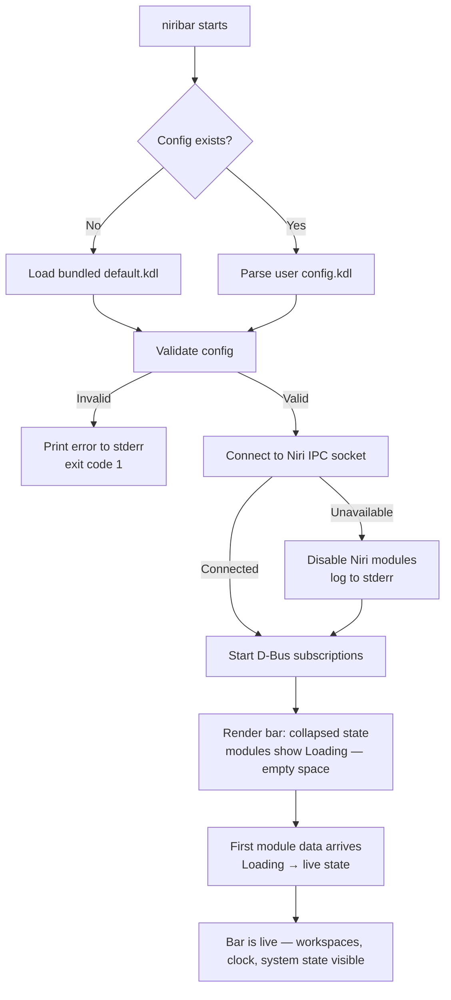
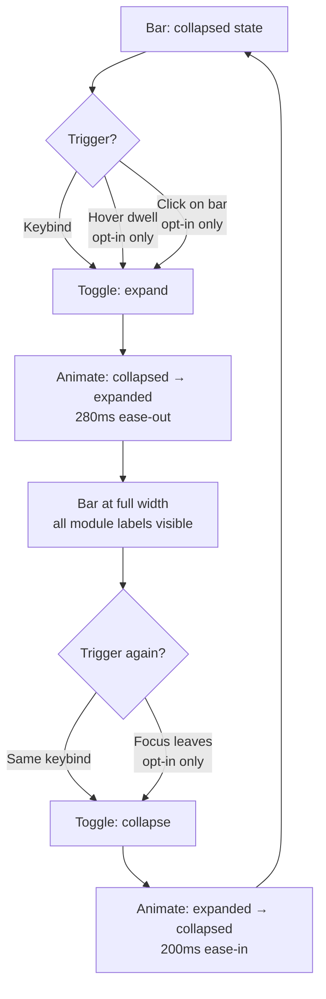
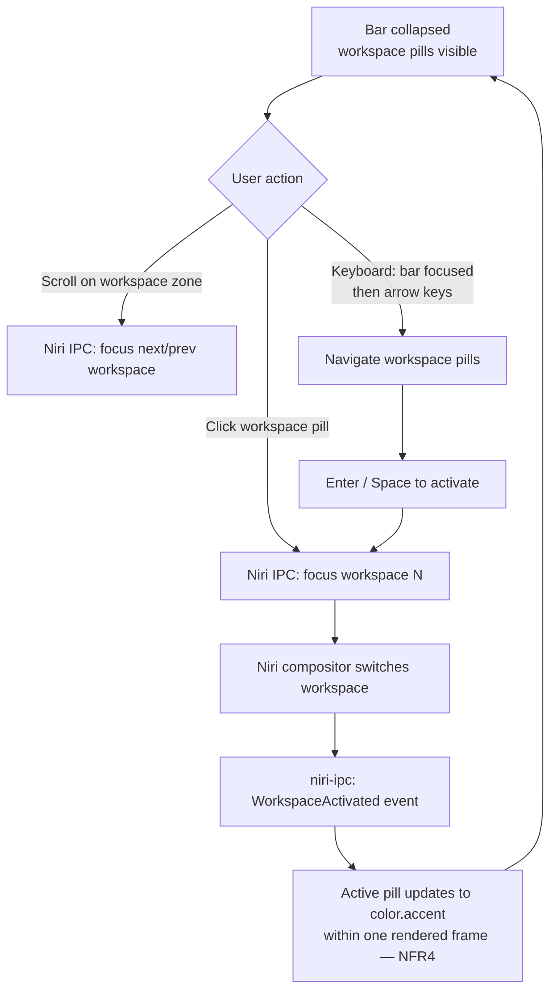
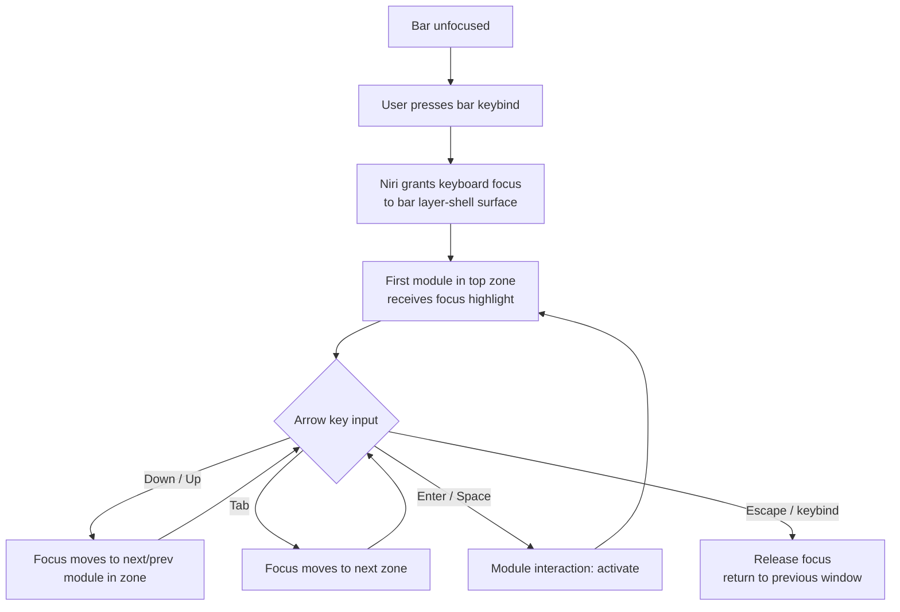
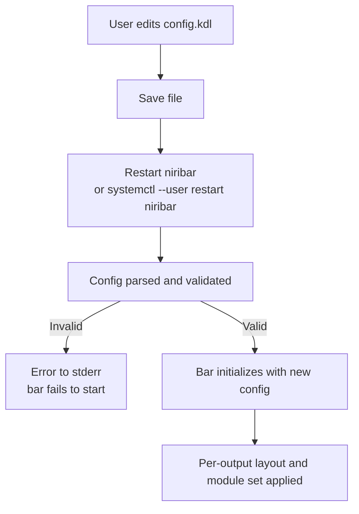

# UX Design Specification niribar

**Author:** Kevin
**Date:** 2026-03-28

---

<!-- UX design content will be appended sequentially through collaborative workflow steps -->

## Core User Experience

### Defining Experience

niribar's core interaction is ambient awareness — the bar sits quietly at the screen edge, delivering essential module state at a glance. Expansion is an intentional gesture to access depth, not an automatic reflex to cursor proximity. The bar respects focus by staying collapsed by default; it opens when the user decides they want more.

**Default expand/collapse trigger:** Intentional only (keyboard toggle or explicit click). Hover-based expansion is an opt-in configuration with configurable delay — never the default.

### Platform Strategy

- Wayland-only (wlr-layer-shell), keyboard + pointer input, no touch requirement
- Layer-shell surface — not a window; focus behavior is compositor-managed
- Single rendering path (wgpu via Iced); no platform fallbacks needed
- HiDPI-aware via wlr-layer-shell scale factor protocol
- Keyboard focus entry via a dedicated keybind configured in Niri's config

### Effortless Interactions

- Module glanceability in collapsed state — essential info readable instantly at icon width, no expansion required
- Module interactions (click, scroll) work in both collapsed and expanded states — users never need to expand just to adjust volume or switch a workspace
- Keyboard focus entry via a single keybind; no mousing to the bar required
- First-run just works — no configuration needed to get a complete, useful bar

### Critical Success Moments

- First workspace switch via the collapsed bar — collapsed interactions working seamlessly without expansion
- First keyboard-navigated bar interaction — focus enters, module activates, focus exits, cleanly
- Power user configures hover-expand with a custom delay and it behaves exactly as tuned
- Expand/collapse animation feels native — not a widget animating, a shell element breathing

### Experience Principles

1. **Intentional by default, configurable to ambient** — The bar does not react to the cursor by default. Expansion requires a deliberate action. Hover behavior is opt-in with configurable delay.
2. **Collapsed state is first-class** — The collapsed bar is not a degraded mode. Module interactions must be fully functional at collapsed width. Every module design starts with its collapsed representation.
3. **The default config expresses niribar's identity** — A newcomer who never touches the config should have a complete, visually coherent, immediately useful experience. No first-run setup, no wizard — the bar simply works.
4. **Keyboard is a full citizen** — Every pointer interaction is reachable by keyboard. Focus entry and exit are clean and predictable. The bar does not trap focus.
5. **Animation is a material property, not a feature** — The expand/collapse transition reflects the physical quality of the bar. It should feel weighted and smooth, like a panel sliding, not a div resizing.

## Responsive Design & Accessibility

### Output Adaptation

**HiDPI / scale factor (NFR11):**
- iced_layershell passes the compositor's scale factor to Iced; wgpu handles physical pixel scaling
- All sizing tokens are in logical pixels — never hardcoded physical values
- Bundled SVG icons render cleanly at any scale factor

**Output height adaptation:**
- Zone layout clips content rather than overflowing on short outputs
- `spacing.module.gap` can be set to 0 via config for compact layouts
- No automatic font scaling — font size is a user config decision

**Output width:**
- Bar is always on a vertical edge; output width only affects the desktop exclusion zone width
- Bar width is determined solely by `size.bar.collapsed`/`size.bar.expanded` config tokens

### Accessibility Strategy

**Target: WCAG AA** (NFR10)

| Requirement | Implementation |
|---|---|
| Color contrast ≥ 4.5:1 (text) | Catppuccin Mocha is AA-compliant; verified at implementation |
| Color contrast ≥ 3:1 (UI components) | `color.surface` on `color.background` meets 3:1 |
| Keyboard fully operable (NFR9) | All interactions reachable via keyboard; bar keybind configurable in Niri |
| Focus visible | `ModuleFrame` hover/focus fill is the focus indicator |
| No keyboard traps | Escape always exits; focus returns to previous window |
| Motion sensitivity | Animations are user-triggered, not looping; no auto-playing motion |

**AT-SPI / screen reader:** MVP does not target AT-SPI integration — keyboard operability is the accessibility floor. Future: revisit when Iced gains AT-SPI support.

### Testing Strategy

- **HiDPI:** Test at 1×, 1.5×, 2× scale factors on actual Wayland sessions
- **Output sizes:** Test on 1280×720 (minimum practical) and ≥2560×1440 (typical power user)
- **Keyboard navigation:** Full keyboard-only walkthrough — focus → navigate all zones → activate each module → exit — without pointer
- **Contrast:** Run Catppuccin Mocha token combinations through contrast checker at implementation; document in `ACCESSIBILITY.md`
- **Animation:** Visual inspection at 60fps and 120fps; check for jank on cold start and rapid expand/collapse toggle

## UX Consistency Patterns

### Interaction Feedback Patterns

**Pointer feedback:**
- Click/scroll on modules: immediate response — all actions are local IPC calls with ≤1 frame latency
- No loading indicator, no pending state — if data changes, it appears on the next event
- No ripple, press animation, or visual "click" effect — `ModuleFrame` hover fill is the sole interactive indicator

**Keyboard feedback:**
- Focus highlight (same as hover fill) is the sole indicator — no additional outline or ring
- Module activations produce no visual acknowledgement beyond the resulting data update

### Loading & Empty State Patterns

| Situation | Pattern |
|---|---|
| Module data not yet arrived | Empty space at final size — no spinner, no skeleton |
| Module service unavailable | Module hidden entirely — no placeholder, no error shown |
| Bar starting up | Modules render empty, fill in as data arrives — no flash or reflow |
| Config error at startup | `stderr` message + exit code 1 — no partial bar rendered |

**Rule:** The bar never shows a loading or error state in the rendered UI at runtime. All diagnostic output goes to `stderr`.

### Scroll Interaction Patterns

Modules that respond to scroll (volume, workspace navigation):
- Scroll up = increase / next; scroll down = decrease / prev
- Works identically in collapsed and expanded state
- No scroll acceleration — each step is one discrete unit
- Volume step: configurable via `module.volume.step` (default: 5%)

### Configuration Error Message Format

```
error: modules[0].type: unknown module "volumee".
Expected one of: battery, clock, network, volume, workspaces, focused-window, script, button.
```

Rules: field path in dot notation (matches KDL structure) · what was wrong · what was expected · no stack traces · always exit code 1

### Multi-Output Patterns

- Each output has independent expand/collapse state
- Module data is shared — battery shows the same value on all outputs simultaneously
- Per-output module sets differ via `[output "DP-1"]` config blocks
- A module unavailable on all outputs is simply absent everywhere; no per-output error states

### Animation Consistency Rules

| Transition | Duration | Curve |
|---|---|---|
| Bar expand | 280ms | `cubic-bezier(0.22, 1, 0.36, 1)` (ease-out) |
| Bar collapse | 200ms | `cubic-bezier(0.4, 0, 1, 1)` (ease-in) |
| Label/value fade-in | 120ms opacity | 60ms delay after expand starts |
| Module state changes | Immediate | No transition — snap |

No other animations. Nothing bounces, pulses, or draws attention unprompted.

## Component Strategy

### All Components Are Custom (Iced Primitives Only)

niribar has no external component library — every UI element is a custom Iced widget built from primitives.

### Component Specifications

**`BarSurface`** — outermost layer-shell container
- States: `Collapsed(width)` / `Expanded(width)` / `Animating(f32 progress)`
- Variants: flush (default), floating (`bar.gap` + `bar.border-radius` config)
- Owns the animated width; all children reflow within it

**`ZoneLayout`** — top/center/bottom zone arrangement
- Stateless layout primitive; center zone fills remaining space
- Never lets zones overlap; clips overflow

**`ModuleFrame`** — wrapper around each module's content
- States: Default / Hover / Focused (keyboard)
- Visual: rounded-rect background fill (`color.surface`, 4px radius) on hover/focus
- Identical visual treatment for pointer hover and keyboard focus

**`WorkspacePill`** — single workspace indicator
- States: Inactive / Active (`color.accent` bg) / Hover
- Collapsed: 32×20px pill, number only
- Expanded: full-width with number + label
- Interactions: click → focus workspace; scroll → next/prev; Enter/Space when keyboard-focused

**`ModuleIcon`** — icon with stateful color treatment
- States: Normal (module-type color) / Warning (`color.warning`) / Critical (`color.critical`) / Dim (`color.overlay0`)
- Size: 20px default, respects `font.size.icon` token
- Source: bundled SVG (default) or icon font glyph (configurable)

**`ModuleLabel`** — icon + label + value row (expanded state)
- Layout: icon + label left-aligned, value right-aligned
- Visibility: label and value opacity 0→1 with 60ms delay after bar width animation starts
- Colors: label `color.text`, value `color.subtext`

**`CriticalBadge`** — threshold overlay (collapsed only)
- Visible only when: bar is collapsed AND module value exceeds threshold
- Position: top-right overlay on module icon
- Visual: small pill, `color.critical` background, `color.base` text, 9px bold
- Config: per-module threshold (battery default ≤15%)

### Implementation Roadmap

| Phase | Components | Required for |
|---|---|---|
| Phase 1 | `BarSurface`, `ZoneLayout`, `ModuleFrame` | Any module rendering |
| Phase 2 | `WorkspacePill`, `ModuleIcon`, `ModuleLabel` | First live modules |
| Phase 3 | `CriticalBadge` | Collapsed-state critical indicators |

## User Journey Flows

### Journey 1: First Launch (Newcomer)



**Key UX constraint:** J→K must have no visible layout jump. Modules render at their final collapsed size even in Loading state — empty space, not a placeholder widget.

### Journey 2: Expand / Collapse (all users)



**Timing asymmetry:** Expand (280ms) is intentionally slightly slower than collapse (200ms) — expansion feels deliberate, collapse feels snappy.

### Journey 3: Workspace Interaction (Power User / Switcher)



### Journey 4: Keyboard Navigation (Power User)



**Non-negotiable:** At I, focus returns to the previously focused Wayland surface. The bar never traps focus. Escape is always a valid exit from any state.

### Journey 5: Configuration (Customizer / Power User)



**MVP:** Restart-to-reload. Flow is designed to support hot reload in a future iteration without changing the config contract.

### Journey Patterns

- **Ambient → intentional → ambient:** Every interaction starts from collapsed/unfocused, requires one deliberate action to enter, and returns to ambient cleanly
- **IPC is source of truth:** All workspace/focus state flows through niri-ipc events; the bar reflects, never infers
- **Escape is always valid:** Every focused or expanded state exits cleanly with at most one key press

## Design Direction Decision

### Directions Explored

Six directions were generated in `ux-design-directions.html` (interactive, open in browser):

| # | Direction | Purpose |
|---|---|---|
| 1 | Default — flush, Catppuccin Mocha, colored icons | Recommended baseline |
| 2 | Floating Panel — 8px gap, rounded corners all sides | Opt-in via `bar.gap` + `bar.border-radius` |
| 3 | Right Edge Placement | Opt-in via `bar.edge = "right"` |
| 4 | Monochrome — achromatic palette | Alternative theme via custom `[colors]` |
| 5 | Module States — warning, critical, muted in expanded view | State visualization spec |
| 6 | Collapsed Critical Badge — threshold badge overlay | Collapsed-state critical indicator spec |

### Chosen Direction

**Direction 1 (Default)** is the design baseline: flush edges, Catppuccin Mocha color tokens, colored module icons, no separator lines, subtle right-edge border.

All other directions are documented configuration paths, not separate products:
- Directions 2–3: placement/shape variants via config
- Direction 4: theme variant via `[colors]` block
- Directions 5–6: canonical module state specifications

### Design Rationale

- Flush default matches the "shell component, not a widget" feeling — the bar is part of the compositor surface
- Colored icons provide instant module identification in collapsed state without labels
- No separators aligns with the anti-Waybar-aesthetic principle
- Floating panel as opt-in gives power users the aesthetic they want without making it the default

### Critical State Specifications (from Direction 5 & 6)

**Module states:**

| State | Icon treatment | Value treatment | Badge (collapsed) |
|---|---|---|---|
| Normal | `color.accent` per module type | `color.subtext` | None |
| Warning (e.g. battery ≤ 30%) | `color.warning` yellow | `color.warning` yellow | None |
| Critical (e.g. battery ≤ 15%) | `color.critical` red | `color.critical` red | % badge overlay |
| Unavailable | Module hidden entirely | — | — |
| Muted/inactive | `color.overlay0` dim | `color.overlay0` dim | None |

Critical badge in collapsed state: appears at configurable threshold (default ≤15%), shows the value as a small colored pill overlaid on the icon. Disappears when bar is expanded (full value visible in label).

## Visual Design Foundation

### Zone Layout

- **Top zone:** modules stack from top edge downward
- **Bottom zone:** modules stack from bottom edge upward
- **Center zone:** modules centered in remaining space
- Zones never overlap; content clips rather than wraps if the bar height is insufficient

### Module Visual Anatomy

| State | Visual representation |
|---|---|
| Collapsed | `[icon]` — icon only; critical badge overlaid at threshold (e.g., battery % only when low) |
| Expanded | `[icon]  [label/value]` — icon left, label/value right, aligned on a row |
| Loading | Empty space — no spinner, no placeholder text |
| Unavailable | Nothing — module is fully hidden, no gap left |

### Bar Shape

- **Default:** flush against the screen edge — no gap, no rounding, no floating panel
- **Configurable:** `bar.gap` adds inset from the screen edge; `bar.border-radius` rounds the bar corners for a floating panel aesthetic

### Module Separators

No separator lines between modules. Spacing only — `spacing.module.gap` (4px default) is the sole visual delimiter. No borders, no rules.

### Hover / Active / Focus States

- **Treatment:** subtle background fill using `color.surface` (`#313244`) behind the module content
- **Shape:** rounded rectangle, 4px radius
- **Scope:** pointer hover and keyboard focus use identical treatment — consistent regardless of input method
- No outline, no border, no color change on text or icon — background fill is the only signal

### Bar Edge Treatment

- Single-pixel border on the desktop-facing edge using `color.border` (`#45475a` Surface1)
- Defines the bar boundary subtly without decoration
- Configurable: `bar.border = false` removes it; `bar.border-color` overrides color
- No drop shadow by default (shadow opt-in via config, compositor-dependent)

### Accessibility

- All text/icon on `color.background` meets WCAG AA — Catppuccin Mocha is AA-compliant by design
- Hover/focus treatment is a shape change (background fill), not color alone — distinguishable without color vision
- Focus indicator identical to hover — no separate focus ring required

## Defining Core Experience

### The Defining Interaction

**"The bar expands, reveals exactly what you need, and collapses cleanly."**

This is the interaction users will describe. It separates niribar from a static panel. If this is smooth, physical, and reliable, everything else follows.

**Critical design constraint:** The collapsed state is not a preview — it is a complete interface. Module interactions (click, scroll) work at collapsed width. If the collapsed state fails to surface essential information, users will keep the bar permanently expanded, defeating the purpose.

### User Mental Model

Users coming from Waybar expect a static panel to read. niribar introduces a revised mental model: the bar has two modes, both complete. Collapsed is not degraded. Expanded is not the "real" state — it is depth on demand.

### Success Criteria

- A user can switch workspaces without expanding the bar
- A user can adjust volume without expanding the bar
- The expand/collapse animation completes without any visible stutter or layout jump
- Focus entry and exit from the bar is clean — no trapped focus, no lost context
- A newcomer with the default config understands the bar's state within 30 seconds without documentation

### Novel vs. Established Patterns

The expand/collapse interaction is a **novel pattern** in the status bar space — no existing Linux bar implements it as a primary interaction model. The closest reference is the macOS Dock in expanded/compact mode, or a drawer component in mobile UIs.

**Teaching strategy:** The default config ships with expand/collapse pre-configured to a keybind. The first time a user expands the bar, the animation makes the model immediately legible — no documentation required. The interaction is self-demonstrating.

### Experience Mechanics

**Initiation:**
- Primary: keybind (configured in `niri.kdl`, triggers via Niri IPC or `niribar --toggle`)
- Secondary (opt-in): pointer hover with configurable dwell delay

**Interaction:**
- Bar animates from `size.bar.collapsed` → `size.bar.expanded` width (ease-out curve)
- Modules transition their visual representations in sync with bar width
- Input region updates atomically — no dead zones during animation

**Feedback:**
- The animation is the feedback — physical, immediate, no secondary indicators
- No toast, no sound, no cursor change

**Completion:**
- **Expanded:** bar rests at full width; all module labels/values visible; keyboard focus optionally enters bar
- **Collapsed:** bar rests at icon width; all module data still current; keyboard focus returns to previous window

**Toggle behavior:** Same keybind toggles both expand and collapse. The bar does not maintain modal state — a single keybind press always inverts the current state.

## Design System Foundation

### Design System Choice

**Custom token-based system on Iced primitives.** No external design library — niribar defines its own design tokens implemented directly in Iced. All tokens are user-configurable via KDL; Catppuccin Mocha is the compiled-in default.

### Color System

**Default palette: Catppuccin Mocha** — widely adopted in the Niri/Wayland community, visually coherent, WCAG AA compliant for text on background.

| Token | Catppuccin Mocha default | Role |
|---|---|---|
| `color.background` | `#1e1e2e` (Base) | Bar surface |
| `color.surface` | `#313244` (Surface0) | Module hover/active states |
| `color.border` | `#45475a` (Surface1) | Subtle dividers (if used) |
| `color.text` | `#cdd6f4` (Text) | Primary labels |
| `color.subtext` | `#a6adc8` (Subtext0) | Secondary/dim values |
| `color.accent` | `#89b4fa` (Blue) | Active workspace, focused elements |
| `color.warning` | `#f9e2af` (Yellow) | Battery low |
| `color.critical` | `#f38ba8` (Red) | Battery critical, network error |
| `color.success` | `#a6e3a1` (Green) | Charging, connected |

**Translucency:** Opaque by default. Blur/translucency opt-in via config; compositor support not guaranteed.

**Catppuccin flavor shorthand:** `theme = "catppuccin-mocha"` (also: latte, frappe, macchiato). Full per-token override always available.

### Typography

**Default: System font** via fontconfig — no bundled font dependency, clean packaging, respects user preferences. User override via `font.family` KDL key.

| Token | Default | Role |
|---|---|---|
| `font.size.base` | `13px` | Module labels, values |
| `font.size.small` | `11px` | Secondary text, timestamps |
| `font.size.icon` | `16px` | Icon font size (when icon font used) |

### Icon System

**Default: Bundled SVG icons** — self-contained, no font dependency, renders cleanly at any scale factor. Ships a minimal set covering all built-in modules.

**User override:** `icon.font` KDL key switches to an icon font (e.g., Nerd Fonts); individual module icons overridable via `icon = "name"` in module config.

### Spacing & Sizing System

**Base unit: 4px grid.** All spacing, padding, and sizing values are multiples of 4px. Configurable via `spacing.unit`.

| Token | Default | Role |
|---|---|---|
| `spacing.module.padding` | `8px` | Padding inside each module |
| `spacing.module.gap` | `4px` | Gap between modules in a zone |
| `spacing.bar.padding` | `4px` | Bar edge padding (top/bottom) |
| `size.bar.collapsed` | `48px` | Collapsed bar width |
| `size.bar.expanded` | `200px` | Default expanded bar width (FR36) |

### Customization Strategy

KDL config exposes design tokens at three levels:
1. **Preset shorthand** — `theme = "catppuccin-mocha"` applies all tokens at once
2. **Section override** — `[colors]`, `[fonts]`, `[spacing]` blocks override token groups
3. **Per-token override** — individual token keys override single values

## UX Pattern Analysis & Inspiration

### Inspiring Products Analysis

**Waybar** — direct predecessor, closest prior art
- *What works:* Comprehensive module coverage, highly configurable, wlr-layer-shell support, familiar to the target audience
- *What doesn't:* Default config is a showcase of capability, not a curated experience — too many modules, too much noise. The visual aesthetic reads as "technical": borders, separators, dense text, a configuration dump made visible. The bar looks assembled, not designed.
- *Key lesson:* The default config is niribar's most important UX artifact. It must be curated, not comprehensive.

**GNOME Shell** — animation quality reference
- *What works:* Panel interactions feel physical and weighted. Workspace transitions have momentum. Overlays appear and dismiss with easing that feels intentional. Nothing snaps or jumps.
- *Key lesson:* The animation curve standard — ease-out on expand (fast start, decelerate to rest), ease-in on collapse (slow start, accelerate away).

**macOS menu bar / Raycast** — "cleaner" quality reference
- *What works:* Information density without visual noise. Every element earns its space. Keyboard-first interactions that feel natural. The bar recedes; content is the focus.
- *Key lesson:* Visual restraint in the default theme. Keyboard interactions designed as first-class, not afterthoughts.

**i3bar / Polybar** — power user baseline
- *What works:* Does exactly what the config says, nothing more. The configurability contract is explicit and honored.
- *Key lesson:* Config is truth — bar appearance is a direct, legible translation of the KDL file.

### Transferable Patterns

- **From GNOME Shell:** Ease-out expand / ease-in collapse curve; every state change animated, even fast ones
- **From macOS / Raycast:** Visual hierarchy where modules are silent in collapsed state unless they have something to say (battery critical, network disconnected); keyboard as first-class interaction
- **From i3bar / Polybar:** Config-is-truth contract — the KDL file should read like the bar looks

### Anti-Patterns to Avoid

- **The Waybar default problem** — a default config that showcases every module is a bad first impression; niribar's default ships only what a user actually needs daily (workspaces, clock, essential system state — 5–6 modules maximum)
- **The "technical" aesthetic** — visible separators between every module, border boxes, monospace status text; this reads as assembled, not designed
- **Hover-expand by default** — the macOS menu bar never jumps at you; niribar shouldn't either
- **Module overload** — modules with nothing to say should say nothing (volume at a stable level needs an icon, not a number)

### Design Inspiration Strategy

**Adopt:** GNOME's easing curve standard; macOS's visual restraint — the bar serves, it doesn't perform

**Adapt:** Waybar's module coverage (feature parity) with a curated default config; Polybar's config-is-truth contract, expressed in KDL

**Avoid:** Waybar's default aesthetic (borders, separators, dense text); any pattern that makes the bar feel like a system monitor rather than a shell component

## Desired Emotional Response

### Primary Emotional Goals

**Primary: Polished** — everything looks and behaves exactly right. Not flashy, not minimal for minimalism's sake — precisely correct. The bar's proportions, animations, module representations, and interactions feel designed together by someone with taste. When a user gets niribar running, the reaction should be recognition: *this is what a native Niri bar should look like*.

**Switcher reaction: "This is cleaner"** — not faster, not more powerful, but cleaner. Fewer rough edges. Visually more intentional. Behaviors that make sense without documentation.

### Emotional Journey Mapping

| Moment | Target feeling |
|---|---|
| First launch with default config | Quiet satisfaction — it just works |
| First expand/collapse | Pleasantly surprised by the animation quality |
| First workspace click in collapsed state | "Oh, that just worked" — no expansion needed |
| Editing the KDL config | In control — familiar format for Niri users |
| A D-Bus module silently absent | Nothing — no friction, no noise |
| Returning after days | Comfort — exactly how you left it |

### Micro-Emotions

- **Confidence over confusion** — every module's collapsed state communicates its value unambiguously
- **Trust over skepticism** — consistent behavior; hover doesn't trigger unexpected expansion; keyboard focus doesn't get lost
- **Satisfaction over delight** — a craftsperson's tool; the reward is competence, not surprise
- **Calm over excitement** — the bar recedes when not needed; it does not compete for attention

### Design Implications

- *Polished* → animation easing carefully tuned; no linear transitions; motion feels physical
- *Cleaner than Waybar* → tight visual hierarchy; no unnecessary padding; no visual noise in collapsed state
- *Quiet degradation* → `Unavailable` modules render as nothing; no placeholder icons, no "N/A" text, no error indicators
- *Power user respect* → every configurable parameter exposed in KDL; sensible defaults mean users tune, not replace; no unnecessary friction

### Emotions to Avoid

- **Jank** — any animation that stutters, any click that feels unresponsive, any reflow that jumps
- **Noise** — error messages surfaced for things the user can't fix; invisible degradation is correct
- **Fight** — power users should never work against defaults; config is tuning, not correcting

## Executive Summary

### Project Vision

niribar is a Niri-native Wayland status bar that feels like an integral part of the compositor's shell — not a GTK panel bolted on, but a Rust/Iced component designed from the ground up to complement Niri's scrollable-tiling model. The defining interaction is an expandable vertical bar: collapsed to a minimal strip for focused work, expanded to reveal labels, detail, and actions on demand. The bar is the seed of a full shell layer; every design decision should preserve the path toward launcher integration and beyond.

### Target Users

1. **The Power User** — Niri daily driver, full control over layout, modules, and behavior; comfortable editing KDL and writing scripts
2. **The Switcher** — Coming from Waybar/Polybar; wants parity modules (workspaces, clock, battery, volume) with better Niri-native integration
3. **The Newcomer** — First time with Niri; needs a default that works immediately and feels intentional without any configuration
4. **The Customizer** — Wants to theme, extend, and build on the module API; cares about script integration and visual flexibility

### Key Design Challenges

1. **The expand/collapse contract** — The bar's defining interaction must feel purposeful and smooth, not jittery. Hover intent, animation curve, and module reflow on expansion all require precise design.
2. **Collapsed state information density** — Each module must communicate its essential state at minimal width; the collapsed representation is the default state most users see most of the time.
3. **Keyboard focus on a layer-shell surface** — Focus entry/exit and inter-module traversal on a layer-shell surface is compositor-specific novel territory; the model must be explicit and consistent.

### Design Opportunities

1. **Workspace visualization** — Niri's scrollable-tiling structure is unique; the workspace module can represent it more faithfully than any generic bar
2. **Expansion as contextual detail** — Expansion can be designed as purposeful depth rather than just a wider bar — the expanded state reveals context that earns the extra space
3. **First-run identity** — The default config can be opinionated enough to express niribar's identity without any user configuration
