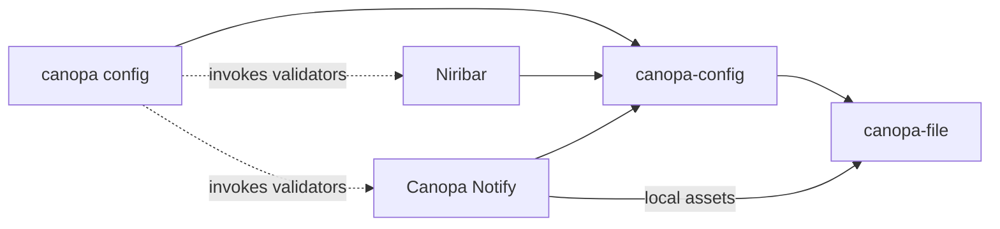

# 0002: Shared configuration sources, independent candidates

Status: accepted for integration phase 3 (2026-09-26).

The shell restart requirement below is superseded by
[Shell ADR 0021](../shell/adr/0021-live-configuration-reload.md).

The appearance extension is now implemented by [ADR 0003](0003-shared-appearance.md).
References below to future appearance support describe the original phase-3 scope.

Canopa has one user configuration entry point and two independently running schema
owners. Niribar remains restart-required in this phase, as explicitly selected by
the user. Notify preserves its serialized candidate preparation and atomic runtime
installation. Shared appearance is a subsequent phase.

`canopa-config` owns XDG source discovery, explicit source formats, a 1 MiB UTF-8
admission budget, the KDL envelope, safe diagnostics, and source fingerprints.
`canopa-file` owns the descriptor-checked nonblocking regular-file reader previously
in Notify, now reused by configuration and Notify's local image/audio assets.
Neither crate depends on application schemas, runtimes, Iced, or a settings service.
Schema owners consume a borrowed namespace document with spans into the original
source. They construct and validate complete typed candidates before installation.

Solid edges are library dependencies; dotted edges are local validation processes.
Validators reuse their application's schema without starting its desktop service.

The shared file is `$XDG_CONFIG_HOME/canopa/config.kdl`, falling back to
`$HOME/.config/canopa/config.kdl`. Empty/relative XDG config paths are ignored; HOME
must be absolute. Precedence is explicit source, discovered common file, legacy
application file only when common is absent, then embedded defaults. Present invalid
files (including dangling symlinks) never trigger fallback. Missing namespaces use
embedded feature defaults, never a merge with legacy files. An explicit source
carries its format: no schema guessing. Existing Notify `--config`, reload-path,
and library file APIs retain their legacy meaning.

The envelope requires exactly one `schema-version 1` and at most one `shell` and
`notifications` block. Namespace blocks accept no arguments or annotations. Unknown
root nodes, including the future `appearance` namespace, are rejected until supported.
Whole-file KDL syntax and envelope errors affect both applications; semantic errors
inside one namespace affect only its owner. Existing feature schemas remain in their
applications. Niribar also rejects unknown/duplicate root sections of its namespace.

Every successful file/default load has a source record: selected absolute path,
format, SHA-256 of the entire selected source, and whether feature defaults were
used. The common fingerprint is identical across consumers even when a namespace
is absent. Notify exposes the record beside its local installation generation and
last reload error. Niribar logs it on startup; local validation reports the current
candidate. These records expose skew; they do not imply cross-process atomic reload.

No-path Notify reload uses the last committed request: discovery remains discovery,
so a newly created common file can replace a discovered legacy file; explicit files
remain explicit. A failed read, parse, validation, or installation preserves the
previous request, source record, settings, rules, and generation. Preparation stays
off the async runtime, serialized even when a caller is cancelled. Library options
without a configuration request remain isolated from ambient user configuration.

`canopa config check` reads immutable bounded snapshots and asks both sibling
application executables to validate their own schemas, reporting both results even
when one fails. This keeps the command free of application runtime dependencies and
keeps all schema logic with its owner. Source excerpts are available only through
explicit local `--show-source`; normal service errors and JSON diagnostics are
content-free. Rich shell diagnostics retain original file offsets.

`canopa config migrate` accepts explicit legacy files, wraps their source into
namespaces, checks both resulting schemas, and creates the requested output with
private permissions using a same-directory no-clobber atomic install. Originals and
existing outputs are never overwritten. Migration does not modify DND, user rules,
history, service state, or the running desktop.

This extends Notify ADR 0010 and supersedes the flat-file discovery portion of
Notify ADR 0040. Its bounded admission, off-runtime preparation, cancellation,
last-good-state, and content-free error guarantees remain in force. Appearance,
shell live reload, a settings daemon, and an XDG portal are outside this slice.
