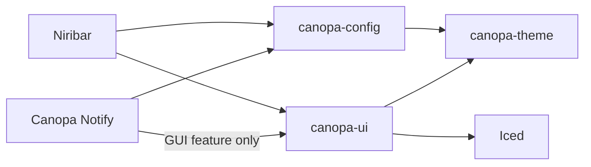

# 0003: Shared appearance snapshots and Iced controls

Status: accepted for integration phase 4 (2026-09-26).

The initial preset colors and dimensions below are superseded by
[Canopa's visual direction](0014-canopa-visual-direction.md). Appearance ownership
and consumer independence remain in place.

The startup-only shell appearance installation below is superseded by
[Shell ADR 0021](../shell/adr/0021-live-configuration-reload.md).

Niribar's fixed Catppuccin palette and Notify's independently selected Iced theme
made notification banners and the shell look unrelated. Both now consume one
appearance snapshot and the same Iced styling adapter. Processes, notification
policy, stores, interaction IDs, and accessibility owners remain independent.

`canopa-theme` contains toolkit-independent RGB colors, immutable `Appearance`,
semantic palette roles, contrast calculations, and logical typography/spacing/radius
tokens. It has no dependencies or process state. The default is Catppuccin Mocha;
the light preset is based on Latte with darker status colors for readable contrast.
`canopa-ui` resolves this data into Iced's full palette and supplies shared surface,
action, muted-text and hyperlink treatments. Its action constructor returns an
ordinary Iced button; the consumer owns messages, revision guards, focus state,
scroll identity and AT-SPI semantics. No domain behavior belongs in these crates.

The schema-1 envelope gains an optional unique `appearance` block, parsed once by
`canopa-config`. Supported settings are `color-scheme "dark"|"light"` and optional
`accent "#rrggbb"`. Unknown fields, annotations, duplicate fields, arguments other
than one string, and nested settings are rejected. Validation occurs before feature
namespace selection, including when feature defaults are used. Errors use a safe
`appearance` code and the original byte offset, never source values. Shared source
fingerprints still cover the complete file. Legacy inputs and absent appearance
use the shared dark default. This extends ADR 0002's envelope.

Niribar installs the immutable theme once at process startup, before module creation.
Its internal palette accessor replaces fixed constants so bars, panels, menus and
module states follow the same selection. Existing configuration token names remain
compatibility aliases; explicit literal color overrides still take precedence.
Validators do not mutate this process state. Shell changes continue to require a
restart; no settings daemon or implicit system color-scheme detection is involved.

Notify installs appearance with its other validated configuration under the existing
mutation guard. The complete banner presentation carries appearance through the
coalesced transport and image preparation. A valid reload republishes current banners,
including existing visible cards, and updates the renderer's cached Iced theme.
Notification identities, revisions, policy decisions and started timeout deadlines
do not change. Invalid candidates or sound-installation failures retain the old
appearance and configuration generation. A disconnected renderer remains a separate
presentation error: a valid local configuration can commit while delivery is unavailable.
Success means snapshot installation, not an acknowledgement of physical repaint.

Default text/status pairs are checked at 4.5:1 and focus indicators at 3:1 in both
presets. Explicit color overrides can reduce contrast. Shared links fall back to
primary text if a custom accent is unreadable; filled accent/danger controls choose
contrasting text. Interactive Center controls show the host's selected action with
a focus outline. Banners retain their non-focus-stealing surface contract.

This step shares notification card/action typography, spacing, frames, actions and
link colors. Font-family selection, text scaling, motion preferences and icon-theme
resolution are deferred until their resource/layout adapters can honor them. No
unsupported settings are accepted as no-ops. Protocol convergence and the notification
summary module remain separate integration phases. No dependency fork changes are needed.
