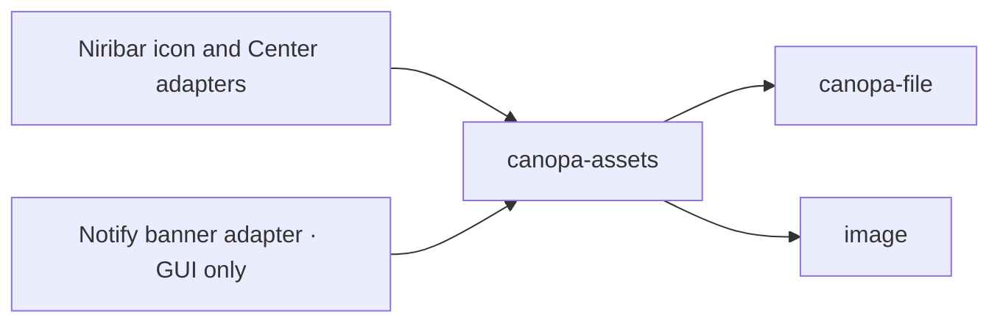

# 0005: Shared local icon lookup and raster preparation

Status: accepted for the asset slice of integration phase 6 (2026-09-27).

Niribar and Notify now share `canopa-assets` for local icon discovery and raster
preparation. The crate returns paths or owned RGBA pixels and depends on
`canopa-file` and the existing image codec library. It contains no Iced, Wayland,
Tokio, notification policy, process state, or provider protocol. Notify enables it
only with its GUI feature. No dependency fork or upstream version changes are needed.

`RasterBatch` owns accounting for one preparation batch. The caller supplies its
per-image policy, aggregate budget and cancellation predicate, then loads files or
admits existing RGBA pixels through the same pixel budget. File attempts and bytes
read are charged even when decoding fails; overflow probes count too. Pixel limits
are checked against source dimensions before decoding and thumbnailing. Successful
pixels belong to the caller; later loads observe file changes. No path-only pixel
cache is added. Failures return absence without logging source paths or content.

The application adapters preserve their existing contracts:

| Policy | Notify banners | Niribar Center images |
| --- | --- | --- |
| Formats | PNG/JPEG filename and detected content | Compiled raster codecs, including GIF/WebP |
| File size | 16 MiB | 8 MiB |
| Dimension | 4,096 | 2,048 |
| Source pixels per image | 4,194,304 | 4,194,304 |
| Decoder allocation limit | 64 MiB for codec allocations, separate RGBA admission | 32 MiB including the native decoded destination |
| Output | Original size, EXIF rotation/mirroring | Thumbnail within 512 × 512, existing orientation behavior |
| Batch | 32 attempts; 32 MiB encoded; 32 MiB RGBA | 16 distinct paths; aggregate ceilings derived from the per-file limits |
| Symlinks | Follow, then validate descriptor | Canonicalize, then reject a replaced final symlink |
| Workers | One admitted worker, cancellation on supersession/drop | Two admitted workers, 250 ms admission wait |

Both file modes use nonblocking, regular-descriptor reads with a bounded overflow
probe. `canopa-file::read_canonical_bounded` shares this implementation with ordinary
bounded reads while preserving Niribar's final-symlink behavior. The
[image allocation limit](https://docs.rs/image/0.25.10/image/struct.Limits.html) is
best-effort. These are logical work/output limits, not a filesystem deadline or a
total process/GPU memory cap. Worker permits, executor choice, stale-result guards,
renderer acknowledgment and fallback text remain owned by the adapters.

The explicit decoder accounting mode preserves a subtle difference between the
former entry points: the Center used `ImageReader::decode`, which reserves the
native decoded buffer before passing the remaining limit to the codec. Notify's
`into_decoder` path did not make that reservation. Native output can exceed RGBA8
size, and some codecs need additional scratch buffers, so replacing these calls
without preserving the reservation would silently weaken the Center's limit.

`IconLookup` shares Notify's indexed theme mechanism across both applications:
ordered absolute XDG roots, first theme index, declared directories, nominal
size/scale ranking, parent traversal, hicolor, then unthemed fallback. This follows
the [Icon Theme specification](https://specifications.freedesktop.org/icon-theme/latest/)
with explicit caller format support. Lookup keeps the existing bounds: 32 roots,
32 themes, 1,024 directories per index, 256 KiB per index, 2 MiB index bytes and
65,536 checks per batch. Malformed metadata, cancellation or budget exhaustion
stops lookup instead of choosing lower-priority assets. Metadata lives in the batch.

Notify retains PNG/JPEG lookup, configured theme/scale, fresh metadata per frame and
the existing single asset worker. Niribar retains PNG/SVG/XPM path selection and its
process-lifetime name/handle caches; SVG rendering stays in Iced. XPM path selection
does not add an XPM decoder or claim complete icon-format conformance. Niribar uses
hicolor at nominal size 22 and source scale 1, as its former first raster size did.
When an index exists, declared directories and size ranking now determine the
selected icon; the shell also gains the shared legacy `~/.icons` and XDG pixmap
roots. If hicolor has no index at all, the shell retains its former fixed-size grid
and scalable SVG fallback. An invalid existing index does not activate that fallback.

Configuration schemas and reload behavior are unchanged. Automatic theme/scale
detection, shared icon-theme settings, asynchronous shell icon loading, global cache
invalidation, SVG rasterization, provider convergence and portals remain later work.
This extends Notify ADRs 0036/0037 and Niribar ADR 0011 at the mechanism seam while
preserving their application ownership.

Panel Menu icon scheduling and SVG preparation now follow [Niribar ADR 0013](../shell/adr/0013-prepare-panel-menu-icons-off-the-ui-thread.md); other shell consumers retain the policy above.
