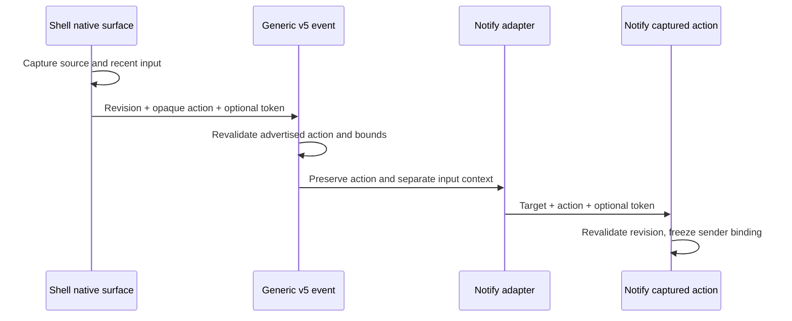

# ADR0032: Carry input-bound activation with opted-in panel actions

Status: implemented; scoped protocol/model/native acceptance passes, shared validation pending, 2026-10-29.

## Context

The Notification portal's private native checks pass for banner input, exported
and non-exported typed callbacks, sender exit, native token consumption and
withdrawal. Native Center input also commits the correct captured action and
typed target, but its platform data is empty. Shell currently forwards only the
opaque action to Notify. Notify's separate Wayland connection cannot recover the
input serial or source surface from that click. Requesting another token without
that context does not establish input authority; increasing its timeout would
not fix the ownership gap.

Shell owns the displayed provider control, native surface and input. Notify owns
notification targets, application identity, action meaning and sender publication.
The shared panel protocol must preserve that division. Shell must not parse or
rewrite a provider's opaque action value to inject notification-specific data.

## Decision

Add opt-in activation metadata to generic rich actions. An action may request
an activation token; ordinary actions keep their existing behavior. Add an
optional bounded activation token to the v5 host event envelope, alongside the
existing captured revision and interaction. Do not change the frozen v4 invoke
event or place transport context inside its opaque value.

Absent metadata serializes identically to the existing wire. Old hosts ignore
the additional action metadata and send their existing token-free event. Old
providers do not opt in, so new hosts do not send an additional event field to
their strict v5 decoders. New providers accept an absent token and retain the
existing fallback. Verify these compatibility claims against actual old-shaped
fixtures. No protocol guessing or implicit migration is allowed.

Only a currently advertised opted-in action can receive activation context.
Validate the token's size/content and complete event envelope. Admission of
fixed opted-in interactions must reserve room for the maximum escaped token;
ordinary forms, sliders and controls keep their current bounds. Provider action
values remain byte-for-byte opaque to Shell.

At native dispatch, Shell captures the actual panel surface and action/session
identity. Request a token through the existing layer-shell connection with its
recent input serial. Bound callback waiting and token age, and revalidate the
session, interaction revision and control identity before forwarding. Replaced,
closed or superseded controls cannot send a late callback to another action.
Missing protocol support or a failed/expired token uses the same valid action
without a token. Never reuse another click's token.

Notify's v5 provider preserves the context while forwarding its private socket
interaction. The daemon passes it through the existing captured-revision action
commitment and frozen portal publication. Legacy socket/v4 clients remain valid.
Notify continues to own domain validation, replacement and permission policy.

## Verification

Cover opt-in/unrequested context, token bounds, exact legacy serialization and
strict decoder compatibility. Exercise replacement/closure during token waiting,
missing/expired replies and per-action token isolation in host/model tests.
Verify the layer-shell recent-input/source check and update any changed fork's
patch/provenance together.

The private Notification fixture must then prove Center callbacks with native
source/serial-bound platform data in dark/100% and light/125%, alongside the
already passing banner cases. Retain the current red evidence:
`/tmp/canopa-notification-center-dark-04` commits `chosen-center` with the original
`(si)` target but no token. Notification stays unadvertised until this handoff,
metadata and final shared checks are complete.

This extends [the unified panel contract](0007-unified-panel-protocol.md) and
[Notify-owned portal integration](0031-notify-owned-portal-adapter.md).

## Current implementation evidence

The optional capability is `PanelAction.request_activation_token`; the optional
v5 envelope field is `activation_token`. Neither is serialized at its legacy
default. The v5 contract checks opt-in, exact action/revision, content and complete
frame bounds. Thirteen focused session tests pass, including old strict-event and
permissive-action decoder fixtures. Shell/Notify all-target compilation passes.

The host now captures the panel window and requests a bounded callback through
its existing native connection. The v5 writer revalidates its captured opaque
control before sending. Notify preserves that context separately through its
private socket and optional core center-command field; the original opaque value
is unchanged. Native input expires after two seconds, replies after one second,
and retired source surfaces cannot return a token. Pending native requests are
bounded to 64 and expired requests are reaped without double destruction.
The layershellev patch and provenance match verified upstream reconstruction.

The callback-replacement/core-target regressions and current-source build pass.
The native fixture requires the Center token to match Shell's own
Wayland Done, serial and source-surface trace and differ from earlier banner
tokens. The complete native suite passes six cases per appearance, including
Center source/serial-bound context. The shipped descriptor and activation entry
also pass private activation in both appearances. Final full consumer, shared
and core validation remains in progress.

