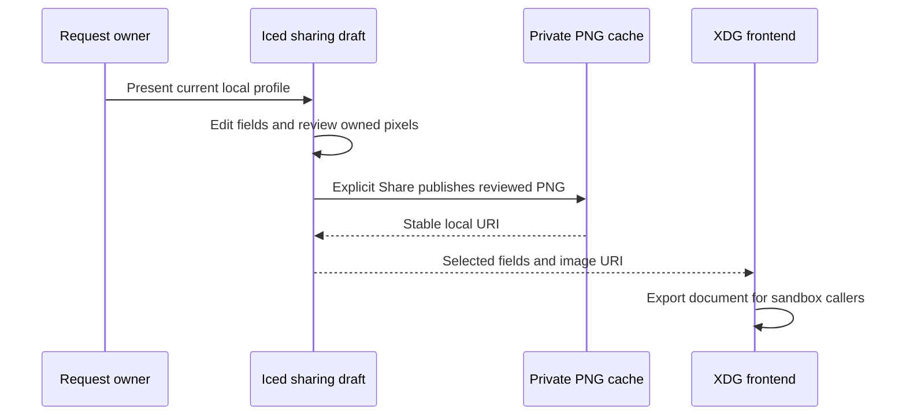

# ADR0033: Keep account disclosure in a request-owned Iced sharing draft

Status: accepted; scoped core/native/activation verification, 2026-10-29.

## Context

The [Account backend](https://flatpak.github.io/xdg-desktop-portal/docs/doc-org.freedesktop.impl.portal.Account.html)
returns user information after a dialog decision. The backend receives a reason
and parent window; the response contains id, name and avatar URI strings.
The standard frontend passes host image URIs through and registers sandbox
images with the document portal. An image must remain readable after its helper
has exited. Profile queries themselves must not disclose data to the caller.

## Decision

Use the existing bounded request host and an ordinary Iced helper. Prepare the
current UID's profile through read-only AccountsService properties with a
two-second service timeout and NSS fallback, away from the UI thread. The dialog owns an editable sharing draft
and explicit field/image choices. Only Share produces a result; initial Enter,
Cancel, Close, caller loss and malformed presenter results cannot disclose fields.
The frontend retains application identification and document export.

Reuse FileChooser's state/view as an embedded picker in the same helper window.
The component reports Selected/Cancelled; its standalone adapter owns process
exit. Account retains its draft when the picker closes. Instance generations
reject old picker/decoder callbacks, and displayed sharing generations reject
stale acceptance after an asynchronous or view transition.

Prepare the reviewed image as owned pixels and a standalone PNG. Use shared
bounded raster/SVG decoding; normalize orientation and strip source metadata and
external resource dependencies. Publish these exact PNG bytes only after Share.
The returned URI references a private cache outside the helper's lifetime.
Original filenames and source image paths are not the shared artifact.

The cache uses content-addressed names, exclusive publication, a cooperating
process lock, file ownership/permission checks and atomic no-clobber writes.
Limit it to 64 generated images and 16 MiB, and protect recently published/reused
entries for at least 60 seconds before pressure eviction. Old generated images
may retire; unrelated entries are left alone. This is a bounded cache, not an
indefinite storage promise. Failed image publication leaves the draft open so
the user can retry or change the image-sharing choice.

## Verification

Require complete wire shape, explicit/cancel/error results, owner-authorized
retirement, shared request capacity and independent concurrent drafts. Test
profile fallback, source removal after preparation, normalized PNG bytes, private
cache bounds/retirement, safe publication and concurrent reuse. Exercise stale
picker/image completions and initial Enter in the UI model.

Private native acceptance must use a fixture AccountsService/profile, exercise
the public frontend, edit/exclude fields, select/clear an avatar, read its URI
after helper exit, cancel/Close/lose callers and preserve drafts across picker
return in both appearances. Recheck standalone FileChooser after extraction.
Actual Flatpak/FUSE export remains a separate environment acceptance requirement.
Advertise Account only after scoped acceptance passes; record broader gate reds
independently in the implementation ledger.

The implementation passes 19 model and five wire tests, focused Clippy, all-target
core checking and all five wire tests without desktop features. Ten private native
checks pass per appearance with the shipped descriptor and activation service.
Standalone FileChooser retains twelve passing native checks per appearance after
the picker extraction. Captures were inspected. The descriptor advertises Account;
live routing is unchanged. Actual Flatpak/FUSE export remains unverified. See the
[evidence ledger](../../.scratch/xdg-portals/IMPLEMENTATION.md) for exact artifacts,
failed attempts and the separate red workspace/core gate outcomes.
