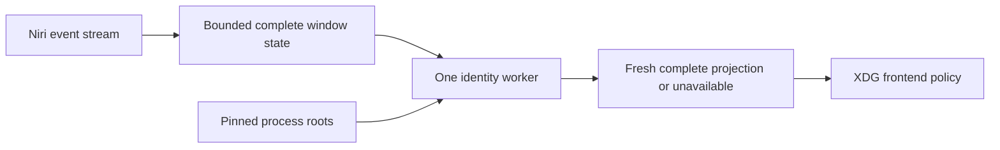

# ADR0034: Observe compositor applications before applying Background decisions

Status: implemented with scoped native and shipped-descriptor acceptance; shared
gate outcome recorded, 2026-10-29.

## Context

The [Background backend](https://flatpak.github.io/xdg-desktop-portal/docs/doc-org.freedesktop.impl.portal.Background.html)
supplies application state and a notification decision. The frontend combines
those observations with its Flatpak instance registry and stored permissions.
An absent application entry means background; a failed observation aborts that
pass. Incorrectly returning an empty map can therefore affect process policy.

Niri has a native event stream with an initial complete window snapshot, subsequent
window/focus events and optional connection-creator PIDs. Its GNOME introspection
adapter supplies a window list, not the running-application API used by GNOME's
Background backend. Neither a window title nor its declared app ID establishes a
sandbox identity. Canopa's pinned native probe verifies the window/PID/focus seam.

## Decision

Keep a portal-owned, renderer-independent Niri observer. It consumes read-only
IPC and does not depend on Shell's process or Iced subscription. Compositor and
session ownership remains unchanged. The observer publishes complete snapshots
or explicit unavailable state; no partial/empty fallback is interpreted as a
successful observation.

Use an initial snapshot barrier, a 1 MiB line limit, 256-window limit, bounded
handshake/partial-frame deadlines and reconnect backoff. Ignore unknown event
variants; malformed known events retire the connection. Each window incarnation
and connection epoch has its own identity key. Generation checks reject a
worker completion after replacement, disconnect or shutdown.

Resolve identity on one filesystem worker with a coalescing, single-pending-job
inbox. Filesystem stalls cannot block D-Bus or grow an unbounded queue. Only this
worker owns the process-reference cache. A fresh projection is usable for two
seconds; a one-second refresh revalidates references. Expired observations become
unavailable, including when no window event arrives. Shutdown invalidates the
source, closes its inbox and aborts the socket reader without waiting on a
potentially blocked filesystem syscall.

Open a process directory under `/proc`, retain that descriptor, read process birth
and liveness, and open its root relative to the pinned descriptor. Read bounded,
regular, non-symlinked `.flatpak-info` metadata for the application and instance
identity. Retain root identity and metadata fingerprints; revalidate before
publishing. A cached window cannot adopt a replacement process's identity after
numeric PID reuse. A missing metadata file is classified as host only when the
root matches the host root. Unknown credentials, inaccessible or unidentified
namespaces and inconsistent metadata fail the complete projection.

This follows the frontend's process-root identity seam without copying its C
implementation or introducing GLib. Niri supplies a numeric PID, not a pidfd;
initial association still relies on the currently reported connection-creator
PID. These guards protect the lookup and retained binding, not an atomic
compositor-issued process reference. Nested/other sandbox formats whose identity
cannot be resolved remain unavailable rather than borrowing a declared app ID.

Group verified sandbox windows by application identity and take the highest
state: active when actually focused, otherwise running while any window remains.
Layer-shell focus means no focused toplevel; Shell's last-active-window display
fallback must not become a foreground claim. The frontend already knows running
instances without windows, so absent entries keep their standard meaning.

The decision adapter reuses Requests admission/ownership and
Canopa Notify's Iced presentation. Automatic background observation should not
steal focus with a new toplevel. Explicit persistent allow, instance-only allow
and forbid must remain distinct. Cancel, caller loss and presentation failure
must not become persistent permission or destructive refusal. The frontend owns
permission storage, instance termination and public RequestBackground consent
through Access. The installed frontend version 1.22.1 also owns autostart file
validation/publication. The deprecated backend autostart method explicitly
returns NotSupported; modern public requests retain frontend-owned behavior.
Background opts into the frontend monitor's `/desktop/notify/backgroundN`
request-handle namespace while retaining common admission, owner checks and
retirement. Other dialogs keep their ordinary `/desktop/request/…` path rules.

Questions offer three typed notification actions. The default action opens a
request-owned Iced review dialog with its own explicit decisions; it forwards
only that invocation's bounded activation token. The helper transport strips
ambient activation and owns cancellation. On Linux, helpers also request a
parent-death signal and check their parent before exec, so abrupt backend loss
does not leave an orphaned review window. Common dialog transport regressions
pass in both appearances after this change. Cold Notify setup gets at most ten
seconds inside the twenty-second overall question lifetime, separately from the
two-second ordinary RPC deadline.

Background requires Notify's optional `org.canopa.request-timeout-ms` capability.
This is an explicit request for timed withdrawal, separate from Notify's
display-based attention timeout. Notify bounds it to 1–30,000 milliseconds,
anchors it at transport admission and keeps the resulting thread transient.
One adapter timer owns weak expiry records under the registration cap and sends
withdrawal through the existing owned queue. Replacement retires the old expiry;
queued expiry checks binding identity before touching a later replacement.
Ordinary portal notifications keep their existing sender-exit/no-expiry contract.
This gives questions an independent lifetime even if their portal process exits.

## Verification

Require model tests for the snapshot barrier, bounds, unknown/malformed events,
focus, incarnation/PID changes, reconnect, partial reads, stale completions,
freshness and shutdown. Process fixtures cover name parsing, ownership/liveness,
birth changes, pinned-directory reuse, namespace/metadata replacement and bounded
regular-file reads. A private native fixture must exercise the actual Rust
observer against real Niri and synthetic bubblewrap process roots whose metadata
identity differs from their Wayland label.

The observer passes seven native checks against Niri and bubblewrap process roots.
The exact D-Bus contract and request ownership have a comprehensive wire test;
presentation passes seven native checks per appearance, including activation,
abrupt backend loss and independent DND expiry. Four installed-frontend acceptance
groups cover observed-instance decisions, Ask retention, public Access consent
and frontend-owned autostart with synthetic Flatpak instance records. Real
Flatpak installation acceptance remains separate. Packaged-descriptor acceptance
passes in both appearances. The shared gate is recorded in the implementation ledger;
scoped success does not make a red workspace gate green.
