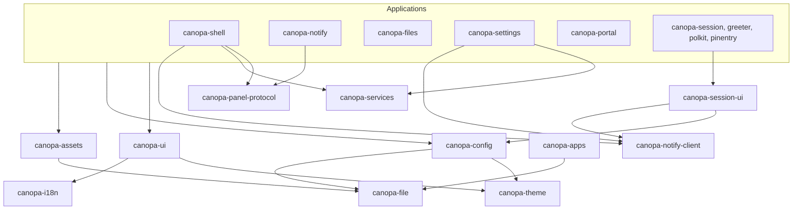

# Architecture overview

Canopa is a Wayland desktop environment built around a patched Niri compositor.
It is written in Rust, draws its windows with Iced (or with a small software
renderer for session surfaces), and talks to the usual freedesktop system
services instead of running its own daemons in front of them. Each part is an
independent process: the shell, the notification daemon, the file manager, the
portal backend, the session tools and the authentication dialogs start, crash and
restart separately.

This page maps the repository and the running session. The other architecture
documents go into each part:

| Document | Covers |
| --- | --- |
| [foundations.md](foundations.md) | Shared crates: configuration, appearance, Iced controls and window conventions, assets, MIME, i18n, accessibility, system-service clients |
| [panel-protocol.md](panel-protocol.md) | The Shell/provider panel protocol (`niribar-v1`, `canopa-v4`, `canopa-v5`) |
| [shell.md](shell.md) | Canopa Shell: bars, panels, launcher, taskbar, OSD, built-in providers |
| [notify.md](notify.md) | Canopa Notify: receipt, policy, history, banners, the Center, the Notification portal |
| [files.md](files.md) | Canopa Files: resident owner, operations, Undo, previews, FileManager1 |
| [portals.md](portals.md) | The portal backend and its dialog interfaces |
| [desktop-sharing.md](desktop-sharing.md) | ScreenCast, RemoteDesktop, Clipboard, InputCapture, GlobalShortcuts, Usb |
| [printing.md](printing.md) | The opt-in Print portal and its private CUPS runtime |
| [session.md](session.md) | Session start, wallpaper, lock, idle, greeter, polkit, pinentry |
| [settings.md](settings.md) | Canopa Settings |

Domain vocabulary lives in [../shell/CONTEXT.md](../shell/CONTEXT.md),
[../notify/CONTEXT.md](../notify/CONTEXT.md) and
[../files/CONTEXT.md](../files/CONTEXT.md). Build and test workflows are in
[../building.md](../building.md) and [../testing.md](../testing.md).

## Repository layout

| Path | Contents |
| --- | --- |
| `crates/` | Every workspace member (one Cargo workspace, root `Cargo.lock`, root `target/`) |
| `packaging/` | systemd units, D-Bus activation files, portal descriptors, Niri defaults, PAM, greetd, Arch recipe, `forks.json` |
| `scripts/` | Checks, builds, packaging, installation, desktop acceptance fixtures |
| `config/`, `examples/` | Starter `config.kdl` and example themes shipped with releases |
| `docs/` | User guides and these developer documents |
| `experiments/` | An archived prototype, excluded from the workspace |

## Component map

Every member of the root `Cargo.toml` workspace:

| Crate | Kind | Role |
| --- | --- | --- |
| [`canopa-shell`](../../crates/canopa-shell/) | application | Canopa Shell: layer-shell bars, panels, menus, launcher, taskbar, tray host, OSD, wallpaper selection, media selection; also the Wi-Fi, audio and media provider binaries |
| [`canopa-notify`](../../crates/canopa-notify/) | application | Canopa Notify: `org.freedesktop.Notifications`, policy, SQLite history, sound, banners, the Center provider and the Notification portal backend |
| [`canopa-files`](../../crates/canopa-files/) | application | Canopa Files: browser windows, file operations and Undo, Quick Look, Trash, devices, `org.freedesktop.FileManager1` |
| [`canopa-settings`](../../crates/canopa-settings/) | application | Canopa Settings (`org.canopa.Settings`) and session helpers such as `init-session` |
| [`canopa-portal`](../../crates/canopa-portal/) | application | `xdg-desktop-portal-canopa`, the portal backend |
| [`canopa-session`](../../crates/canopa-session/) | application | `canopa-wallpaper`, `canopa-lock` and `canopa-idle` |
| [`canopa-greeter`](../../crates/canopa-greeter/) | application | greetd login screen |
| [`canopa-polkit`](../../crates/canopa-polkit/) | application | polkit authentication agent |
| [`canopa-pinentry`](../../crates/canopa-pinentry/) | application | GnuPG pinentry, plus the dialog behind the GCR keyring prompter |
| [`canopa-cli`](../../crates/canopa-cli/) | application | The `canopa` command: `config check`, `config migrate`, and forwarding to the companion tools |
| [`canopa-config`](../../crates/canopa-config/) | library | Shared `config.kdl` discovery, envelope, appearance parsing, diagnostics, fingerprints |
| [`canopa-theme`](../../crates/canopa-theme/) | library | Toolkit-free appearance: palettes, typography, UI style resolution, contrast |
| [`canopa-ui`](../../crates/canopa-ui/) | library | Shared Iced styling, right-to-left helpers, icon handles, the AccessKit layer |
| [`canopa-i18n`](../../crates/canopa-i18n/) | library | Fluent translations, language negotiation, ICU4X formatting |
| [`canopa-assets`](../../crates/canopa-assets/) | library | Icon-theme lookup, bounded raster/SVG preparation, the freedesktop thumbnail cache |
| [`canopa-file`](../../crates/canopa-file/) | library | Bounded descriptor-checked reads, shared-mime-info detection, icon-theme selection, GTK bookmarks, private state files, path watching, upgrade-safe executable paths |
| [`canopa-apps`](../../crates/canopa-apps/) | library | Desktop-entry discovery and metadata, launch checks, MIME application associations |
| [`canopa-services`](../../crates/canopa-services/) | library | Clients for NetworkManager, BlueZ, audio, UPower, logind and other system services |
| [`canopa-panel-protocol`](../../crates/canopa-panel-protocol/) | library | Panel provider wire contracts |
| [`canopa-notify-client`](../../crates/canopa-notify-client/) | library | Bounded clients for Notify's control socket: summary, lock-screen feed, preferences |
| [`canopa-widgets`](../../crates/canopa-widgets/) | library | Passive widget data (battery, media, idle, script, weather) |
| [`canopa-launcher`](../../crates/canopa-launcher/) | library | Launcher preferences and extension discovery shared by Shell and Settings |
| [`canopa-session-ui`](../../crates/canopa-session-ui/) | library | Software-rendered session presentation for lock, greeter, polkit, pinentry and the wallpaper picker |

### Binaries

| Binary | Built by | Started by |
| --- | --- | --- |
| `canopa-shell` | canopa-shell | `canopa-shell.service` |
| `canopa-wifi-provider`, `canopa-audio-provider`, `canopa-media-provider` | canopa-shell (`src/bin/`) | The Shell, when a panel opens |
| `canopa-notify` | canopa-notify | `canopa-notify.service`, or D-Bus activation of the Notification portal name |
| `canopa-files` | canopa-files | The user, the Shell, or `org.freedesktop.FileManager1` activation when installed |
| `canopa-settings` | canopa-settings | The user, `org.canopa.Settings` activation, `canopa-session` (`init-session`), `canopa-display-profiles.service` |
| `xdg-desktop-portal-canopa` | canopa-portal | D-Bus activation from the portal frontend |
| `canopa-wallpaper`, `canopa-lock`, `canopa-idle` | canopa-session | `canopa-wallpaper.service`, `canopa-lock.service`, `canopa-idle.service` |
| `canopa-greeter` | canopa-greeter | greetd |
| `canopa-polkit` | canopa-polkit | `canopa-polkit.service` |
| `canopa-pinentry` | canopa-pinentry | gpg-agent (`pinentry-program`), or the keyring prompter |
| `canopa` | canopa-cli | The user |

Three programs are not Rust workspace binaries: `canopa-session`
([`scripts/canopa-session.py`](../../scripts/canopa-session.py), the session
launcher installed by the Arch package), `canopa-keyring-prompter`
([`packaging/keyring/`](../../packaging/keyring/), a C GCR SystemPrompter that
hands keyring prompts to `canopa-pinentry`), and `canopa-portal-config`
([`scripts/portal-config.py`](../../scripts/portal-config.py), shipped in the
release archive). The compositor and the portal frontend are built from forks;
see [Dependency forks](#dependency-forks).

### Library layering

Applications depend on libraries, never on each other, with one exception: the
portal links `canopa-files` for its FileChooser. The headless profiles keep GUI
crates out: `canopa-notify --no-default-features`, `canopa-panel-protocol` and the
Shell's providers (`canopa-shell --no-default-features`) build without Iced,
Wayland or AccessKit. `scripts/check-core-dependencies.sh`,
`scripts/check-provider-dependencies.sh` and `scripts/check-panel-protocol.sh`
enforce this.

## The running session

### Session start

The Arch package installs a dedicated session. A display manager (normally
greetd with `canopa-greeter`) runs `/usr/share/wayland-sessions/canopa.desktop`,
whose `Exec` is `/usr/bin/canopa-session`. That launcher:

1. Refuses to start if another compositor session is active.
2. Sets `CANOPA_SESSION=1`, `NIRI_CONFIG=$XDG_CONFIG_HOME/canopa/niri.kdl`,
   `XDG_CURRENT_DESKTOP=canopa:niri`, `XDG_SESSION_DESKTOP=canopa`,
   `XDG_SESSION_TYPE=wayland` and `CANOPA_SESSION_PID`.
3. Runs `canopa-settings init-session`, which creates any missing `niri.kdl`,
   its include files and `stasis.rune` under `~/.config/canopa/`.
4. Imports the environment into the systemd user manager, stops any running
   portal frontend and backend so they restart with it, and runs
   `systemctl --user --wait start canopa-compositor.service`.
5. On exit, starts `canopa-shutdown.target`, which conflicts with the session
   targets and stops every companion.

`canopa-compositor.service` runs `/usr/lib/canopa/niri --session` and wants
`canopa-session.target`. The system target
([`packaging/system/canopa-session.target`](../../packaging/system/canopa-session.target))
has `ConditionEnvironment=CANOPA_SESSION=1` and `BindsTo=canopa-compositor.service`,
so companions start only inside a Canopa session and nothing has to be enabled.

The portable layout (release archive, `~/.local/bin`) uses
[`packaging/wayland-sessions/canopa.desktop`](../../packaging/wayland-sessions/canopa.desktop),
which runs the distribution's `niri-session`. There the user enables the units
from [`packaging/systemd/`](../../packaging/systemd/), including that directory's
`canopa-session.target`, which is `WantedBy=graphical-session.target`.
`scripts/install-system.py` installs the same `.service` files for the Arch
package with `/usr/bin` paths, `niri.service` replaced by
`canopa-compositor.service`, and their `[Install]` sections removed.

### systemd user units

| Unit | Runs | Notes |
| --- | --- | --- |
| `canopa-compositor.service` | `/usr/lib/canopa/niri --session` | Arch session only; `Type=notify` |
| `canopa-session.target` | — | Wants the companions below |
| `canopa-shell.service` | `canopa-shell` | Restarts on failure |
| `canopa-notify.service` | `canopa-notify daemon --service --socket %t/canopa-notify/control.sock` | Also the activation unit for the Notification portal name |
| `canopa-wallpaper.service` | `canopa-wallpaper daemon` | |
| `canopa-lock.service` | `canopa-lock daemon` | Needs `/etc/pam.d/canopa-lock`; `KillMode=process` so an active lock survives a listener restart |
| `canopa-idle.service` | `canopa-idle run` | Binds to `canopa-lock.service`; needs `~/.config/canopa/stasis.rune` (and, on Arch, `/usr/bin/stasis`) |
| `canopa-polkit.service` | `canopa-polkit` | `Type=notify` |
| `canopa-display-profiles.service` | `canopa-settings watch-display-profiles` | Arch session only; follows display profiles and the lid-close choice |
| `xdg-desktop-portal-canopa.service` | `xdg-desktop-portal-canopa` | `Type=dbus`, started on demand; `ExecReload` sends SIGHUP |

### D-Bus names

Session-bus names Canopa processes own:

| Name | Owner | Purpose |
| --- | --- | --- |
| `org.freedesktop.Notifications` | canopa-notify | Notification server |
| `org.freedesktop.impl.portal.desktop.canopa.notify` | canopa-notify | Notification portal backend |
| `org.freedesktop.impl.portal.desktop.canopa` | xdg-desktop-portal-canopa | All other portal backend interfaces, at `/org/freedesktop/portal/desktop` |
| `org.canopa.Shell.Wallpaper` | canopa-shell | Durable wallpaper selection (`org.canopa.Shell.Wallpaper1`) |
| `org.canopa.Shell.Media` | canopa-shell | The selected MPRIS player, read by media keys and the lock screen |
| `org.kde.StatusNotifierWatcher` | canopa-shell | Tray host, while a tray module is placed |
| `org.canopa.Settings` | canopa-settings | Single Settings window: `Activate`, `OpenPage` |
| `org.freedesktop.FileManager1` | canopa-files | File manager interface (activation file installed opt-in on Arch) |

Canopa's compositor fork adds `org.canopa.Niri.WindowPreview1` (taskbar
thumbnails), `org.canopa.Niri.RemoteInput1`, `org.canopa.Niri.InputCapture1` and
`org.canopa.Niri.GlobalShortcuts1` (desktop sharing). The portal also uses Niri's
`org.gnome.Mutter.ScreenCast` implementation.

### Local sockets

| Path | Owner | Clients |
| --- | --- | --- |
| `$XDG_RUNTIME_DIR/canopa-shell.sock` | canopa-shell | `canopa-shell reload`, `--toggle-menu`, `--dmenu`, device keys |
| `$XDG_RUNTIME_DIR/canopa-notify/control.sock` | canopa-notify | `canopa-notify ctl`, the Center provider, the Shell's summary, the lock screen, Settings |
| `$XDG_RUNTIME_DIR/canopa-files-<key>.sock` | canopa-files | Later `canopa-files` launches, which hand their request to the resident owner; the key comes from the state directory |
| `$XDG_RUNTIME_DIR/canopa-wallpaper-<key>.sock` | canopa-wallpaper | `canopa-wallpaper` control commands; the key comes from `WAYLAND_DISPLAY` |
| `$XDG_RUNTIME_DIR/canopa-lock-control-<key>.sock` | canopa-lock | `canopa-lock` control commands; the key comes from `WAYLAND_DISPLAY` |

All of them require `XDG_RUNTIME_DIR`; none falls back to a shared temporary
directory. Files and the session tools also refuse a runtime directory that is not
owner-only.

### Shell, providers and Notify

The Shell draws everything in a panel, but domain logic for rich panels lives in
separate **provider** processes that the Shell starts when a panel opens and
closes when it closes. They speak the panel protocol over stdin/stdout; see
[panel-protocol.md](panel-protocol.md). Built-in providers are
`canopa-wifi-provider`, `canopa-audio-provider`, `canopa-media-provider`,
`canopa-shell --hardware-panel bluetooth|power`, and
`canopa-notify panel-provider` for the Notification Center. The Shell looks for
each beside its own executable first, then on `PATH`.

The Shell's notification module never reads notification history. It subscribes
to Notify's bounded summary (`summary-subscribe-v1` on the control socket:
attention count, Do Not Disturb, suppression) through `canopa-notify-client`, and
opens the Center provider for content. Notify keeps delivering banners while the
Shell is stopped, and the Shell reconnects when Notify restarts.

### Portals

Applications talk to the public `org.freedesktop.portal.Desktop` frontend, which
routes each interface to a backend. In the Arch session the frontend is Canopa's
fork of xdg-desktop-portal, installed at `/usr/lib/canopa/xdg-desktop-portal`. A
systemd drop-in points `xdg-desktop-portal.service` at
`/usr/lib/canopa/portal-frontend`, a wrapper that runs the fork only when
`CANOPA_SESSION=1` and `XDG_SESSION_DESKTOP=canopa`, and the distribution's
frontend otherwise. The fork adds ordered RemoteDesktop input, session-owner
lifetime, the InputCapture phase and USB grant ownership.

Routing comes from `canopa-portals.conf` (`default=canopa;gtk;`, Notification to
`canopa-notify`, Secret to gnome-keyring or oo7). The `.portal` descriptors in
[`packaging/portal/`](../../packaging/portal/) decide what each backend advertises;
the backend serves more interfaces on the bus than the base descriptor lists.
Details are in [portals.md](portals.md) and
[desktop-sharing.md](desktop-sharing.md).

### Compositor

The session runs Canopa's Niri fork from `/usr/lib/canopa/niri`; the
distribution's `/usr/bin/niri` and its own session are left alone. Shipped
defaults are [`packaging/niri/defaults.kdl`](../../packaging/niri/defaults.kdl)
(installed as `/usr/share/canopa/niri-defaults.kdl` and included by the user's
`niri.kdl`). Canopa relies on fork features: drag-source lifetime, screencast,
remote input, input capture, shortcut leases, layout and window-parent IPC,
spawn placement (`SpawnPlaced`, used by window session restore), typed text in
the overview (`overview { emit-typed-text }`, which opens the launcher), touch
gestures, window previews and pinned columns. The Shell, Settings and Notify use
the fork's `niri-ipc` crate, pinned to the same commit as the compositor.

### Configuration and state

One user file, `$XDG_CONFIG_HOME/canopa/config.kdl`, holds `appearance` and one
namespace per component; each component validates and reloads its own namespace.
See [foundations.md](foundations.md#configuration) and
[../configuration.md](../configuration.md). Niri reads `~/.config/canopa/niri.kdl`,
which Settings maintains through generated include files. Application state lives
under `$XDG_STATE_HOME/canopa/` (Shell pins, wallpaper store, portal databases) or
in each application's own store (Notify's SQLite history, Files' journal).

## Dependency forks

Patched upstream projects live in GitHub forks under `kevinard/`, each with a
`canopa/main` branch that merges one topic branch per change. Nothing is vendored
in this repository.

- **Rust crates** are patched in the root `Cargo.toml` `[patch.crates-io]`
  section by git `rev`: winit, the iced crates, iced_layershell and layershellev
  (exwlshelleventloop), reis, uucore (coreutils) and niri-ipc. They carry Wayland
  transient parents, foreign-parent dialogs, input-bound focus and activation
  tokens, data-device drag and drop, keyboard-shortcut inhibition and recording,
  the input batch boundary, layer-shell output snapshots, activation tokens, idle
  inhibition and retired-window cleanup, an EIS read fix for desktop sharing, and
  copy progress for Files.
- **Separately built programs** are pinned by fork commit and archive SHA-256 in
  [`packaging/forks.json`](../../packaging/forks.json): the Niri compositor (with
  a Smithay fork), the xdg-desktop-portal frontend, and an optional private CUPS
  client used by the Print portal.

How to change a fork, rebuild and re-pin is in
[../vendor-maintenance.md](../vendor-maintenance.md).

## Design decisions

Earlier decision records were consolidated into the architecture documents; the
originals are in the git history at commit `cb300936` under `docs/adr/`.

- **One workspace, forks outside it.** The root manifest owns dependency
  versions, release settings and crate patches; applications inherit them and add
  features. Forks are GitHub repositories with one reviewable topic per change,
  so provenance is the fork's history, and crates from one repository are always
  taken from the same commit to avoid duplicate incompatible types.
- **Separate processes, separate lifetimes.** Shell, Notify, Files, the portal
  and the session tools share libraries, not processes or stores. Each can be
  restarted on its own, and shared crates carry no notification policy, file
  operation policy or shell actions. This is why the Shell sees only Notify's
  bounded summary and renders the Center as a generic provider.
- **System services own state and policy.** Canopa presents NetworkManager,
  BlueZ, logind, UPower, polkit, PAM, greetd and GnuPG; it does not put a daemon
  of its own between them and the desktop.
- **Release builds unwind on panic.** Files, Notify and the portal contain worker
  panics with `catch_unwind` and report a failed job instead of losing the
  process; `panic = "abort"` would disable that recovery only in shipped builds.
- **Renames keep wire literals.** The shell was previously called Niribar.
  Protocol and compatibility literals keep their old values: the `niribar-v1`
  protocol and its frame magic, the `NIRIBAR_*` environment fallbacks, and
  `~/.config/niribar/config.kdl` as a legacy source when `canopa/config.kdl` is
  absent. Nothing moves or rewrites a user's configuration automatically.
- **Few integration-test executables.** Packages disable automatic test
  discovery and declare one `integration` target that includes each case as a
  module, so a library change relinks a handful of executables rather than one per
  test file. Files keeps a few extra targets for its copy and device harnesses.
  See [../testing.md](../testing.md).

## Known limitations

- The release archive installs `org.freedesktop.FileManager1.service` into
  `share/dbus-1/services/` directly; the Arch package installs it opt-in.
- `canopa-session` (the launcher script) and the `canopa-session` crate (wallpaper,
  lock, idle) share a name but are unrelated.
