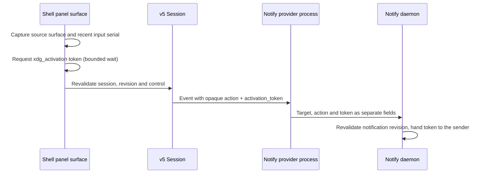

# Panel protocol

Canopa Shell draws every panel, but the domain logic of a rich panel (Wi-Fi,
Sound, Media, Bluetooth, Power, the Notification Center, or a third-party panel)
lives in a separate **provider** process. The Shell starts the provider when the
panel opens, exchanges JSON messages with it over stdin and stdout, and stops it
when the panel closes. The wire contracts live in
[`canopa-panel-protocol`](../../crates/canopa-panel-protocol/), a crate with no
toolkit, Shell or Notify dependency.

This page describes the contracts and how host and providers divide the work.
For writing a provider and declaring it in `config.kdl`, see
[../shell/external-panel-providers.md](../shell/external-panel-providers.md).

Earlier decision records were consolidated into this document; the originals are
in the git history at commit `cb300936` under `docs/adr/`.

## Ownership

| Host (Canopa Shell) | Provider |
| --- | --- |
| Panel window, placement, size, styling, scrolling | Domain state and backend connections (NetworkManager, Pulse, MPRIS, BlueZ, Notify) |
| Rendering of every control, keyboard focus and selection | Which controls exist, their labels and values |
| List search text, image and icon decoding | Domain validation of each interaction |
| Accessibility tree and native input | Ordering of accepted operations, credential handling |
| Process start, bounded cleanup, stale-event rejection | When an interaction revision changes |

Content is declarative. A provider cannot ship toolkit widgets, executable
commands, menus or tooltips, and the host never interprets a provider's opaque
action values.

## Contracts

| | `niribar-v1` | `canopa-v4` | `canopa-v5` |
| --- | --- | --- | --- |
| Module | `v1` | `v4` (also re-exported at the crate root) | `v5` |
| Start | Host sends a handshake (session ID, provider name, bar/output origin); provider answers with its first document | Provider sends first | Provider sends first |
| Framing | Magic `NIRIBAR_EXTERNAL_PANEL_JSON_V1\n`, big-endian `u64` length, JSON | One JSON line | One JSON line |
| Size limit | 1 MiB payload | 1 MiB including the newline | 1 MiB per response, 64 KiB per host message, including the newline |
| Content | Form elements: text, button, selectable list (optional custom value), text input (optional secret, error), status | Rich content: sections, controls, items, metadata, styled and rich text, links, local images, actions | `Form` (v1 elements) or `Rich` (v4 content) |
| Input | Typed element events | `Invoke` with an opaque target, action key and value | v1 or v4 events, wrapped with the captured revision |
| Revisions | None | None | Explicit, nonzero, never decreasing |
| Close | Typed `close` event | Host closes stdin | Explicit `close` message (or stdin EOF) |
| Used by | Configured providers that omit `protocol`; `canopa-wifi-provider` without arguments | `canopa-notify panel-provider` without `--protocol` | Every built-in provider |

The v1 and v4 wires are frozen: field names, limits and semantics do not change.
v5 reuses their content types (`v5::FormContent` is `v1::ExternalPanelDocument`,
`v5::RichContent` is `v4::PanelContent`) instead of defining a third schema.
Additions to the shared rich types are optional fields that are omitted at their
default, so v4 and v5 bytes for existing content are unchanged (see
[Compatibility](#compatibility)).

## Selecting a protocol

A provider is named. The Shell resolves a name in this order:

1. A `panel-providers { provider "NAME" { command …; protocol "…" } }`
   declaration. Its command and protocol replace the built-in together. Omitting
   `protocol` means `niribar-v1`; an unknown value is a configuration error.
2. A built-in name, which always uses `canopa-v5`:

   | Name | Command |
   | --- | --- |
   | `wifi` | `canopa-wifi-provider --protocol canopa-v5` |
   | `audio` | `canopa-audio-provider --protocol canopa-v5` |
   | `media` | `canopa-media-provider --protocol canopa-v5` |
   | `bluetooth`, `power` | `canopa-shell --hardware-panel bluetooth` or `power` |
   | `notifications` | `canopa-notify panel-provider --protocol canopa-v5` |

   Built-in binaries are looked up beside the running `canopa-shell` first, then
   on `PATH`.

There is no protocol detection. A host never guesses from the first bytes, and
no configuration is rewritten to a newer protocol.

## v5 messages

A provider writes `Response` lines:

```json
{"protocol_version":5,"revision":3,"content":{"kind":"rich","body":{"title":"Sound","sections":[],"actions":[],"error":null}}}
```

The host writes `HostMessage` lines:

```json
{"type":"event","protocol_version":5,"revision":3,"interaction":{"kind":"rich","event":{"type":"invoke","target":{"target":"item","id":"output"},"action_key":"volume","value":"40"}}}
{"type":"close","protocol_version":5}
```

`activation_token` is an optional string on `event` (at most 4,096 bytes,
nonempty, no NUL) that the host adds only for actions that asked for one.

Validation, applied by both sides before a message is used:

- the version is exactly 5 and the revision is nonzero;
- `Form` content has at most 4,096 elements and at most 8,192 elements plus list
  entries; `Rich` content passes `PanelContent::validate` (unique section and item
  IDs, nonempty keys and labels, unique action key/value pairs per scope, valid
  icons, links and sliders; at most 1,024 sections, 4,096 items and 8,192
  interactive controls);
- every interaction the content advertises must itself fit in a 64 KiB host
  message, computed with the longest possible revision, JSON escaping and, for
  opted-in actions, the maximum activation token. Content that fits in 1 MiB but
  advertises an unsendable control is rejected before it is installed.

Readers distinguish clean EOF from a truncated frame and read at most one byte
beyond the limit. Encoders refuse oversized output instead of building it.

### Interaction revisions

`v5::Session` holds the one current contract and is shared by both sides:

- A provider calls `Session::replace(content, Update::Replace)` for a new view
  or operation; the revision advances. `Update::PreserveFormEdits` keeps the
  revision only when the new form is identical apart from text-input values and
  input errors; any other change (status text, IDs, labels, secret flags, order,
  buttons, list entries) advances it. Rich replacements always advance it.
- The host calls `Session::observe(response)` and rejects a decreasing revision or
  an incompatible reuse.
- A provider calls `Session::accepts(message)` and drops events with a stale
  revision, a wrong control kind, a disabled or unknown list entry, a disallowed
  custom value, an unpublished rich action, a slider value off its grid, or an
  activation token on an action that did not ask for one.

The provider owns when meaning changes. This is what makes buffered password
entry safe: input echoes share the prompt's revision, while starting a connection
or returning a failed attempt retires it, so a late submit cannot apply to a
different operation.

The host adds its own guards on top. Form control IDs are rewritten to include
the panel session ID and the wire revision, and rich controls carry a
host-generated snapshot generation, so a late event from a replaced or closed
panel is never sent. Domain guards stay with providers: Notify keeps its
daemon-instance, notification-revision and per-view page checks.

## Rich content

| Type | Fields |
| --- | --- |
| `PanelContent` | `title`, `sections`, content-level `actions`, optional `error` |
| `PanelSection` | `id`, `title`, optional `icon`, `items`, `controls` |
| `PanelItem` | `id`, `title`, optional `attribution`, `body`, `styled_body`, `rich_body`, `metadata`, `actions`, optional `slider` |
| `PanelAction` | `key`, `label`, optional `value`, optional `request_activation_token`, `destructive`, `pressed`, `secondary`, `primary`, `symbol` |
| `PanelControl` | `key`, `label`, current `value`, `options` (value/label pairs) |
| `PanelSlider` | `key`, `label`, `min`, `max`, `step`, `value` (all `u16`), `unit` |
| `PanelAttribution` | nonempty `label`, optional `icon` |
| `PanelIcon` | `local_path` (absolute) or `theme` (one or two names, theme name, scale 1–8) |
| `RichBodySegment` | `text`, `link` (URI for assistive technology plus an opaque action), `image` (absolute local path, optional alt text) |
| `PanelMetadata` | `key`, `label`, `value` (empty value: a presence marker) |

All rich input is one event: `Invoke { target, action_key, value }`, where the
target is `content`, `section { id }` (a control; `value` is the chosen option)
or `item { id }` (an action, a body link, or the slider). A slider commit carries
the slider's key and the canonical decimal value (`"40"`, never `"040"`).

Presentation hints are optional and ignored by older hosts: `destructive` marks
an action that removes something, `pressed` marks a toggle's state, `secondary`
marks a view or settings action the host may set apart from the others, `primary`
marks an item's main action the host may fill, `symbol` names a symbolic icon
(`preferences-system-symbolic`) a host may draw for the action instead of its
label, which stays the tooltip and accessible name, item
`attribution` names the source of a card (the Center uses it for the sending
application), and a section `icon` sits beside its title. The host owns how they
look; see the provider reference for the current rendering.

## Activation context

Some actions need to start or raise another application with compositor
permission: the Center's notification actions are the main case. Notify cannot
get a valid activation token on its own, because the click happened on the
Shell's surface. So an action opts in with `request_activation_token: true`, and
the Shell attaches a token to that one event:



The token is requested through the Shell's existing layer-shell connection with
the input serial of the click (input at most two seconds old, reply within one
second, at most 64 pending requests). If the protocol is missing or the request
fails or expires, the same event is sent without a token. A token is never reused
for another click, and the provider's action value is never modified. Only an
action in the currently advertised content can receive one; `Session::accepts`
rejects a token on any other event.

## Process lifecycle

The Shell runs the provider's configured argv (or `sh -c` for a shell-form
command when `command-policy { allow-shell }` permits it) in its own process
group, keeps the last 4 KiB of its stderr for diagnostics, and validates every
frame before display. On close it sends the protocol's close, then cleans up the
process group after a grace period: 250 ms by default, three seconds for
Bluetooth, and 35 seconds for Wi-Fi, which may need to finish and undo a
connection-creation call. The panel itself closes immediately.

The built-in headless providers share a small transport
([`provider_io.rs`](../../crates/canopa-shell/src/provider_io.rs)): one reader
task with a bounded input queue, which survives cancellation of a waiting
consumer and stops reading at `close`, and a two-second write-and-flush deadline,
so a host that stops reading ends publication instead of holding a backend
operation or credential session. Each provider owns its ordering: Wi-Fi keeps
edits and submissions in order, Sound coalesces only adjacent absolute-volume
edits for the same device, and Media keeps a pending refresh.

Notify's provider process (`canopa-notify panel-provider`) connects to the
daemon's control socket and converts the daemon's private v4 stream to v5 when
asked; v5 close or stdin EOF closes only that view. An open Center ends when the
daemon goes away and has to be reopened.

## Crate API

- `v1`: wire types, `encode_frame`, `decode_frame`; with the `tokio` feature,
  `perform_handshake`, `write_frame`, `read_frame`.
- `v4`: `PanelContent` and friends, `ProviderResponse`, `InteractionEvent`,
  `Frame::read` (and `read_async`), which validates a frame and keeps its original
  bytes for forwarding without re-encoding.
- `v5`: `Response`, `HostMessage`, `Content`, `Interaction`, `Session`, `Update`,
  with `encode`, `decode`, `read` and (feature `tokio`) `read_async`.
- `ProtocolError` distinguishes oversized, truncated, missing-magic, invalid JSON,
  I/O, incompatible-version, invalid-content and unexpected-message outcomes.

The default dependency graph is Serde and serde_json only. The `tokio` feature adds
async read and write traits, not a runtime. Callers own deadlines, backpressure,
cancellation and process management. Stream reads are not cancellation-safe once
they have consumed part of a frame: keep the read future alive across unrelated
updates rather than restarting it.

## Compatibility

- New optional fields serialize only when set: `attribution`, section `icon`,
  `slider`, `request_activation_token`, `destructive`, `pressed`, `secondary`,
  `primary` and `symbol`. Existing
  content produces the same bytes, and readers that do not know a field ignore it
  (v4 types do not deny unknown fields).
- Older hosts send token-free events, and providers accept an absent token.
  Providers that do not opt in never receive the field, so strict older v5
  decoders keep working.
- A slider or other new control needs host and provider updated together to be
  shown; an older host simply omits it.
- `tests/wire_compatibility.rs` and `tests/v5_sessions.rs` pin these behaviors
  with old-shaped fixtures in both directions.
- `scripts/check-panel-protocol.sh` checks that Shell and Notify use this one
  crate and that its default graph has no application, runtime or desktop
  dependency.

## Design decisions

**One toolkit-free crate for every wire.** Providers must be buildable without
the Shell, Iced, Wayland or a runtime, and Shell and Notify must validate frames
identically. Keeping wire types, validation and bounded codecs in one crate,
with Tokio I/O behind a feature, gives both. The cost is that callers own all
execution policy: deadlines, queues and cleanup.

**Explicit protocol selection, old contracts kept.** Existing providers keep
working unchanged, and a host never guesses. Built-ins pass `--protocol
canopa-v5` explicitly, and the binaries keep their old defaults for old
declarations. A user declaration overrides command and protocol together, so a
custom command can never be paired with an unexpected protocol.

**One successor that reuses the old primitives.** v5 has two content modes (form
and rich) over one envelope, framing, revision and close lifecycle, reusing the
v1 and v4 types instead of a new schema. Mixing form fields into rich sections
is not supported until a real provider needs it.

**Revisions that track meaning, owned by the provider.** A per-message counter
would break buffered password edits; no counter would let late events act on a
new operation. The provider decides when the meaning of the interaction changed,
and the shared `Session` enforces the rest identically on both sides.

**Reject unsendable content up front.** Checking every advertised interaction
against the host-message limit when content arrives means a click can never
produce an event that cannot be sent. An oversized edit keeps the last sendable
value and shows an error; values, including credentials, are never truncated.

**Additive presentation fields.** Source attribution, section icons, sliders and
action hints are generic presentation data. They carry no notification policy:
Notify decides what the attribution says and what an action does.

**Sliders commit once.** A slider is one control with an opaque key and an
integer grid. Dragging and held keys preview in host widget state and commit the
final value once on release, so a provider sees one command per gesture. A
content replacement cancels an unfinished gesture rather than applying it to the
new contract.

**Activation context is opt-in and host-captured.** Only the Shell holds the input
that authorizes activation, and only the provider knows which actions need it.
An opt-in flag on the action plus a separate envelope field keeps the opaque
action value untouched and leaves v4 unchanged.

**Providers are processes.** Separate processes isolate crashes and keep service
permissions (network secrets, audio, Bluetooth pairing) out of the bar, and the
headless build (`canopa-shell --no-default-features`) keeps them free of host
rendering.

## Known limitations

- Form and rich content cannot be mixed in one v5 response.
- v1 has no revisions; stale events are guarded only by the host's session checks.
- Rich content accepts only local images and icons; there is no network fetching.
