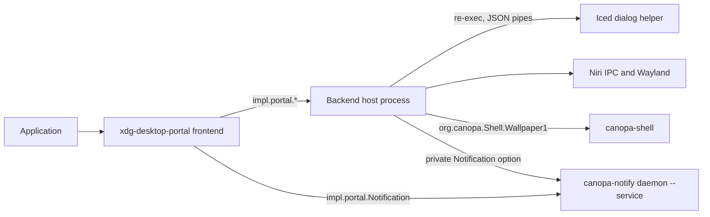

# Portal backend architecture

This document covers the dialog portals of `xdg-desktop-portal-canopa`
(crate [`crates/canopa-portal`](../../crates/canopa-portal/)) and the
Notification portal adapter in Canopa Notify. The desktop sharing interfaces
(ScreenCast, RemoteDesktop, Clipboard, InputCapture, GlobalShortcuts, Usb) are
in [desktop-sharing.md](desktop-sharing.md) and Print is in
[printing.md](printing.md). The user and packaging guide is
[../portals.md](../portals.md).

Earlier decision records were consolidated into this document; the originals
are in the git history at commit cb300936 under docs/adr/.

## Overview

The public frontend owns application identity, the permission store, document
export into sandboxes and the public interface versions. Canopa implements only
the `org.freedesktop.impl.portal.*` backend side. It copies no GNOME or GTK
backend code.

| Piece | Location |
| --- | --- |
| Bus name, object path, Settings | [`src/lib.rs`](../../crates/canopa-portal/src/lib.rs) |
| Process startup, interface registration, signals | [`src/main.rs`](../../crates/canopa-portal/src/main.rs) |
| Request admission and lifetime | [`src/requests.rs`](../../crates/canopa-portal/src/requests.rs) |
| Helper process transport | [`src/process.rs`](../../crates/canopa-portal/src/process.rs), [`src/process/fd.rs`](../../crates/canopa-portal/src/process/fd.rs) |
| Off-UI-thread preparation | [`src/worker.rs`](../../crates/canopa-portal/src/worker.rs), [`src/icons.rs`](../../crates/canopa-portal/src/icons.rs) |
| Choices shared by FileChooser and Access | [`src/choices.rs`](../../crates/canopa-portal/src/choices.rs) |
| AT-SPI bridge for dialogs | [`src/accessibility_ui.rs`](../../crates/canopa-portal/src/accessibility_ui.rs) |
| Translations | [`i18n/`](../../crates/canopa-portal/i18n/), [`src/i18n.rs`](../../crates/canopa-portal/src/i18n.rs) |
| Packaging | [`packaging/portal/`](../../packaging/portal/), [`packaging/system/`](../../packaging/system/) |

Each portal has a D-Bus module (`src/<portal>.rs`, plus a directory for its
internals) and, when it has a dialog, a `src/<portal>_ui.rs` Iced module. The
`desktop` Cargo feature (default) enables the Iced helpers, Wayland capture,
PipeWire and image decoding. `--no-default-features` builds a headless core for
protocol tests and Settings; it must not be installed as an interactive
backend.

## Backend process

`xdg-desktop-portal-canopa` is one session-bus process with a Tokio runtime and
no display connection of its own.

- At startup it loads the shared appearance (`canopa_config::SharedConfiguration`),
  opens the Lockdown policy, starts the Background observer and builds every
  interface. It then serves them all at `/org/freedesktop/portal/desktop` and
  requests `org.freedesktop.impl.portal.desktop.canopa` without replacement in
  either direction: it fails rather than replace an existing owner. Signal
  handlers are installed before the name is acquired, so a reload cannot be
  lost at activation.
- Invalid configuration or an invalid Lockdown source prevents startup.
- It serves Settings, FileChooser, AppChooser, Access, Account, Background,
  DynamicLauncher, Lockdown, Wallpaper, Screenshot and the desktop sharing
  interfaces unconditionally. Print and `org.canopa.Portal.PrintJobs` are added
  only with `--experimental-print`. What the frontend routes is decided by the
  `.portal` descriptor, not by what the process serves.
- SIGHUP prepares a new appearance and reloads Lockdown independently. A valid
  appearance is installed into the Settings object and emits `SettingChanged`
  for changed keys only. Failures are logged and the old state kept.
- It stops on session-bus loss, SIGTERM, SIGINT, or when the Lockdown signal
  relay ends. Shutdown stops the screenshot and device observers, the sharing
  sessions, the observer and Lockdown worker, and withdraws outstanding
  Background questions before closing the connection.

The packaged user unit is `Type=dbus` with `ExecReload=kill -HUP` and no
`[Install]` section; D-Bus activation starts it.

## Request lifetime

All interactive interfaces go through one `Requests` owner
([`requests.rs`](../../crates/canopa-portal/src/requests.rs)):

1. **Admission.** A shared semaphore allows 16 interactive requests in total.
   The seventeenth fails immediately with `LimitsExceeded`; nothing queues.
2. **Validation.** The handle must be under
   `/org/freedesktop/portal/desktop/request/`. Background alone may also use the
   frontend monitor's `/org/freedesktop/portal/desktop/notify/backgroundN`.
3. **Ownership.** The backend subscribes to `NameOwnerChanged` for the caller,
   then checks the caller still exists, then exports an
   `org.freedesktop.impl.portal.Request` object at the handle. Subscribing first
   means a disconnect during setup cannot strand a dialog. A duplicate handle is
   rejected. Only the originating unique name may call `Close`.
4. **Interaction.** The portal's future races against `Close` and caller loss.
   Either one cancels it; the helper is killed when its future is dropped.
5. **Retirement.** The Request object is removed and the response returned as
   0 (success), 1 (cancelled) or 2 (failure). Awaiting a dialog never holds the
   object-server lock, so Settings and other calls stay responsive.

Blocking preparation (decoding, filesystem, SQLite, capture) runs on workers
that keep their own resource permits until the blocking work actually returns,
even after the request is cancelled. Limits are therefore logical bounds on
concurrent work, not hard memory or I/O deadlines.

## Dialog helpers

Every dialog runs in a child process: the backend re-executes its own binary
(`canopa_file::executable::current()`) with a hidden mode flag such as
`--file-chooser`, `--app-chooser`, `--access-dialog`, `--account-dialog`,
`--background-dialog`, `--dynamic-launcher-dialog`, `--wallpaper-dialog`,
`--screenshot-dialog` or `--screenshot-window-picker`. The backend passes its
own `--canopa-config` or `--defaults` selection so the helper loads the same
appearance. Each helper keeps the appearance it opened with.

- **Transport.** The request goes to the helper's stdin as JSON; the result
  comes back on stdout. Messages are limited to 1 MiB. AppChooser uses
  newline-delimited JSON frames for live choice updates. Up to 16 extra
  descriptors (sealed memfds for screenshots) can be inherited; CLOEXEC is
  cleared only in the child, between fork and exec.
- **Lifetime.** Helpers have `kill_on_drop`, request `PR_SET_PDEATHSIG` with
  SIGKILL and check their parent before exec, so a backend crash cannot leave
  an orphaned dialog. The backend validates every helper result again; a
  malformed result is a failure, never a grant.
- **Activation.** The child environment drops ambient `XDG_ACTIVATION_TOKEN`
  and `DESKTOP_STARTUP_ID`. A request-specific token, when there is one, is set
  explicitly and applied when the window is created.
- **Windows.** Iced runs on the helper's main thread with Wayland app ID
  `org.canopa.Portal`. A `wayland:HANDLE` parent is
  passed to `iced::window::open_dialog`, provided by the `kevinard/iced` and
  `kevinard/winit` forks pinned in the root `Cargo.toml`. It imports the handle
  through xdg-foreign-v2 and sets the xdg-dialog-v1 modal hint before the first
  commit, and keeps the relationship until the window is destroyed. A missing
  or expired handle, or a missing protocol, gives an ordinary independent
  window. Other parent types (X11) are ignored.
- **Accessibility.** FileChooser, AppChooser, Access, Background,
  DynamicLauncher and Wallpaper dialogs publish an AT-SPI tree through the
  `canopa-ui` bridge. Nothing is collected while no assistive technology
  listens.
- **Safety defaults.** No dialog accepts on open or on an unhandled initial
  Enter. Escape, window close, `Request.Close` and caller loss always take the
  non-accepting path.

## Shared code with other crates

| Crate | Used for |
| --- | --- |
| `canopa-files` (`default-features = false`) | `browse::Browser`/`Directory` model, personal folders and cancellation for the file chooser. Files' operation engine, resident host and GIO runtime are not linked or started. See [files.md](files.md). |
| `canopa-apps` | Desktop-entry catalog shared with Shell's launcher, used by AppChooser and for app names in dialogs |
| `canopa-assets` | Bounded PNG/JPEG/GIF/WebP/SVG decoding for icons, avatars, wallpapers |
| `canopa-file` | Bounded regular-file reads and the current executable path |
| `canopa-config`, `canopa-theme`, `canopa-ui` | Shared appearance, Iced theme, controls, AT-SPI bridge |

## Settings

`Settings` in [`lib.rs`](../../crates/canopa-portal/src/lib.rs) implements
backend version 1: `Read`, `ReadAll` (empty filter, exact name, `*` and
trailing `.*` patterns) and `SettingChanged`. It publishes `color-scheme`,
`accent-color`, `contrast` and `reduced-motion` in `org.freedesktop.appearance`,
computed from the effective appearance. Unknown keys return
`org.freedesktop.portal.Error.NotFound`. The frontend adds public version 2 and
`ReadOne`.

Discovery follows `canopa-config`: the common `config.kdl` or the shared
defaults, never a legacy application file, repeated on each reload. An explicit
`--canopa-config` path stays selected; a missing file is a rejected reload.

## FileChooser

[`file_chooser.rs`](../../crates/canopa-portal/src/file_chooser.rs) parses
OpenFile, SaveFile and SaveFiles options, keeping paths as NUL-terminated byte
arrays and producing percent-encoded `file://` URIs from the original bytes.
[`chooser_ui.rs`](../../crates/canopa-portal/src/chooser_ui.rs) is the Iced
picker; its `Picker` state and view are also embedded in the Account dialog.
[`chooser_ui/filters.rs`](../../crates/canopa-portal/src/chooser_ui/filters.rs)
applies glob and shared-mime-info filename rules.
[`chooser_ui/folders.rs`](../../crates/canopa-portal/src/chooser_ui/folders.rs)
creates folders. Accepting never creates or truncates a file; existing
non-regular destinations are refused.

New folder opens the parent once on the filesystem worker and keeps the
descriptor. At creation it rechecks the parent's identity and calls `mkdirat`
for one validated name, refusing any existing entry. Revision checks drop late
results from earlier operations.

Folder memory is [`file_chooser/history.rs`](../../crates/canopa-portal/src/file_chooser/history.rs):
a SQLite database at `$XDG_STATE_HOME/canopa/portal-file-chooser.db`, opened
per operation, owned regular single-link file, mode 0600, at most 2 MiB and 128
applications. One operation runs at a time without queuing, and the request
waits for it at most 200 ms. Only accepted results update it: the selected
folder, or the common parent of the selected files. Anonymous callers are never
stored. Failures fall back to ordinary defaults.

## AppChooser

[`app_chooser.rs`](../../crates/canopa-portal/src/app_chooser.rs) keeps the
active choice list authoritative in the backend and serializes
`UpdateChoices` with result validation. Updates reach the helper over the framed
pipe; a choice that disappears invalidates a pending acceptance.

The helper uses the incoming activation token when it creates its window. On
acceptance it asks the window adapter for a new `xdg-activation` token bound to
recent input on the focused chooser surface. It waits up to one second, ignores
late replies and finishes without a token when the protocol or eligible input is
missing. The incoming token is never returned in place of a fresh one.

## Access

[`access.rs`](../../crates/canopa-portal/src/access.rs) validates options and
choices through [`choices.rs`](../../crates/canopa-portal/src/choices.rs) and
returns only explicit grants. Icons are prepared off the UI thread with the
shared bounded loader. Text is rendered as plain text.

## Account

[`account.rs`](../../crates/canopa-portal/src/account.rs) runs the dialog;
[`account_profile.rs`](../../crates/canopa-portal/src/account_profile.rs) reads
the current UID's AccountsService properties (two-second timeout) with NSS and
`~/.face` fallbacks, and prepares the avatar: sources up to 8 MiB (SVG 256 KiB),
orientation applied, metadata and external references removed, 256 px PNG. The
dialog owns an editable sharing draft. Generations reject stale picker and
decoder completions.

Only Share publishes. [`account_profile/cache.rs`](../../crates/canopa-portal/src/account_profile/cache.rs)
writes the reviewed PNG under `$XDG_CACHE_HOME/canopa/portal/account/` with
content-addressed names, a process lock, ownership and permission checks and
no-clobber writes. It keeps at most 64 images and 16 MiB and protects entries
for 60 seconds before evicting.

## Background

Three parts in [`background/`](../../crates/canopa-portal/src/background/):

- **Observer** ([`observer.rs`](../../crates/canopa-portal/src/background/observer.rs)).
  Reads the Niri event stream from `NIRI_SOCKET`: waits for the complete
  initial window snapshot, then follows window and focus events. Lines are
  limited to 1 MiB and windows to 256. It reconnects with backoff (200 ms up to
  5 s). Unknown event variants are ignored; malformed known events drop the
  connection.
- **Identity** ([`process.rs`](../../crates/canopa-portal/src/background/process.rs)).
  One filesystem worker with a coalescing single-slot inbox resolves each
  window's connection PID: it opens `/proc/PID`, keeps the descriptor, checks
  birth and liveness, opens the process root relative to it and reads a bounded
  (64 KiB), regular, non-symlinked `.flatpak-info`. A missing file counts as host
  only when the root is the host root. Root identity and metadata fingerprints
  are rechecked before publishing, so PID reuse cannot inherit an identity.
- **Projection.** Verified sandbox windows are grouped by application: active
  when focused, otherwise running. A projection is valid for two seconds and
  refreshed every second. Any unresolved window, stale state or missing socket
  makes `GetAppState` fail instead of returning a partial or empty map, because
  the frontend reads an absent application as "background".

Questions ([`notify.rs`](../../crates/canopa-portal/src/background/notify.rs))
are sent to Notify's portal adapter directly
(`org.freedesktop.impl.portal.desktop.canopa.notify`) as app
`org.canopa.Portal`, with three typed actions and the private
`org.canopa.request-timeout-ms` option. Notify owns the 20-second expiry and
withdrawal, so a question expires even if the portal process dies. Cold Notify
startup gets at most 10 s of that lifetime; ordinary calls have a 2 s deadline.
The default action opens the review helper with that invocation's activation
token only. Cancel, caller loss and presentation failure map to the
instance-only outcome. The frontend keeps permission storage, termination and
autostart; the deprecated backend `EnableAutostart` returns NotSupported.

## DynamicLauncher

[`dynamic_launcher.rs`](../../crates/canopa-portal/src/dynamic_launcher.rs)
implements version 1 for application and web-app launchers. It admits the
request before decoding, then
[`dynamic_launcher_icon.rs`](../../crates/canopa-portal/src/dynamic_launcher_icon.rs)
prepares a 128 px preview with at most four decoders running. The helper never
sees the original bytes; the backend returns them unchanged in the nested
variant the frontend expects and revalidates the chosen name. Limits: 1 MiB
icon, PNG/JPEG 512×512, SVG 4096×4096, 1024-byte names, 4096-byte IDs, 16 KiB
URIs. `RequestInstallToken` is always denied. The frontend owns tokens and
desktop-entry publication.

## Lockdown

[`lockdown.rs`](../../crates/canopa-portal/src/lockdown.rs) owns the seven
switches as runtime policy, separate from `config.kdl`.

- **Store** ([`lockdown/store.rs`](../../crates/canopa-portal/src/lockdown/store.rs)):
  SQLite at `$XDG_STATE_HOME/canopa/portal/lockdown.sqlite3` or
  `--lockdown-policy`. Versioned schema, 1 MiB limit, regular non-symlinked
  file. Missing state means all false and creates nothing until the first
  change. Each change is an immediate transaction that rereads current values,
  so concurrent writers keep each other's switches. Lock waits are limited to
  250 ms.
- **Worker.** One worker serializes all operations with at most 16 queued.
  A committed change is published even if the caller has gone.
- **D-Bus adapter** ([`lockdown/dbus.rs`](../../crates/canopa-portal/src/lockdown/dbus.rs)):
  a hand-written `zbus` `Interface` implementation instead of the property
  macro, so `PropertiesChanged` is emitted only for real changes, in commit
  order and independently of the caller's future, and `GetAll` reads one
  snapshot. There is no `version` property and no caller check on `Set`.
- **Propagation.** The frontend keeps one cached proxy of the Lockdown
  interface and follows `PropertiesChanged`. Its FileChooser save methods,
  OpenURI, Print, Camera and Location check that cache before calling a
  backend. This is stock frontend behavior; the Canopa frontend fork does not
  change it. Canopa's own Print backend additionally watches the snapshot and
  refuses work when a relevant switch is on or changes during a dialog.

## Wallpaper

[`wallpaper.rs`](../../crates/canopa-portal/src/wallpaper.rs) and
[`wallpaper_image.rs`](../../crates/canopa-portal/src/wallpaper_image.rs).
Before the review it resolves the unique owner of `org.canopa.Shell.Wallpaper`
and checks its `Destinations` property. It then freezes the source: a regular
local descriptor or a bounded HTTP(S) download (Rustls, 20 s total, 5 s connect,
10 s read, five redirects, no cookies, credentials or compressed bodies), at
most 32 MiB, two preparations at a time plus two separately admitted DNS jobs.
It decodes with orientation applied (16,384 px per side, 64 Mi pixels, 512 MiB
decoder allocation), writes a full PNG of at most 128 MiB into a sealed
anonymous file and sends the helper a 384 px RGBA preview.

After Apply it checks the owner's unique name has not changed and calls
`Apply(fd, mask)` on `org.canopa.Shell.Wallpaper1` at
`/org/canopa/Shell/Wallpaper` (mask 1 background, 2 lockscreen, 3 both). The
call is never retried against a replacement owner. Shell's single worker copies
the image into `$XDG_STATE_HOME/canopa/shell/wallpaper` by SHA-256, publishes
both destinations atomically and draws background surfaces on every named
output ([`crates/canopa-shell/src/wallpaper/`](../../crates/canopa-shell/src/wallpaper/)).
`canopa-shell lock` opens the lock image under the state lock and starts
Swaylock with the inherited descriptor. See [shell.md](shell.md).

## Screenshot

[`screenshot.rs`](../../crates/canopa-portal/src/screenshot.rs) implements
version 3. Capture is owned by the request, not by Shell or a shared service.

- **Screen and Area** ([`capture.rs`](../../crates/canopa-portal/src/capture.rs),
  [`capture/wayland.rs`](../../crates/canopa-portal/src/capture/wayland.rs)):
  a fresh Wayland connection per capture, binding `zwlr_screencopy_manager_v1`
  v3 and `zxdg_output_manager_v1` v2 or later. Up to 16 outputs, 16,384 px per
  side, 64 Mi pixels; 32-bit RGB/BGR shared-memory formats only. A 10 s
  deadline, reads polled in 50 ms steps, and layout changes during capture
  fail the request. Pixels are copied into private upright RGBA. Niri's
  screenshot IPC is never used because it writes the clipboard.
- **Window and ActiveWindow** ([`capture/window.rs`](../../crates/canopa-portal/src/capture/window.rs)):
  one frame through a temporary ScreenCast recorder lease from the Canopa
  Niri build's capture owner, cursor hidden. The PipeWire producer's process must be the pinned compositor.
  One shared-memory BGRx/BGRA plane is read with `pread` and checked before
  allocation. The producer is stopped before review.
  `AvailableTargets` is 15 only when the capture owner matches both the Niri
  IPC endpoint and the helpers' Wayland display, otherwise 5 (Screen and
  Area);
  [`screenshot/availability.rs`](../../crates/canopa-portal/src/screenshot/availability.rs)
  emits `PropertiesChanged` when that changes.
- **Review.** Two snapshots are admitted at a time. Frames live in one sealed
  memfd that is the only descriptor passed to the helper, with bounded previews
  (4 Mi pixels, 1024 px side). The helper returns a rectangle or a pixel
  coordinate; the backend composes the PNG (highest output density, nearest
  pixels, transparent gaps) or reads the original RGB. A non-interactive Screen
  request skips review only when the frontend passes
  `permission_store_checked=true`.
- **Publication** ([`screenshot_image/cache.rs`](../../crates/canopa-portal/src/screenshot_image/cache.rs)):
  random names, atomic, mode 0400 under a 0700
  `$XDG_CACHE_HOME/canopa/portal/screenshots`, operations anchored to the
  directory descriptor. At most 128 MiB per PNG and 1 GiB/128 files, at least
  24 h retention, failure instead of evicting recent files. Nothing is deleted
  on request or backend exit.

## Notification adapter in Notify

The Notification portal lives in
[`crates/canopa-notify/src/notification_server/portal.rs`](../../crates/canopa-notify/src/notification_server/portal.rs),
not in this crate. In service mode the daemon also owns
`org.freedesktop.impl.portal.desktop.canopa.notify` and implements
`org.freedesktop.impl.portal.Notification` version 2 on Notify's own delivery,
Do Not Disturb, history and action pipeline. `SupportedOptions` advertises the
supported categories, button purposes and the private
`org.canopa.request-timeout-ms` option used by Background. Intake limits are in
[`portal/intake.rs`](../../crates/canopa-notify/src/notification_server/portal/intake.rs).
See [notify.md](notify.md).

## Frontend fork

The packaged session runs a build of the `kevinard/xdg-desktop-portal` fork,
pinned by commit and archive checksum in
[`packaging/forks.json`](../../packaging/forks.json). Its changes concern the
sharing interfaces (ordered RemoteDesktop input, session-owner lifetime,
InputCapture phase, USB grant ownership); the dialog portals rely on stock
frontend behavior. `scripts/build-xdg-portal-compat.py` builds it with
`--prefix=/usr --libexecdir=/usr/lib`, and `scripts/install-system.py` installs
it as `/usr/lib/canopa/xdg-desktop-portal` with a provenance record in
`/usr/share/canopa/portal-frontend-provenance.json`. The wrapper
[`packaging/system/canopa-portal-frontend`](../../packaging/system/canopa-portal-frontend)
selects it only inside the Canopa session. See
[../vendor-maintenance.md](../vendor-maintenance.md) for changing it.

Descriptors: [`packaging/portal/canopa.portal`](../../packaging/portal/canopa.portal)
lists the ten dialog interfaces. `scripts/package-desktop-sharing.py`
`descriptor()` prepends the sharing interfaces; `install-system.py` installs
that version. [`scripts/portal-config.py`](../../scripts/portal-config.py)
(`canopa-portal-config` in the release archive) generates routing for manual
installs.

## Testing

Unit and wire tests are in the crate (`--lib`) and
[`crates/canopa-portal/tests/`](../../crates/canopa-portal/tests/) (the
`integration` target). Native harnesses run a private bus, the real frontend
and nested compositors, and never touch the live session:

- `scripts/test-settings-portal.py`
- `scripts/test-file-chooser-portal.py`, `scripts/test-file-chooser-qt.py`,
  `scripts/test-file-chooser-gtk.py` (shared `scripts/file_chooser_toolkit.py`)
- `scripts/test-file-chooser-flatpak.py`, `scripts/prepare-file-chooser-flatpak.py`
- `scripts/test-app-chooser-portal.py`
- `scripts/test-access-portal.py`
- `scripts/test-account-portal.py`
- `scripts/test-background-portal.py`, `scripts/test-background-frontend.py`
- `scripts/test-dynamic-launcher-portal.py`
- `scripts/test-lockdown-portal.py`
- `scripts/test-wallpaper-portal.py`, `scripts/test-wallpaper-owner.py`
- `scripts/test-screenshot-portal.py`, `scripts/test-screenshot-composition.py`,
  `scripts/test-window-screenshot-portal.py`
- `scripts/test-notification-portal.py`
- `scripts/test-portal-config.py`

See [../testing.md](../testing.md) for prerequisites and how they fit into
`scripts/check.sh`.

## Design decisions

**Backend only, frontend unchanged for dialogs.** Canopa implements the
`impl.portal` side and keeps the public frontend for identity, permissions and
document export. Reimplementing those would duplicate security-sensitive policy
that Flatpak apps already depend on. Consequence: some limits (unattended
DynamicLauncher installs for unidentified host processes, Lockdown enforcement)
are the frontend's, and the docs say so.

**One host process, one helper process per dialog.** The D-Bus host has no
display and stays responsive; each dialog runs Iced on its own main thread in a
re-executed copy of the binary, with JSON over anonymous pipes. There is no
public helper service, temporary response file or shell interpolation. A crashing
or hung dialog affects one request, and cancellation is a process kill.

**Shared admission and explicit failure.** Sixteen interactive requests across
all interfaces, failing beyond that, rather than queuing dialogs the user cannot
see. Blocking workers keep their permits until they really finish, so
cancellation cannot be used to start unbounded decoders or captures.

**Explicit acceptance everywhere.** Grants, shares, installs and captures
require a deliberate action; opening a dialog or an initial Enter never accepts.
Every non-accepting path (Escape, close, Close, caller loss, invalid helper
output) maps to the safe outcome for that portal.

**Parenting through the Iced/Winit forks.** `open_dialog` passes the exported
Wayland parent and modal hint at window creation so the relationship exists
before the first commit. Missing support degrades to an independent window.
X11 parents are out of scope.

**Reuse Files' browser, not Files.** The chooser uses Files' renderer-independent
`Browser` without default features, so the portal does not start Files' operation
engine, GIO runtime or resident host, and the two keep one browsing model. The
chooser owns only the small New folder operation, done with `mkdirat` on a
retained parent so it cannot replace existing entries.

**Folder memory is advisory backend state.** It is keyed by the frontend's
application ID, stores only folders, and fails open to normal defaults. It is
kept out of the helpers and away from document grants so it can never widen
access. A 200 ms wait bound keeps a slow disk from delaying the dialog.

**Shared desktop-entry catalog.** Shell's desktop-entry parser moved to
`canopa-apps` so AppChooser shows the same names and icons without depending on
Shell. The chooser projection keeps handlers that menus hide (NoDisplay,
Terminal), because the frontend offered them explicitly; hidden user overrides
still apply.

**Fresh activation tokens only.** AppChooser requests a new token bound to the
user's input in the chooser, and never forwards the incoming one, so focus
stealing rules apply to the user's actual choice.

**Account shares a reviewed copy.** The dialog edits a draft and publishes a
normalized PNG only on Share, into a bounded private cache that outlives the
helper because the frontend exports the URI asynchronously. Original paths and
metadata never leave the backend.

**Background fails rather than guesses.** The frontend treats an absent app as
"in background", so a partial or empty map could change process policy. The
observer publishes complete, fresh projections or an error, and identifies apps
by pinned process roots and `.flatpak-info`, never by a declared Wayland app ID.
Questions use Notify instead of a new window, so automatic observation never
steals focus; Notify owns expiry so questions do not outlive their meaning if
the backend dies.

**DynamicLauncher keeps original icons.** Editing is optional in the contract,
and the frontend records the input format and size; a re-encoded icon could
contradict that. Without a trusted-installer policy, every unattended token
request is denied rather than copying another desktop's allowlist.

**Lockdown is portal-owned runtime state.** The switches change at runtime and
must persist, but `config.kdl` is shared and hand-edited, and an atomic rename
cannot compare-and-swap against other editors. A private SQLite database with
transactions gives durable, concurrent-safe updates. Failed reads never turn
restrictive switches off. The hand-written D-Bus adapter exists because the
`zbus` property macro emits on every set and ties emission to the caller.

**Shell owns wallpaper.** Writing GNOME preferences would change neither Niri's
desktop nor Swaylock. Shell already draws per-output layer surfaces, so it owns
the selection, state and surfaces behind a private interface. The portal freezes
the image before review and hands Shell exactly the reviewed pixels. An omitted
`set-on` means background only, so a separately chosen lock image is not
replaced. After Apply, Shell's admitted operation completes even if the caller
leaves; nothing is rolled back or retried.

**Screenshot capture is request-owned and clipboard-free.** A per-request
Wayland client reads screencopy frames directly. Niri's screenshot IPC writes the
clipboard and replies before encoding finishes, so it is not used. Pixels are
frozen before review so the result is what the user saw, and the backend, not
the helper, computes the PNG or color. Window images come from the window's own
ScreenCast producer, because cropping the desktop cannot provide an unobscured
window; the producer's PID is checked against the compositor.

**Screenshot results are retained by the backend.** Frontend document export is
asynchronous, so files must outlive the request. A bounded cache with a 24-hour
minimum age fails when full of recent files rather than deleting a file a
consumer may be opening.

**Routing is explicit.** Portal configuration files are selected whole, so
Canopa never edits them at runtime. The packages ship a complete
`canopa-portals.conf`; manual installs use `canopa-portal-config`, which merges
into a base file the user chooses and treats `none` as a veto, not a fallback.

## Known limitations

- InputCapture, GlobalShortcuts and Usb are served but not advertised by the Arch packages.
- Print is opt-in: start the backend with `--experimental-print`.
- Only `wayland:` parent handles are supported; X11 parents give an independent window.
- Niri lacks `xdg-dialog-v1`, so the modal hint has no effect there.
- Account and Screenshot dialogs have no AT-SPI tree.
- The Screenshot final review has no keyboard confirmation.
- Background observation relies on Niri's numeric connection PIDs, not a compositor-issued process handle.
- Background resolves only Flatpak identities; other sandbox formats make observation fail.
- DynamicLauncher icons are read-only and `RequestInstallToken` is always denied.
- Lockdown `Set` has no caller check; any session-bus client can change a switch.
- The Wallpaper lock image reaches only `canopa-shell lock`, not `canopa-lock`.
- The file chooser has no previews, remote locations or content-based MIME detection.
- Real Flatpak runtimes are covered only for FileChooser; other portals are tested with host or synthetic sandbox clients.
