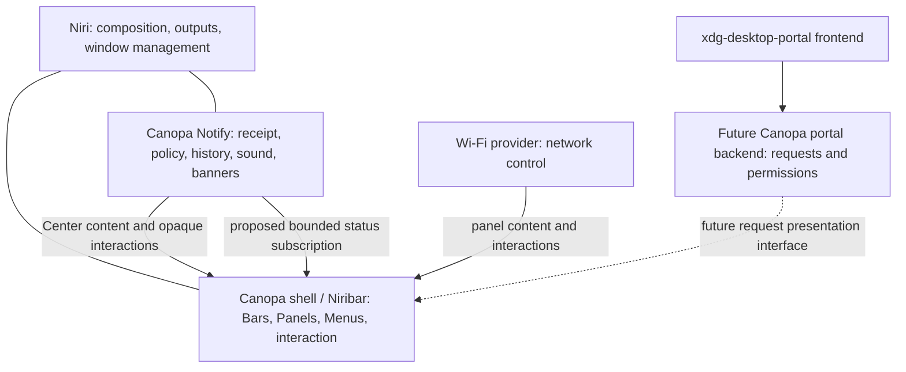

# Canopa integration proposal

Proposed direction, 2026-09-26. Based on Niribar `2c0d017` and Notify `1be911d`.
This document proposes architecture and migration work; it does not record accepted
decisions or implemented features. Both source repositories were clean when inspected.

Accepted implementation decisions are recorded separately in
[ADR 0001](adr/0001-shared-workspace-and-upstream-forks.md) (workspace/forks) and
[ADR 0002](adr/0002-shared-configuration.md) (configuration),
[ADR 0003](adr/0003-shared-appearance.md) (appearance), and
[ADR 0004](adr/0004-integrated-notifications.md) (notifications), and
[ADR 0005](adr/0005-shared-assets.md) (local assets). The original inventory
and proposed later phases below remain a historical planning reference.

Build Canopa as one product and one Rust workspace, with Niribar as the shell and
independently restartable processes for notifications and future desktop facilities.
Share configuration infrastructure, appearance, widgets, and narrowly scoped desktop
mechanisms. Keep notification policy and persistence owned by Notify, and interaction
coordination owned by the shell.

The intended developer experience is one checkout, one build entry point, coordinated
dependency updates, shared documentation, and integration tests that exercise the
shipped combination. The intended user experience is one configuration entry point,
consistent appearance and keyboard behavior, built-in notification integration, and
one documented installation and session lifecycle.

The working assumptions are a future monorepo, continued independent Notify operation,
and keeping the current executable names during migration. These are recommendations,
not requirements already supplied by the user. The first portal interface remains a
product decision; its possible future existence should guide extensibility without
making the initial integration depend on implementing it.

The existing code provides a substantial starting point:

| Area | Observed implementation | Integration implication |
| --- | --- | --- |
| Build | Two Git repositories; Notify has its own workspace. Both use Rust 2024, a Rust 1.95 baseline, Iced 0.14, KDL 6.5, Tokio, and zbus. | Consolidate dependencies and validation without a toolkit migration. |
| Notification Center | Notify supplies declarative content; Niribar owns its Panel, rendering, focus, and input. | Retain this ownership model. |
| Panel protocol | Notify's canonical `canopa-panel-protocol` manifest and source match Niribar's vendored copy byte for byte. Niribar also has a separate framed v1 protocol used by Wi-Fi. | Share the existing v4 crate immediately; protocol convergence is separate work. |
| Accessibility dependency | All 29 files in the two `accesskit_unix` vendor trees match. | Maintain one copy and one patch record. |
| Layer-shell dependencies | Niribar vendors 0.18.0; Notify vendors 0.18.1. Both have distinct local changes. | Reconcile patches deliberately before selecting one shared implementation. |
| Configuration | Niribar loads `niribar/config.kdl` at startup with source diagnostics. Notify loads `canopa-notify/config.kdl`, validates bounded candidates, and supports reload with last-good-state retention. | Share discovery, reading, diagnostics, and candidate preparation; preserve feature-specific schemas. |
| Appearance | Niribar uses fixed Catppuccin constants and style overrides. Notify's banners use Iced palette-based styles and local dimensions. | A shared parser alone will not align the visual experience. |
| Assets | Separate icon discovery and image preparation implementations have different formats, limits, and caching. | Share mechanisms only after preserving both callers' contracts. |
| Operation | Separate unit files, install paths, release scripts, and companion setup instructions. | Product integration includes packaging and session behavior. |

Evidence: [Niribar manifest](../niribar/Cargo.toml), [shared manifest](../Cargo.toml),
[provider integration](../notify/docs/niribar-panel-provider.md),
[Niribar configuration](../niribar/src/config.rs),
[Notify configuration](../notify/crates/canopa-notify/src/configuration.rs),
[shell palette](../niribar/src/theme.rs),
[banner styles](../notify/crates/canopa-notify/src/presentation/renderer.rs), and the
[Niribar](../niribar/docs/vendor-maintenance.md) and
[Notify](../notify/docs/maintaining.md) maintenance records. Vendor identity above
was checked directly against local file contents; historical audit findings were
not treated as evidence that a defect remains in the current source.

The process ownership should be explicit:



Shared Rust libraries sit beneath these processes. No application depends on the
other application's runtime or main loop. Notify remains the sole owner of history,
delivery decisions, DND, and notification actions. Niribar receives projections and
issues commands; it does not read Notify's SQLite database or reconstruct its rules.

Keep Notification Banners in Notify initially. This preserves delivery during shell
restarts and follows [Notify ADR 0005](../notify/docs/adr/0005-daemon-owned-notification-banners.md)
and [ADR 0018](../notify/docs/adr/0018-same-process-ui-for-version-one.md).
The shared UI implementation can make banners and the Center consistent across
processes. Moving banners into Niribar later would reopen those decisions and require
a contract for display acknowledgements, timeout start, activation, renderer loss,
and recovery. It is not necessary to achieve the requested visual consistency.

Start with these shared modules, each with a small interface and substantial
implementation hidden behind it:

| Proposed crate | Interface and ownership | Dependency constraints |
| --- | --- | --- |
| `canopa-config` | Discover a source, read bounded KDL, select a namespace with original source spans, prepare a validated candidate, and report structured diagnostics. Applications supply their schema validation and own installation. | No application runtime or Iced dependency. |
| `canopa-theme` | Resolve appearance settings into immutable semantic colors, typography, spacing, radii, icon-theme selection, and motion preferences. | Plain data; no Iced or Wayland dependency. |
| `canopa-ui` | Render shared Iced controls and surfaces from resolved appearance and caller-supplied events; include focus treatment and accessibility semantics. | Depends on theme and Iced; no notification policy, SQLite, or network control. |
| `canopa-panel-protocol` | Versioned declarative content, validation, and opaque interaction types. Initially the existing v4 contract unchanged. | Keep it usable by providers without GUI dependencies. |

Create these as their first consumers migrate, rather than scaffolding unused
packages. Keep the shell's Foreground, Panel Runtime, Module Runtime, and Module
Data Source Runtime as internal modules. Their current interfaces already express
useful ownership; extracting each into a crate would add little depth.

Later extraction candidates are bounded local asset reads, icon resolution, and
image decoding. Notify's icon lookup follows theme indexes, inheritance and budgets;
Niribar's simpler lookup supports SVG paths that Notify does not render. A shared
resolver must account for supported formats, requested size/scale, cancellation,
cache lifetime, and caller budgets. Preserve shell SVG support and Notify's bounded
work. Likewise, the two image decoders have different byte, dimension, and allocation
limits; share the mechanism while keeping those policies explicit. Do not silently
adopt the more permissive limits everywhere.

Avoid a catch-all `canopa-common` crate. Application launching can remain in Niribar
until another actual caller needs it. Niri is the selected compositor; keep its
adapter localized without designing an unneeded multi-compositor framework.

Configuration should have one public entry point:
`$XDG_CONFIG_HOME/canopa/config.kdl`, with the normal `~/.config` fallback. The following
is a proposed shape, not syntax supported by today's binaries:

```kdl
schema-version 1

appearance {
    color-scheme "dark"
    accent "#89b4fa"
    font "Noto Sans"
    icon-theme "hicolor"
}

shell {
    // Existing named bar, module, menu and provider declarations.
}

notifications {
    sound enabled=#true theme="freedesktop" default="message-new-instant"
    rule "quiet-chat" app="org.example.Chat" outcome="silenced"
}
```

Share configuration *behavior* as well as syntax. Use one source discovery rule,
one diagnostic vocabulary, predictable defaults, explicit schema evolution, and a
common candidate lifecycle. Each application validates its own namespace and shared
appearance. A future portal owns its namespace. The shared loader recognizes the
document envelope and supported namespace names, but does not import application
types. An invalid shell option should not prevent notification delivery; invalid KDL
syntax or shared appearance affects every consumer of that document. A product-wide
validation command should run each owner's validator and report all failures.

Use this precedence during migration: an explicitly selected configuration source,
then the Canopa file, then the application's legacy file when no Canopa file exists,
then embedded defaults. Explicit legacy imports should select the legacy schema;
avoid guessing between schemas from error messages. A present but invalid Canopa file
must produce an error, not silently fall back. A missing namespace in a valid Canopa
file uses that feature's defaults, not settings merged from a legacy file. Report
the selected source so users can understand the result. Start with one file; add
includes only with defined ordering, cycle detection, and aggregate read limits.

Prepare candidates off the async/UI execution paths and install complete local
snapshots. A failed reload preserves the previous local configuration and generation.
Niribar needs new reload work: reconcile Bar Surfaces, Module Instances, subscriptions,
and open interactions using its existing owners. Classify settings that require a
restart explicitly. Fonts and other resource changes must not be advertised as live
until their actual adapters support them. Notify's delivery-policy changes continue
to affect future requests under [ADR 0027](../notify/docs/adr/0027-policy-changes-apply-to-future-notification-requests.md).
Changing appearance should have a separately specified repaint policy.

Atomic replacement within one process does not establish an atomic update across
processes. Initially, coordinated reload should report success, rejection, or
unavailability for each process, with a source revision/fingerprint to expose skew.
Do not introduce a settings daemon merely to load the same file. A future requirement
for durable, globally synchronized live settings would justify revisiting this.

Keep source-aware diagnostics while preserving Notify's content-free logging rule
in [ADR 0040](../notify/docs/adr/0040-safe-configuration-candidates.md).
Common errors can contain a diagnostic code, known schema field, location, and safe
help text. Source excerpts should require an explicit local diagnostic mode; daemon
logs and status should not reproduce configuration values. Preserve Notify's bounded
regular-file reads and preparation serialization when extracting the loader. Any new
shared source limit must be documented and checked against existing shell configs.

Keep runtime state separate from configuration. DND, history, and UI-managed permission
rules stay in Notify's existing stores; UI actions do not rewrite hand-authored KDL.
This preserves [ADR 0011](../notify/docs/adr/0011-ui-managed-rules-use-user-rule-store.md).
Leave state paths and database migration behavior unchanged during the initial
configuration migration. They can be migrated later with backup and ownership rules.

For appearance, use semantic roles such as background, elevated surface, primary
text, muted text, accent, warning, destructive action, border, and focus indicator.
Treat Catppuccin as the initial preset. Keep current token names as compatibility
aliases where needed. Components consume resolved roles instead of copying palette
constants or selecting an unrelated Iced theme.

The first shared widgets should be the ones already repeated: action buttons,
surface frames, labels, rich-text/link presentation where their contracts match,
and selected/disabled/error states. Consistency includes focus visibility, keyboard
navigation, scrolling, text scaling, reduced motion, and AT-SPI behavior. Preserve
appropriate differences: a Notification Banner remains non-focus-stealing, while an
interactive Panel accepts navigation. Validate the same fixture content in both
renderers, including high DPI, long text, unavailable actions, and light/dark themes.

Continue the declarative provider model in
[Niribar ADR 0010](../niribar/docs/adr/0010-external-panel-providers-use-declarative-content.md).
The host owns visual treatment; providers supply meaning and receive opaque events.
Both existing contracts now live in the shared crate, with host state separated
from wire models ([ADR 0006](adr/0006-shared-provider-contracts.md)). This completes
source consolidation. Built-ins now use the common v5 contract
([ADR 0007](adr/0007-unified-panel-protocol.md)), with the earlier adapters retained
for configured providers. The parity constraints below guided that migration.

Sharing the v4 source is an immediate deduplication. Replacing `niribar-v1` with v4
is not: v1 has selectable lists and secret text inputs used by Wi-Fi, while v4 has
rich notification content. Keep both adapters until a versioned successor covers
both real consumers and passes their integration fixtures. Preserve frame limits,
backpressure, stale-action rejection, revision checks, and process cleanup. Avoid
protocol guessing and arbitrary provider-owned widgets.

`xdg-desktop-portal-canopa` now implements Settings using shared appearance
([ADR 0008](adr/0008-settings-portal.md)). It is an independent backend for the
existing frontend; other interfaces remain future work. It implements selected
`org.freedesktop.impl.portal.*` interfaces and provides D-Bus
activation and portal metadata. The official architecture permits implementation
of individual interfaces, with backend selection configured per interface, so the
project can grow support incrementally.
Sources: [writing a backend](https://flatpak.github.io/xdg-desktop-portal/docs/writing-a-new-backend.html)
and [backend selection](https://flatpak.github.io/xdg-desktop-portal/docs/portals.conf.html).

Do not make the current Panel model the universal portal UI contract. Every Panel
currently has a Bar Surface origin, and Foreground coordinates one active interactive
overlay. Portal requests can originate from applications without a bar interaction.
For example, FileChooser passes application and parent-window information, and the
backend Request interface supports closing the associated UI.
Sources: [FileChooser backend](https://flatpak.github.io/xdg-desktop-portal/docs/doc-org.freedesktop.impl.portal.FileChooser.html)
and [Request.Close](https://flatpak.github.io/xdg-desktop-portal/docs/doc-org.freedesktop.impl.portal.Request.html).

When the first interactive portal is selected, design a separate shell request
interface for presentation, result, and cancellation. Keep request IDs, caller
identity, permissions, and protocol completion in the backend; keep visual controls,
placement, and input in the shell. Define concurrent-request queuing and what happens
on shell disconnect or restart; pending permission requests must never become an
implicit approval. This is proposed Canopa behavior, not functionality provided by
the current panel protocol. Reuse the theme/widgets first, and share request UI
mechanisms only as actual needs become clear. Do not route every portal through
notification-center content.

Make integration visible early with a notification Module. It should display
Requires Attention count, DND, and availability; open the built-in Notification
Center provider; and issue DND commands through Notify. Add a bounded summary
subscription to Notify's control interface. Current status exposes DND and availability
but not that count; deriving it by transferring complete history would duplicate
work and couple the shell to persistence. Notify should own its meaning and query
cost. Reconnect with a fresh snapshot after daemon restart and show unavailable
state explicitly. Item actions keep the existing daemon-lifetime and revision guards.

Recommended migration order:

| Step | Concrete change | Completion evidence |
| --- | --- | --- |
| 1. Reconcile dependencies | Inventory both layer-shell patch sets, choose one baseline, port both behaviors, and preserve provenance and licenses. The identical AccessKit patch can have one source. | Both applications' existing checks plus isolated output, popup, banner-display, activation, scaling, and accessibility fixtures pass against the candidate. |
| 2. Establish one workspace | Bring both histories into a Canopa repository, centralize dependencies and root patches, use one lockfile and protocol crate, and provide one validation entry point. Retain source layout and binary names initially. | Both apps build individually and together; Notify core-only checks still exclude GUI/audio dependencies; protocol/provider fixtures pass. |
| 3. Share configuration | Introduce the loader, namespaced Canopa file, explicit legacy migration, diagnostics, validation entry points, and documented reload/restart behavior. | Default, legacy, new, invalid, oversized, and failed-reload cases preserve their specified behavior. Invalid unrelated feature options remain isolated. |
| 4. Share appearance | Introduce theme data and migrate concrete shared Iced controls in shell and banners. | Shared visual fixtures, contrast checks, keyboard checks, and native accessibility checks cover both consumers. |
| 5. Ship integrated notifications | Add the summary subscription, notification Module, built-in Center action, DND controls, defaults, and companion packaging. | A fresh session works without manual provider wiring; daemon and shell restarts produce documented recovery without losing history. |
| 6. Grow from actual consumers | Extract assets, converge provider protocols after parity, and implement the first chosen portal interface with any required request presentation seam. | Wi-Fi and Notify retain behavior; portal request, cancellation, unavailable-shell, and concurrent-request fixtures pass for the selected interface. |

Steps 1–2 are the first implementation slice. It removes source drift and gives later
work one testable foundation. Steps 3–5 form the first user-facing integrated release.
Defer filesystem rearrangement, executable renaming, database relocation, protocol
replacement, and UI redesign beyond that initial slice.

A monorepo can initially retain `niribar/` and `notify/crates/` under a root manifest;
moving application sources into an `apps/` tree is optional tidying later. Nested
workspace ownership and root-level patch selection must be resolved as part of the
conversion. Central dependency declarations should preserve per-application features
instead of enabling all GUI/audio features everywhere. Run Notify's dependency check
in an isolated core-only invocation as well as testing the combined workspace.
Keep the rotation prototype outside the supported build as it is today.

Preserve original licensing: Niribar is MIT and Notify is MIT OR Apache-2.0; vendor
notices and moved-source obligations remain attached. Retain the domain glossaries
and ADR histories, adding a root map to shell and notification contexts rather than
merging their vocabularies indiscriminately. Replace absolute sibling-checkout paths
in documentation and desktop fixtures with workspace-relative inputs.

Ship coordinated packages with separate user services and a common session target
where useful. Document graphical-session environment setup once. Restarting the shell
should not restart Notify or terminate applications launched from the shell; preserve
[session-owned launching](../niribar/docs/adr/0012-session-owned-application-launches.md).
A future `canopa` command can expose status, configuration validation/reload, and
notification operations through existing interfaces. It need not supervise processes
or become another mandatory daemon. Give diagnostics consistent component names and
structured fields while retaining content-free notification/configuration errors.

The dependency-sharing slice needs behavior tests because the vendor implementations
differ, not simply a successful combined build. The integrated release needs a private
Niri/Wayland session exercising a notification arriving, a banner appearing, the
attention count changing, Center opening, an action completing, DND toggling, and
independent process restarts. Extend the existing isolated desktop harnesses instead
of testing against the developer's live notification service. No runtime or graphical
tests were run for this proposal; its verification was source inspection, direct
vendor comparisons, and checking the cited portal documentation.

The ADR changes should be explicit during implementation. Shared v4 workspace
ownership supersedes the vendored-snapshot arrangement in
[Niribar ADR 0011](../niribar/docs/adr/0011-explicit-canopa-panel-protocol-adapter.md).
The new configuration envelope and its compatibility rules extend
[Notify ADR 0010](../notify/docs/adr/0010-kdl-configuration.md) and require a successor
to ADR 0040's flat application schema while preserving its validation guarantees.
Banner ownership, separate state stores, and domain-free panel types remain in place.
