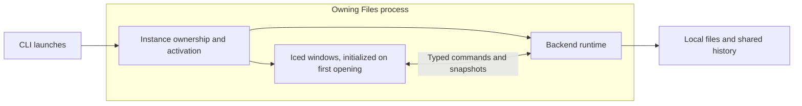

# 0076: Window-independent runtime and optional resident mode

Status: accepted direction; scoped resident hosting and activation verified,
2026-10-19. Full runtime extraction and acceptance remain incomplete. Extends
ADR0001/0074 following the user's daemon/headless proposal.

## Lifetime and hosting

The application runtime owns accepted operations, shared history, progress and
pending decisions independently of browser windows. Closing the last window
does not cancel that work. Reopening Files reconnects to the same runtime and
its Operations state. This lifetime requirement already belongs to the product
brief; it must not depend on keeping an invisible browser alive.

Add an optional resident mode that starts without a browser and remains available
while idle, so later launches can activate the existing application and open
windows promptly. Ordinary launch may exit after its work and windows are gone;
resident mode deliberately retains the runtime. `--daemon` now expresses that
policy; `--quit` releases it while preserving windows and accepted-work holds.

There must be one owning runtime for a user's Files state. New launches activate it or
start it on demand instead of opening another history writer. The runtime's
typed command, snapshot and decision interfaces must be hostable without Iced
or a renderer. Platform transports such as a Wayland clipboard may need their
session connection, but core operation execution must not require a display.

Windowless operation and process separation are distinct choices. The current
Iced event-loop API permits zero windows, but does not supply a display-free host,
primary-instance activation or an independently running backend. A separate
headless process would also isolate operations from a frontend crash. Keep that
hosting option viable; choose process layout and local activation/transport
before implementing the resident host. The domain and application interfaces
remain the same rather than acquiring GUI-specific execution rules.

This supersedes ADR0074's categorical dismissal of separate-process hosting.
It does not introduce a remote server or network-facing protocol.

## Background behavior

An operation needing a decision waits in the runtime and can request attention
through the existing desktop-notification direction. Opening Operations presents
the same generation-bound question. A missing window never supplies an implicit
Replace, Skip or Cancel answer. Orderly runtime shutdown must account for active
work and unsaved results instead of silently abandoning them.

Keep residency inexpensive: bound caches, release unused preview/rendering work,
and avoid polling or retaining watchers for closed browser sessions. Validate
idle CPU and memory as well as warm window-opening latency. Keeping the runtime
alive creates an opportunity for faster activation; actual performance requires
measurement.

Frontend closure and frontend crashes do not establish safe daemon restart.
Filesystem-journal reconciliation, original source/media ownership and durable
continuation gates still apply when the owning runtime itself is interrupted.
Updater and activation packaging must also handle an older running runtime;
record the shared integration decision before changing session units or launchers.

## Evidence and acceptance

Thunar's upstream manual, published in the
[Debian package manual](https://manpages.debian.org/trixie/thunar/Thunar.1.en.html),
describes `--daemon` as keeping its instance running after the last window closes
to speed subsequent window opening. That confirms the resident-mode inspiration;
it does not prove display-free Thunar operation.

The executable now composes ConfigurationJobs, LocalOperations and LocalActions
before Iced. Its local-runtime feature builds those workflows without Iced.
Resident startup blocks on local activation without initializing a GUI; the
first accepted browser request initializes Iced and attaches to those handles.
Afterward, zero-window residency retains that frontend's session connection.
The [hosting and integration decision](../../adr/0022-files-resident-host-and-activation.md)
records process layout, launch-only transport, configuration selection and update
behavior. A headless start without display variables refuses browser requests
without stopping its backend. Start with the graphical session's environment to
open windows later. GUI and backend share the owning process; crash isolation
and safe continuation after an interrupted runtime remain separate work.

Acceptance must cover no-window startup, core work without GUI initialization,
closing all windows during a transfer and a decision, activation into the same
queue, orderly shutdown, instance ownership and measured idle/warm performance.
Private native acceptance now covers initial headless hosting, same-process
reopening, shared Undo, a decision and queued work after all windows close, and
shutdown waiting for the exact platform helper. The transport tests also cover
bounded admission, handoff, conflicting configuration, a full accept backlog,
endpoint replacement and recovery of an idle crashed owner's stale endpoint.
See root ADR0022 and the implementation ledger for scoped evidence and measured
debug-build opening times. Full session/focus integration, production performance,
remaining platform ownership, execution/restart authority and the entire product
brief remain open.
