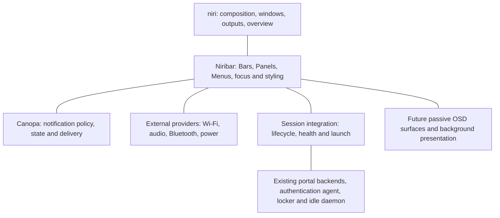

# Desktop shell readiness — 2026-09-23

Niribar has a substantial foundation for a desktop shell, but existing features still have implementation gaps. The next step should combine correctness work with a coherent niri session and everyday system controls.

Scope: whole-project feature and architecture review at `988f970`, with a clean initial working tree; sibling notification project at `/home/kevinard/projects/canopa/notify`. The owner confirmed that niri remains the primary compositor. This is a review and proposed roadmap, not an implementation commitment or a claim that every possible defect has been excluded.

Findings below describe that baseline. See the [implementation follow-up](2026-09-23-shell-gap-remediation.md) for the subsequent F1–F7 fixes, migration notes and validation limits.

The earlier [project audit](2026-09-23-project-state.md) describes a pre-fix revision. Its [remediation](2026-09-23-remediation.md) and [desktop validation](2026-09-23-desktop-validation.md) resolve many of its findings. Do not reopen those findings based on the old report alone. External platform and Canopa details are in the companion [primary-source research](2026-09-23-shell-platform-research.md).

## Verification

| Check performed in this review | Result |
| --- | --- |
| `cargo test --locked --all-targets -j 2` | 1,186 passed; no failures or ignored tests |
| `cargo clippy --locked --all-targets -- -D warnings` | Pass |
| `cargo fmt --all -- --check` | Pass |
| `python3 scripts/check-vendor.py` | Pass, local provenance manifest check |
| `python3 scripts/check-contrast.py` | All 21 documented default color pairs pass |
| Production command/discovery probe | Reproduced command timeout, stripped desktop field codes, and omission of a D-Bus-only application |

Toolchain: Rust/Cargo 1.97 nightly (`14196dbfa` / `eb94155a9`). The test total is 17 library + 1,151 application + 6 Canopa transport + 2 protocol + 10 Wi-Fi tests; the recursively invoked AT-SPI fixture is counted once. The initial sandboxed attempt could not start private D-Bus daemons; the successful run used the already permitted unsandboxed test command. Current Rust 1.95 runtime behavior was not rerun.

The [probe source](data/2026-09-23-shell/probe.rs) and [verification summary](data/2026-09-23-shell/verification.txt) are retained. The probe imports production command and discovery modules; a minimal configuration stub only satisfies unused type dependencies. It launches an isolated `sleep` process, not a desktop application.

No new hardware/compositor acceptance run was performed. Existing graphical evidence covers selected scenarios, not all monitors, audio servers, network hardware, or accessibility paths. Passing tests do not negate the findings below.

## Existing capability inventory

“Implemented” means a real production path exists; it does not mean universal hardware acceptance.

| Area | What exists | Remaining completeness work |
| --- | --- | --- |
| Bars and Outputs | Named Bars, exact output targeting, all edges/layers, multiple Bars, Wayland output reconciliation, logical sizing | Mixed-scale hotplug and suspend/resume acceptance; explicit overflow UX if clipped content needs access |
| Configuration and appearance | KDL parsing/validation, embedded defaults, per-module formatting, states/icons/styles, content rotation | Live reload with last-good rollback, validation-only CLI, consistent shell/provider theme and text scaling |
| Workspaces and focused window | niri event subscription/recovery, output-sensitive workspaces/titles/icons and interactions | Window switcher and richer workspace actions are future capabilities; avoid duplicating niri's existing overview |
| Clock/calendar | Live clock and calendar Module Detail Session | Calendar events, multiple time zones and agenda integration are new features |
| Battery | UPower percentage and charging state, thresholds and presentation | Presence/state semantics in F5; time remaining, profiles and policy are separate additions |
| Audio | Default output volume/mute status, scroll/keyboard volume adjustment | Backend consistency and missing-sink handling in F4; native mute, input/output routing and mixer |
| Network status | NetworkManager and networkd subscriptions with recovery | Truthful unknown state and active-link selection in F6 |
| Wi-Fi control | Actual NM/iwd scan, known/open/personal/hidden joins, credential prompts, streamed progress and cleanup | Radio/rfkill control, disconnect, forget/edit saved networks, explicit adapter selection and VPN; enterprise provisioning remains explicitly outside current scope |
| Tray | SNI watcher/host, icon updates, owner retirement, DBusMenu updates, navigation and search | Menu-only primary activation and icon variants in F7; broader application compatibility acceptance |
| Scripts/buttons/actions | Explicit shell/argv execution, polling, bounded output, timeout and process-group cleanup | Separate application launch semantics from bounded automation in F1/F2; event-driven status where polling becomes expensive |
| Launcher/selection | Desktop ID precedence, discovery off GUI path, fuzzy search, icons, configured menus, rich/plain dmenu and concurrent bounded IPC | Launch lifecycle/desktop semantics in F1–F3; direct global launcher/provider commands and useful failure feedback |
| Panels/providers | Foreground ownership, replacement/stale-event handling, module details, framed v1 and Canopa v4, failure UI and process cleanup | Reusable sliders/toggles/progress/disabled controls; persistent data feeds independent of open Panels |
| Notifications | Existing Canopa server and Niribar Notification Center integration | Status Module, DND UI and installation/session wiring; see notification section |
| Accessibility | Keyboard routing, contrast checks, native Canopa AT-SPI | Ordinary Bars, menus and generic provider controls need equivalent semantics and screen-reader acceptance |
| Distribution/operations | Both binaries packaged, systemd unit, manual updater, diagnostics, CI, vendor records | Reproducible session onboarding, dependency/health checks, cross-project compatibility gate, broader hardware matrix; Nix remains explicitly deferred |

Inventory evidence: [Module catalog](../../../crates/niribar/src/modules.rs), [configuration model](../../../crates/niribar/src/config/module.rs), [provider content types](../../../crates/niribar/src/external_panel/protocol.rs), [Foreground](../../../crates/niribar/src/app/foreground.rs), [README](../../../crates/niribar/README.md), and [accessibility assessment](../ACCESSIBILITY.md). Unchecked historical ticket boxes are not an inventory of missing features; use [.scratch/niribar/implementation-review.md](../../../.scratch/niribar/implementation-review.md).

## Current implementation findings

P1: fix before treating the affected path as dependable. P2: concrete compatibility/correctness work for the next stabilization milestone. Evidence is identified per finding.

### F1 — P1: Default menu application launches have a three-second lifetime

The shipped [menu](../../../crates/niribar/config/default.kdl) uses `command "kitty"` and `command "firefox"` (lines 26–27). [CommandPolicy](../../../crates/niribar/src/config/module.rs) defaults to 3,000 ms (line 32), and [configured command execution](../../../crates/niribar/src/command.rs) routes these actions through process-group termination (lines 239–265, 300–316). A first-instance application that stays running can be killed after three seconds. A launcher that forks a child in the same process group can also lose that child when its immediate process exits.

**Reproduced:** the production execution function kept an isolated `sleep 30` alive at 100 ms and killed/reaped it by 3,400 ms using the default duration. This verifies the command path, not every terminal/browser's process model.

**Change:** provide an explicit application-launch action, use it in the default menu/examples, and preserve bounded commands for scripts/automation. Do not globally remove worker/provider timeouts. Acceptance: a launched app survives beyond the timeout; a timed-out automation command still retires its descendants. This extends the action model without abandoning [ADR 0003](../adr/0003-allow-explicit-shell-commands-by-default.md).

### F2 — P1: Installed applications inherit the bar's systemd lifetime

The installed-application path bypasses the command timeout, but [its spawn implementation](../../../crates/niribar/src/command.rs) is an ordinary child process (lines 229–234, 289–297). The shipped [user unit](../../../packaging/systemd/niribar.service) does not separate application cgroups. Therefore an ordinary, non-self-relocating launched application remains inside `niribar.service`; stopping/restarting that unit can terminate it. “Fire and forget” and a separate process group do not establish independent systemd ownership.

**Evidence:** source inspection plus systemd's default `KillMode=control-group`; not reproduced against the user's running service. See [systemd's primary definition](https://raw.githubusercontent.com/systemd/systemd/main/man/systemd.kill.xml).

**Change:** launch applications through the compositor or per-application user scopes, with correct desktop-entry activation. Keep Niribar-owned workers/providers attached to Niribar. Acceptance: restarting Niribar leaves launched apps running and still cleans up owned helpers.

### F3 — P2: The installed-application launcher implements only part of desktop-entry semantics

[Discovery](../../../crates/niribar/src/desktop_apps.rs) requires `Exec`, ignores localized names and launch `Path`, and intentionally excludes terminal entries. [Argument handling](../../../crates/niribar/src/command.rs) removes `%i`, `%c`, and `%k` instead of expanding them. [Launch-time errors](../../../crates/niribar/src/app/app_effects.rs) are discarded.

**Reproduced:** `example --title %c %i --desktop-file %k` becomes just `example --title --desktop-file`. A valid `DBusActivatable=true` entry without `Exec` is absent. Source inspection also establishes missing locale/working-directory handling. The [Desktop Entry specification](https://specifications.freedesktop.org/desktop-entry/latest-single/) defines the relevant fields and activation behavior.

**Change:** use a standards-aware launch adapter, retain the source entry identity/location and report failures. Test field expansion, working directory, D-Bus-only activation and localization. Terminal applications, desktop actions and activation tokens are worthwhile follow-ons; terminal support is an expansion of today's intentionally GUI-only scope, not a broken existing promise. `TryExec` filtering is also useful but is not a mandatory compliance failure.

### F4 — P2: Audio reading and control do not have the same supported backend

[Status](../../../crates/niribar/src/dbus/wireplumber.rs) uses libpulse, while [adjustment](../../../crates/niribar/src/command.rs) unconditionally executes `wpctl`. A PulseAudio-only installation can display volume correctly while adjustment fails; a PipeWire install without the helper has the same control gap. The README currently permits either audio stack. [`wpctl`](https://pipewire.pages.freedesktop.org/wireplumber/man/wpctl.html) controls WirePlumber/PipeWire.

Additionally, the status subscription handles only New/Changed (lines 118–125), and a default-sink lookup emits only on `ListResult::Item` (lines 156–170). Removed/no-result/error paths do not invalidate the last value while the server stays connected. Loss of the last real sink can therefore leave stale state; server-disconnect recovery does not cover this case.

**Evidence:** code-confirmed branches; no live audio reconfiguration. **Change:** one explicit audio read/write contract, dependency/capability reporting, and missing-sink invalidation. Acceptance: supported PulseAudio and PipeWire configurations, helper absence, default-device change, last-device removal/reappearance and server restart. Avoid making a native PipeWire rewrite a prerequisite for basic correctness.

### F5 — P2: Battery presentation ignores whether UPower says it should exist

The [UPower proxy](../../../crates/niribar/src/dbus/upower.rs) reads only Percentage and State. [Battery mapping](../../../crates/niribar/src/modules/battery.rs) always creates a visible reading. UPower's DisplayDevice [IsPresent](https://upower.freedesktop.org/docs/UPower/) specifically indicates whether its status icon should be shown. A daemon with no present battery can therefore produce a visible zero/unknown battery instead of an Empty Module.

Fully charged and pending charge are also collapsed into `is_charging=true`; this loses useful state and can display “charging” while already full.

**Evidence:** source-confirmed, not a new hardware reproduction. **Change:** retain presence and distinct power state, watch changes, map absent devices to Empty. Acceptance: no-battery desktop, battery removal/reappearance, charging, full, pending and discharging.

### F6 — P2: Network status can misrepresent both connectivity and the active link

[NM mapping](../../../crates/niribar/src/dbus/networkmanager.rs) maps Unknown to None, producing an offline indication when connectivity probes are disabled or have not run. NetworkManager [defines those states differently](https://networkmanager.pages.freedesktop.org/NetworkManager/NetworkManager/nm-dbus-types.html). The source comment also reverses Portal/Limited numeric names, although both currently share one display state.

The [networkd label](../../../crates/niribar/src/dbus/networkmanager.rs) selects the first non-loopback entry from ListLinks without checking link state or routing. A disconnected Ethernet device or virtual link can be labeled as the active connection. Only OnlineState changes trigger refresh, so changing the active interface while remaining online can retain the old label.

**Evidence:** code-confirmed mappings and subscriptions. **Change:** distinguish unknown probe result, link connectivity and Internet reachability; derive labels from meaningful active-link facts and subscribe to their changes. Acceptance: probes disabled, captive portal, Ethernet-to-Wi-Fi handover while online, and extra disconnected/virtual links. Treat networkd online as link availability rather than proof of Internet reachability.

### F7 — P2: Tray compatibility is incomplete for menu-only items

The [SNI proxy](../../../crates/niribar/src/dbus/sni/proxy.rs) has no ItemIsMenu property; [primary click](../../../crates/niribar/src/modules/tray.rs) always requests Activate. The [SNI specification](https://specifications.freedesktop.org/status-notifier-item/latest-single/) says a menu-only item should prefer menu presentation/ContextMenu. Such an item can do nothing on ordinary left click even though right click opens its menu.

The proxy/fetch path also omits attention and overlay icon properties. These are compatibility/presentation additions, distinct from the already repaired stale-icon subscription bug. Their absence should not be described as universal SNI failure.

**Evidence:** source-confirmed routing. **Change:** retain ItemIsMenu and use it for primary activation; then support icon variants/theme paths/fallbacks as needed by tested clients. Acceptance: private-bus menu-only fixture and representative real tray clients.

## Notification integration: build on Canopa

Canopa already supplies the notification server, persistence, Requires Attention/history handling, rules, actions, images/links, DND control, and a provider-backed Notification Center. Niribar already renders its v4 content with native accessibility. This work is more advanced than simply “add notifications.” The [research report](2026-09-23-shell-platform-research.md) separates source implementation from recorded desktop evidence.

The useful remaining work is:

1. A notification Module showing **Requires Attention** count, DND and daemon availability, with a direct Center action. Obtain a bounded summary from Canopa, rather than repeatedly fetching/parsing complete history or duplicating persistence.
2. DND controls in the Center/quick settings. Canopa has the control operation; its current Center projection does not expose that control.
3. A documented companion installation/configuration and session lifecycle, including provider compatibility checks and clear unavailable/recovery states.
4. Surface identity that lets niri target the Center separately for capture/privacy rules. Current Panels all use `niribar`; banners have their own Canopa namespace. Privacy policy remains with the compositor, consistent with Canopa's decisions.

## Recommended architecture

Keep the current Foreground, Panel Runtime, Bar Surface Registry and Module Data Source Runtime. Extend them around concrete features. [ADR 0010](../adr/0010-external-panel-providers-use-declarative-content.md) already gives rich domain controls a suitable external-provider seam.

Keep one interactive Foreground unless a real workflow requires otherwise. OSDs and persistent backgrounds need distinct lifecycles so a volume key does not replace a Wi-Fi credential Panel. A secure lock screen uses a dedicated session-lock implementation, not an ordinary Panel or overlay. Evolve provider controls incrementally: sliders, toggles, disabled/busy state, focus retention and accessible labels first. Background status must continue when a provider Panel closes; this does not automatically require permanent provider processes.

## Delivery order toward a full desktop

These are proposed milestones. Feature lists are intentionally prioritized rather than claims about previously promised scope. Protocol/service choices and primary references are documented in the [platform research](2026-09-23-shell-platform-research.md).

| Order | Deliverable | Why it matters / acceptance |
| --- | --- | --- |
| 0 | Complete F1–F7 and broader accessibility | Existing advertised interactions behave reliably. Add regressions at the real process/transport seam; execute the hardware matrix rather than treating unit coverage as desktop acceptance. |
| 1 | A reproducible niri desktop session | Coordinate Niribar, Canopa, environment import, autostart, portal backends, a polkit agent, locker/idle handling and systemd lifecycle. Add a health/diagnostics command. Login, logout, suspend/resume and shell restart should behave predictably; file dialogs and screen sharing should work. Integrate existing implementations initially. |
| 2 | Global shell entry points and safe customization | CLI/IPC to open/toggle named launcher, provider and quick settings on the focused Output; working niri binding examples; `--help`, unknown-option errors, config validation and transactional reload. Reload failure retains the last working configuration. |
| 3 | Canopa status plus quick settings | Notification count/DND; output/input audio and mute, brightness, Wi-Fi on/off/disconnect/forget, Bluetooth pairing, power profiles and lock/logout/suspend/reboot/shutdown. Capability-aware controls and failure feedback. Build audio/brightness first to exercise the provider primitives. |
| 4 | Everyday shell workflow | Volume/brightness/microphone OSD, MPRIS media controls, searchable window switching through niri IPC, keyboard layout/input-method state, clipboard history with explicit persistence/secret policy. Use niri's existing overview and screenshot functions where appropriate. |
| 5 | A coherent desktop product | Wallpaper, display settings with revert-on-timeout, fonts/cursor/theme/text-size settings, default applications/open-with, removable-drive mount/eject via existing system infrastructure, secret-service/keyring integration, night light where supported, screenshot/recording workflow and privacy indicators. |

Power actions should use session capabilities/inhibitors and the existing authentication agent. Basic Wi-Fi joining should not be gated on implementing enterprise provisioning. Bluetooth requires pairing/authorization interaction, not just a devices list. Notification delivery and critical session responsibilities should survive closing a Panel and, where appropriate, restarting Niribar.

The first three concrete feature slices after stabilization should be **session integration**, **global launcher/Center/quick-settings commands**, and **Canopa status + audio/brightness controls**. They exercise the existing architecture and remove more daily friction than adding decorative status Modules or beginning another broad refactor.

## Acceptance still needed

Use the existing [desktop matrix](../manual-validation.md), adding application survival across service restart, no-battery/no-audio-device cases, probe-disabled network status, menu-only tray clients, portal file-dialog/screencast flows, and lock-before-suspend/resume. Include real NM and standalone iwd separately, mixed-scale Outputs, keyboard-only operation and screen-reader traversal across all shell surfaces.

The current evidence supports continued development on this architecture. It does not yet establish a complete desktop environment, whole-application accessibility, or performance targets on a healthy, fully populated desktop.
