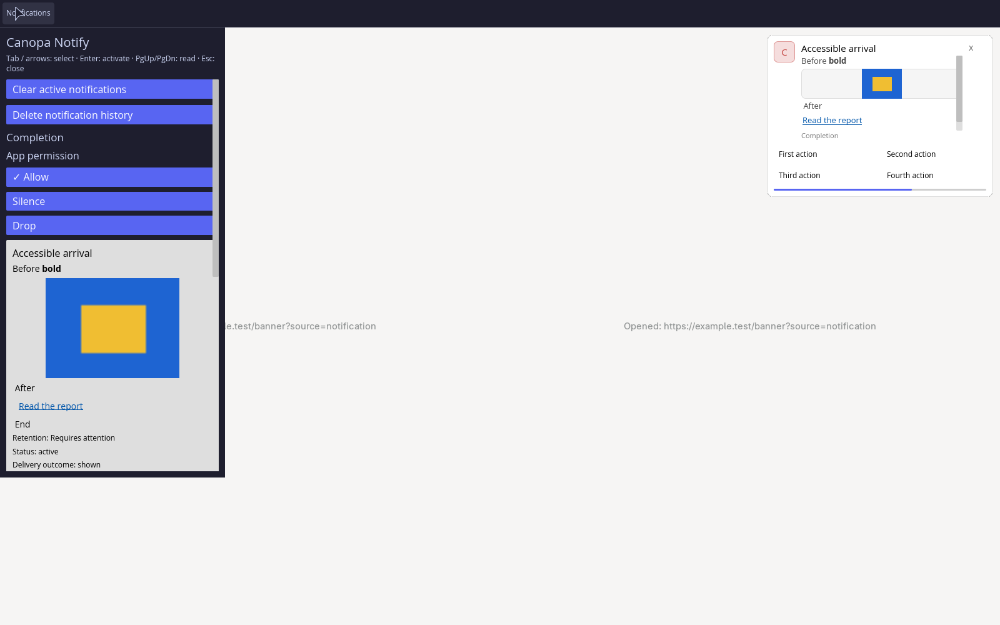
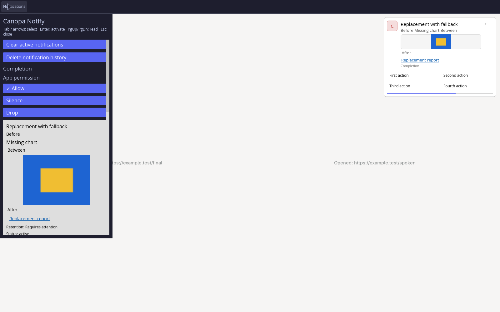
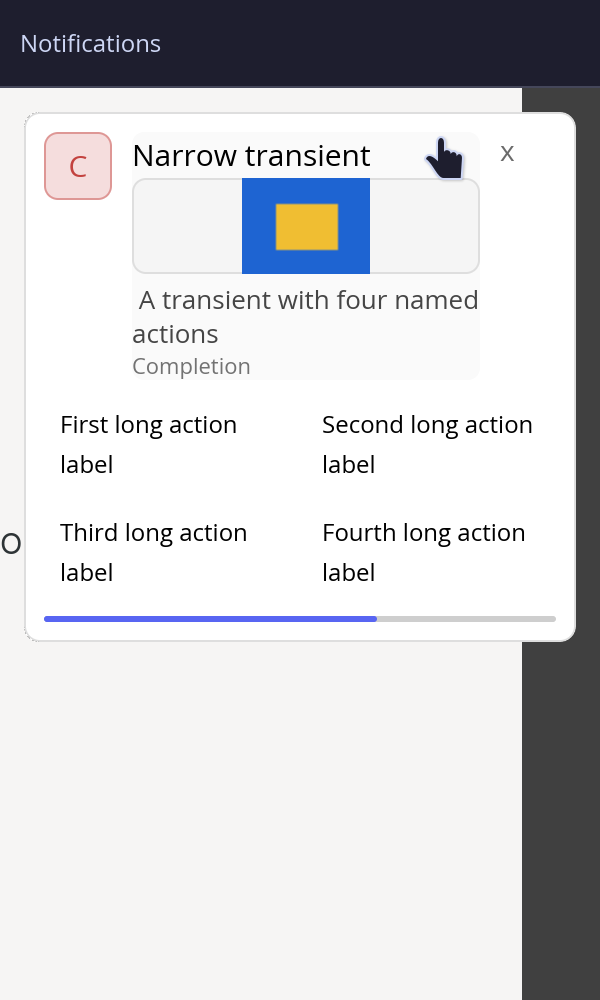

# Desktop notification acceptance, 2026-09-16

Implementation baseline: Notify `8898be0`, Niribar `05e6e5f`. This records the
paired working-tree implementation; final repository checks and revisions belong
in the completion tracker. Earlier output/expiry evidence remains linked below.

## Isolated environment

The test used a private, nonactivating D-Bus session, fresh XDG directories,
software-rendered headless Sway, and nested Niri 26.04. The outer output was
1600×1000 at scale 1, then 600×1000 with Niri scale 2 (300 logical pixels wide).
Niribar consumed Canopa protocol v4 with a 720-pixel panel. Notify sound was disabled.
The real xdg-desktop-portal frontend 1.22.0 and GTK backend 1.15.3 negotiated
OpenURI version 5. A fixture-local HTTP(S) handler recorded targets and opened a
GTK test window; no network request or system default-browser change occurred.

Orca 50.2 used Speech Dispatcher 0.12.1 and eSpeak NG 1.52.0, extracted under
`/tmp` with verified package hashes. Speech was synthesized into a private PCM
file through ALSA file/null plugins. See the [reproducible Orca toolchain and
shortcut instructions](orca-isolated-fixture-research.md). No live notification
service, bar, compositor settings or accessibility settings were replaced.

## Rendering and interactions

The actual banner and Center displayed ordered styled text, a local PNG, following
text and a distinguishable underlined link. Successful images did not duplicate
alternative text visually. Four named banner actions remained reachable beside
default activation, dismissal and progress. The Center retained ordered body
content and exposed pending attention separately from sender status.

Replacing the same live notification displayed “Missing chart” for an absent image,
then the valid PNG and following link, on both surfaces. The banner stayed in its
existing stack. The Center uses a stable window and clears obsolete selection;
real-widget and native AT-SPI tests additionally reject clicks captured before a
replacement, closure or session change.

At 600×1000 physical pixels and scale 2, the transient banner fit the 276-logical-pixel
card width with its body image, progress and all four wrapping action labels.
Clicking the final line of each label emitted exactly `one`, `two`, `three`, and
`four` for sender ID 2, while the resident transient banner remained visible.
Earlier [scale/output evidence](../.scratch/freedesktop-completion-review/OUTPUT-FIT-EVIDENCE.md)
covers scales 1/1.5/2, click-through and display-based expiry;
[output lifetime evidence](../.scratch/freedesktop-completion-review/OUTPUT-LIFETIME-EVIDENCE.md)
covers reserved panels and surviving-output fallback. These are supported fixture
configurations, not exhaustive physical-hotplug, font, locale or compositor certification.

Banner pointer activation, Center pointer activation and Center Enter activation
opened the exact selected HTTP(S) target through the real portal. The private
handler received activation context in `DESKTOP_STARTUP_ID`. Those link operations
emitted no sender action or closure and did not acknowledge resident content.
The recorded targets included `/banner?source=notification`, `/final` and `/spoken`
on `example.test`; actual token values are excluded from repository evidence.

## Screen reader and keyboard

The [actual speech transcript](evidence/notifications-2026-09-16/orca-speech.txt)
records the following post-fix behavior:

- First displayed banner revision: “Completion: First spoken arrival…” followed
  by body and image alternative text, once. Unchanged redraws do not announce it
  again. Replacement announces the new revision once. Keyboard focus remains
  with the existing interactive window.
- Center Tab navigation speaks button labels and roles, radio labels and selected
  state, and link labels/roles. PageUp/PageDown/Home/End read overflowing content;
  Enter invokes the selected action, and Escape closes the panel.
- A compositor F6 shortcut invoking Orca's FlatReviewPresenter reads the visible
  body in order, including the image alternative once. F7 detailed context reads
  the link destination (“https link spoken”). Enter then opens that link.

The panel uses on-demand keyboard focus; click within its header when focus is
still in another application. Custom F6/F7 bindings were on the private outer Sway
and the key injector explicitly targeted its socket. Niri's virtual keyboard path
does not trigger compositor bindings. This is a real keyboard→compositor→Orca
reading pass; it does not claim that default Orca keypad/global-grab shortcuts
were exercised. The research note documents Niri session-mode monitor requirements.

The first Orca pass exposed two defects that model-only tests missed: a Link role
without Hyperlink destination metadata, and malformed AT-SPI cache signal argument
structures. Both were corrected in Notify and Niribar. Native tests now query
`Hyperlink.GetURI(0)`, exact transmitted cache signatures, layout-derived bounds,
focus and retired-control rejection. No new cache-signature warnings or link-detail
exception appeared with the corrected binaries. First-banner silence was then
fixed by registering the native window before publishing its first live revision;
a real-bus regression verifies the initial announcement and redraw deduplication.

## Re-run boundaries

Run the private-bus suite and the compatible Niribar native/widget tests first.
Use a disposable compositor with its own bus/XDG paths; start its accessibility bus
and registry before adapters when service activation is disabled. Configure the
local provider using [the integration guide](niribar-panel-provider.md), then run
the [verification checklist](notification-center-verification.md). Capture rendered
pixels, actual sender signals and actual screen-reader speech as distinct evidence.
A projection assertion or synthetic transcript does not substitute for these checks.

Fixture sources and raw logs were retained under `/tmp/canopa-completion-desktop`
and `/tmp/canopa-orca-fixture` during this run. Repository captures and transcript
above preserve the relevant result after temporary fixture cleanup.

## Repeatable release smoke check

The final optimized daemon and compatible host passed `scripts/test-desktop.py`:
actual AT-SPI activation of the fourth banner action and fourth Center action
emitted exactly two `(1, "four")` sender callbacks. The Center exposed its image
fallback through its own native application tree. See the [result record](evidence/notifications-2026-09-16/release-result.json)
and [release screenshot](evidence/notifications-2026-09-16/release-desktop.png).
The harness cleaned up its private process groups. This pass supplements the
separate Orca and successful-image evidence above.
